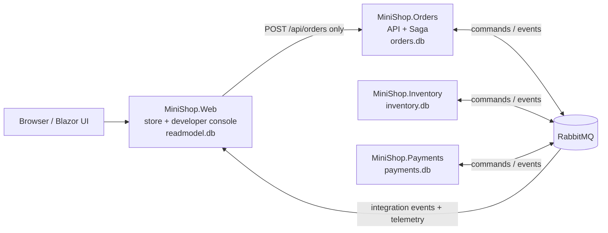

# MiniShop — a classroom-sized microservices system

A small store (three products, one wallet) whose "Place order" button drives a real distributed
workflow: **Saga orchestration, Transactional Outbox, Inbox de-duplication, CQRS read model and
RabbitMQ messaging**, with a Developer Console that shows what actually happens and a Scenario Lab
that injects real faults (duplicates, crashes, timeouts, a stopped broker) and verifies the system's
invariants in the owners' databases.

Nothing in the UI is a mock-up: every animation, counter and state comes from telemetry and audit
records produced by the services themselves.

> Persian quick start: [docs/README.fa.md](docs/README.fa.md) ·
> Persian course (17 modules, exercises, class plan): [docs/course/MiniShop-Microservices-Course.fa.md](docs/course/MiniShop-Microservices-Course.fa.md)

---

## 1. Run it

### Option A — everything in Docker (recommended for the classroom)

```bash
git clone https://github.com/mortezadalil/CleanArchMicroServices.git
cd CleanArchMicroServices
docker compose -f infra/compose.yaml up --build
```

| URL                          | What                                                    |
|------------------------------|---------------------------------------------------------|
| http://localhost:5100        | MiniShop store (Store Mode) and `/developer` (Developer Mode) |
| http://localhost:15672       | RabbitMQ management UI (`guest` / `guest`)              |
| http://localhost:5101/health/ready | Orders API health (5102 Inventory, 5103 Payments)  |

Optional: `--profile faults` also starts the small **runner** container that can stop/start the
RabbitMQ container for scenario S04 (it is the only component that touches the Docker socket).

### Option B — RabbitMQ in Docker, the four projects with `dotnet run`

Requirements: .NET 10 SDK, Docker.

```bash
docker compose -f infra/compose.yaml up -d rabbitmq
scripts/run-local.sh            # or start the four projects from your IDE (Rider: see Option C)
```

Ports: Web 5100, Orders 5101, Inventory 5102, Payments 5103. SQLite files are created under each
project's `data/` folder.

### Option C — no Docker at all, debug in JetBrains Rider

Requirements: .NET 10 SDK and a RabbitMQ installed on your machine (there is no in-memory transport:
the four processes talk only through the broker). On macOS:

```bash
brew install rabbitmq
brew services start rabbitmq
rabbitmq-plugins enable rabbitmq_management   # UI on :15672, also used by the Developer Console
```

Open `MiniShop.slnx` in Rider. **MiniShop only works when all four services run together** (plus
RabbitMQ), so the shared run configurations in `.run/` put one entry on top of the run-configuration
selector: the compound **MiniShop - Run ALL services**. Pick it and press **Debug**: Web, Orders,
Inventory and Payments start together under the debugger, breakpoints work in every service. The
single-service entries (`Web only (5100)`, `Orders only (5101)`, ...) live in the folder
*Single service only (needs the other 3 running)*: use them only to restart one service while the
others keep running. Rider may also show its own auto-generated `MiniShop.<Service>` entries; they
start one service each and can be deleted. Then open
http://localhost:5100 (Inventory, Orders and Payments have no page at `/`, a 404 there is normal; use
`/health/ready`).

Without Docker, S09 restarts only Orders' bus in-process (the default `OrdersRestartMode: Bus`) and for
S04 you stop the broker yourself (`brew services stop rabbitmq`, then `start`) when the log asks.

### First five minutes

1. Open http://localhost:5100, add a mouse to the cart, place the order, watch it go
   `Pending → AwaitingPayment → Confirmed`. Click **Inspect flow**.
2. In Developer Mode pick **S03 Insufficient wallet** and press **Run**: watch the stock being reserved,
   the payment failing, the compensation (`ReleaseStock`) and the evidence-based report.
3. Press **FailNextDbSave** in the Faults tab, buy something, and follow the retry in the timeline.
4. Run **S06**, **S11** and **S13** and read their *Lesson* lines.

---

## 2. Architecture



Exactly four runnable .NET projects, each with its own SQLite file. No project references another
project; `contracts/` (messages) and `shared/` (Outbox, Inbox, fault injection, telemetry) are
**linked source** compiled into each service — the demo stand-in for a versioned NuGet package.

| Project              | Owns                                                                  | Database       |
|----------------------|-----------------------------------------------------------------------|----------------|
| `MiniShop.Orders`    | `POST /api/orders`, order state, the saga orchestrator and its timeouts | `orders.db`    |
| `MiniShop.Inventory` | catalog, stock, reservations (reserve / release / commit)              | `inventory.db` |
| `MiniShop.Payments`  | wallets, ledger (one debit per order), cancel/tombstone                 | `payments.db`  |
| `MiniShop.Web`       | storefront, projections, Developer Console, Scenario Lab               | `readmodel.db` |

### The order flow (happy path)

1. Web → `POST /api/orders` with an `Idempotency-Key` → **202 Accepted** immediately.
2. Orders writes the order, the saga instance and an `OrderPlaced` **outbox row** in one transaction.
3. The outbox dispatcher publishes `OrderPlaced`; the saga reacts and sends `ReserveStock` (also via the outbox).
4. Inventory reserves atomically (inbox row + stock + reservation + `StockReserved` outbox row, one transaction).
5. Saga sends `ChargeWallet`; Payments debits once (unique ledger key) and publishes `PaymentCompleted`.
6. Saga publishes `OrderConfirmed`; Inventory turns the reservation into consumption.
7. Web projects every event into `readmodel.db`; Blazor Server re-renders through its own SignalR connection.

### State charts

```text
Order : Pending → Reserving → AwaitingPayment → Confirmed
                            ↘ Compensating → Rejected
        Reserving → Rejected (out of stock)
        Compensating → RequiresAttention (compensation never confirmed)

Saga  : Started → WaitingForStock → WaitingForPayment → Completed
                  │ StockReservationRejected → Rejected
                  │ PaymentFailed            → WaitingForRelease → (StockReleased) → Rejected
                  │ payment timeout          → WaitingForPaymentCancellation
                  │       PaymentCancelled            → WaitingForRelease
                  │       PaymentAlreadyCompleted / PaymentCompleted (late) → Completed
                  │ compensation not confirmed after N attempts → RequiresAttention
```

The saga is a **pure function** (`src/MiniShop.Orders/Saga/OrderSaga.cs`): `(state, message) → decision`.
`SagaRunner` persists the decision and `SagaTimeoutWorker` fires deadlines stored in the database.

### Messages (`contracts/`)

Every message carries the same envelope: `MessageId` (dedup), `CorrelationId` (= OrderId),
`CausationId`, `ScenarioId`, `OccurredAtUtc`, `SchemaVersion`, `Producer`.

| Kind      | Messages                                                                                          |
|-----------|---------------------------------------------------------------------------------------------------|
| Commands  | `ReserveStock`, `ReleaseStock` → Inventory queue · `ChargeWallet`, `CancelPayment` → Payments queue |
| Events    | `OrderPlaced`, `StockReserved`, `StockReservationRejected`, `StockReleased`, `PaymentCompleted`, `PaymentFailed`, `PaymentCancelled`, `PaymentAlreadyCompleted`, `OrderConfirmed`, `OrderRejected`, `OrderRequiresAttention`, `ProductCatalogChanged`, `WalletBalanceChanged` |
| Telemetry | `DiagnosticEvent` with kinds `MessagePublished`, `MessageConsumed`, `ConsumerFailed`, `OutboxStored`, `OutboxDispatched`, `InboxDuplicateIgnored`, `SagaTransitioned`, `ProjectionUpdated`, `RetryScheduled`, `MessageDeadLettered`, `FaultInjected`, `StateSnapshot` |

RabbitMQ topology (MassTransit conventions): queues `minishop.orders`, `minishop.inventory`,
`minishop.payments`, `minishop.web`, `minishop.web.diagnostics`; one fan-out exchange per event type
(`MiniShop.Contracts:OrderPlaced`); failed messages are parked in `<queue>_error` after 3 retries
(0.5 s, 1 s, 2 s).

### Outbox, Inbox, idempotency

* **Outbox** (`shared/Outbox`): the business change and the message row commit together; a background
  dispatcher publishes with the original `MessageId`, retries with backoff and keeps `Attempts` /
  `LastError`. A crash between publish and mark-as-published produces a duplicate, never a loss.
* **Inbox** (`shared/Inbox`, `IdempotentConsumer`): the consumer checks/records the `MessageId` inside the
  same transaction as its own writes. Duplicates are logged as `InboxDuplicateIgnored`.
* **Business keys**: `Orders.IdempotencyKey` (unique), `Reservations.OrderId` (unique),
  `WalletLedger(OrderId, OperationType)` (unique) — so even two *different* messages cannot debit twice.
* **Timeout ≠ failure**: when payment times out the saga sends `CancelPayment`; Payments either reports
  `PaymentAlreadyCompleted` (→ confirm) or writes a **tombstone** in the ledger slot so a late
  `ChargeWallet` can never debit (→ release stock). Inventory uses the same tombstone idea for a late
  `ReserveStock`.

### Late subscribers: why the Web asks for a snapshot

RabbitMQ delivers an event only to queues that exist **when it is published**. On a first
`docker compose up`, Inventory and Payments announce the catalog and the wallets before the Web has
created its queue, so those events are dropped by the broker. The broker is not an event store.
`ReadModelBootstrapper` in the Web therefore publishes `ReadModelSnapshotRequested` every 5 seconds while
its product cards or wallets are empty; the owners answer by re-publishing `ProductCatalogChanged` /
`WalletBalanceChanged` through their outbox. Projections are idempotent, so extra answers are harmless.

### CQRS

The Web never opens another service's database. It subscribes to events, appends each one to
`EventAudit` (append-only, the replay source) and upserts `ProductCards`, `WalletBalances` and
`OrderSummaries` with ordering guards. The **CQRS Explorer** shows write state vs read state and the
measured projection lag; **Rebuild** wipes the projections and replays `EventAudit`.

---

## 3. Developer Console

| Panel                 | Source of truth                                                               |
|-----------------------|-------------------------------------------------------------------------------|
| Architecture Explorer | `/health/ready` of each service + RabbitMQ management API; edges animate from `MessagePublished/Consumed` records of the last seconds |
| Event Timeline / Message Explorer | `EventAudit` (business events + telemetry); click a row for ids, attempt, duration, error, payload, snapshot |
| Saga Inspector        | `SagaTransitioned` telemetry emitted after each committed transition             |
| Outbox/Inbox Inspector| counters from telemetry + live tables via each owner's read-only `/diagnostics` endpoints |
| Database Explorer     | read-only `/diagnostics/*` endpoints (no SQL, no file access)                   |
| CQRS Explorer         | owner state vs `readmodel.db`, projection lag, rebuild                          |
| Replay                | steps through the recorded timeline and its stored state snapshots; never re-executes commands |
| Faults                | the demo control plane (`FailNextPayment`, `PausePaymentsConsumer`, `DuplicateNextMessage`, `FailNextDbSave`, …) |
| Scenario runs / report| expected vs actual trace, invariants with evidence, counters                    |

Store Mode and Developer Mode share the `orderId` / `scenarioId` context through the URL
(**Inspect flow** on an order, **store view** from the console).

### Demo control plane (Development only)

The header has a **⟲ Reset data** button. After a confirmation it removes all fault rules, purges the
MiniShop queues, empties every database and restores the seed (10 units per product, `demo-customer`
with 2,000,000). See `src/MiniShop.Web/Services/DemoResetService.cs` and `infra/seeds/README.md`.

All `/demo/*` and `/diagnostics/*` endpoints exist only when `Demo:Enabled=true`
(`appsettings.Development.json`, compose) and require the header `X-Demo-Token: minishop-dev`.
They are never mapped in Production. Fault rules are scoped by `ScenarioId`, limited by
`RemainingHits`, expire automatically and are removed at the end of each scenario.

---

## 4. Scenario Lab (S01–S16)

Each scenario is a short, readable function in `src/MiniShop.Web/Scenarios/ScenarioCatalog.cs`:
arrange (wallet / stock / faults) → act (place orders) → wait on **durable** state → assert evidence
read from the owner databases. A run ends `PASSED`, `FAILED` or `INCONCLUSIVE` (a wait timed out).

| #   | Scenario                               | Fault used                                   | Proves                                                      |
|-----|----------------------------------------|----------------------------------------------|-------------------------------------------------------------|
| S01 | Successful purchase                    | —                                            | happy path, reservation committed, one debit                |
| S02 | Insufficient stock                     | quantity 999                                 | rejection without compensation, Payments never contacted    |
| S03 | Insufficient wallet                    | wallet 100,000                               | `PaymentFailed → ReleaseStock → StockReleased → OrderRejected` |
| S04 | RabbitMQ outage                        | broker stopped (runner or by hand)           | outbox keeps the message, delivery after reconnect          |
| S05 | Payments consumer paused               | `Pause` at `Payments.ChargeWallet`           | visible backlog, no blocked request, resume                 |
| S06 | Duplicate delivery                     | `Duplicate` at `Outbox.Dispatch`             | `InboxDuplicateIgnored`, single effect                      |
| S07 | Transient database failure             | `Fail` at `Db.SaveChanges` ×2                | rollback + retry, no partial writes                         |
| S08 | Slow projection                        | `Delay` at `Web.Projection`                  | eventual consistency and measured projection lag            |
| S09 | Orders restarts mid-saga               | container exit (compose) / bus restart (local)| saga resumes from persisted state, nothing sent twice      |
| S10 | Payment timeout → cancellation         | `Fail` at `Payments.ChargeWallet` (permanent)| reconcile first, tombstone, then compensation               |
| S11 | Crash after publish before outbox mark | `Fail` at `Outbox.AfterPublish`              | redelivery, de-duplicated                                   |
| S12 | Compensation keeps failing             | `Fail` at `Inventory.ReleaseStock` (permanent)| `RequiresAttention`, then manual retry → Rejected          |
| S13 | Late PaymentCompleted after timeout    | `Delay` 30 s at `Payments.ChargeWallet`      | `PaymentAlreadyCompleted` → Confirmed, not Rejected         |
| S14 | Checkout twice with one key            | same `Idempotency-Key`                       | one order, same id returned                                 |
| S15 | Two orders race for the last unit      | stock = 1, two concurrent orders             | at most one reservation, stock never negative               |
| S16 | Projection crashes, then recovers      | `Fail` at `Web.Projection` ×2                | retries converge, no duplicate projection                   |

Run them from the console, from `scripts/run-scenarios.sh`, or through the E2E test project
(`tests/MiniShop.E2E`). **S04** needs someone to stop the broker: with `--profile faults` the runner
does it; otherwise the run log tells you when to execute `docker compose stop rabbitmq` and
`docker compose start rabbitmq` (the scenario waits, then ends `INCONCLUSIVE` if nobody does).

---

## 5. Tests

```bash
dotnet test MiniShop.slnx --filter "FullyQualifiedName!~MiniShop.E2E"   # unit + integration (no infrastructure needed)
dotnet test tests/MiniShop.E2E                                           # against a running stack (http://localhost:5100)
MINISHOP_E2E_INCLUDE_S04=1 dotnet test tests/MiniShop.E2E                # when the runner profile is up
```

| Project                        | What it covers                                                                              |
|--------------------------------|---------------------------------------------------------------------------------------------|
| `tests/MiniShop.Orders.Tests`  | every saga transition (pure state machine), outbox round-trip                               |
| `tests/MiniShop.Inventory.Tests` | real consumers on in-memory SQLite + MassTransit in-memory transport: dedup, business idempotency, tombstone, last-unit race, commit |
| `tests/MiniShop.Payments.Tests`| one debit per order under duplicate deliveries/commands, insufficient funds, cancel before/after charge |
| `tests/MiniShop.E2E`           | drives S01–S16 through the Web API and asserts `PASSED`                                     |

---

## 6. Configuration

| Setting (env var form)                 | Default                 | Meaning                                              |
|----------------------------------------|-------------------------|------------------------------------------------------|
| `RabbitMq__Host` / `Port` / `Username` / `Password` | `localhost` / 5672 / guest | broker connection                               |
| `Database__Path`                       | `data/<service>.db`     | SQLite file of the service                           |
| `Demo__Enabled`, `Demo__Token`         | `false` (`true` in Development) / `minishop-dev` | control plane switch + shared token |
| `Saga__StockTimeoutSeconds`, `Saga__PaymentTimeoutSeconds` | 20 / 20       | saga deadlines                                       |
| `Saga__CompensationTimeoutSeconds`, `Saga__MaxCompensationAttempts` | 8 / 3  | re-send interval / attempts before `RequiresAttention` |
| `Services__Orders` … (Web)             | `http://localhost:510x` | where the Web finds the services                     |
| `Services__OrdersRestartMode` (Web)    | `Bus` (`Crash` in compose) | how S09 restarts Orders                           |
| `Services__Runner` (Web)               | empty                   | runner URL for S04                                   |

---

## 7. Limitations and honest notes

* **Teaching demo, not production.** SQLite is single-writer and the services run as single instances;
  do not use it to demonstrate multi-node scale-out. The schema is created with `EnsureCreated` (delete
  the `data/` files or the compose volumes after model changes) instead of migrations.
* **Consumers run one message at a time** (`PrefetchCount = 1`) so a paused consumer shows a real
  backlog; the reservation code is still safe under concurrency (transaction + version check), which the
  Inventory tests and S15 verify.
* **Telemetry is best-effort** and flows on a separate queue; business messages never depend on it.
  During a broker outage telemetry waits in memory (bounded) and is flushed afterwards.
* **S04 and S09 need infrastructure help**: in compose, S09 exits the Orders process and Docker restarts
  it; locally the bus is stopped and restarted in-process. S04 needs the runner profile or a human.
* **Compose was authored and reviewed here but could not be executed in the authoring sandbox** (no
  Docker daemon). Everything else — all four services, the sixteen scenarios, the unit/integration
  tests — was run against a real RabbitMQ before publishing. If a compose detail bites you, please
  open an issue with the output of `docker compose -f infra/compose.yaml logs`.
* **MassTransit 8.5** is the last Apache-2.0 line (9.x is commercial). Its built-in EF outbox is not
  used because it does not support SQLite and because the explicit Outbox/Inbox/Saga tables are the
  thing we want students to read.

## 8. Troubleshooting

| Symptom                                               | Check                                                                 |
|-------------------------------------------------------|-----------------------------------------------------------------------|
| Store shows "Waiting for the catalog…"                | The Web asks Inventory/Payments for a snapshot every 5 s until it gets one (see below). If it never fills, Inventory or RabbitMQ is not healthy (`/health/ready`, management UI → `minishop.web` consumers) |
| Order stays `Pending`                                 | Outbox/Inbox tab → pending rows in Orders? RabbitMQ down? Saga Inspector → deadline will fire a timeout |
| Everything `RequiresAttention`                        | a `FailReleaseStock` rule is still active → Faults tab → Clear all, then *retry compensation* |
| `database is locked`                                  | two processes opened the same SQLite file — each service must use its own `Database__Path` |
| Scenario ends `INCONCLUSIVE`                          | a wait timed out; read the run log (S04 waits for you to stop the broker) |
| Messages in `*_error` queues                          | expected after S10/S12; purge them from the RabbitMQ UI or press **Reset demo data** |

## 9. Repository map

```text
MiniShop.slnx
contracts/                 message contracts (linked source)
shared/                    Outbox, Inbox, IdempotentConsumer, fault injection, telemetry, demo endpoints
src/MiniShop.Orders        API + saga (Saga/OrderSaga.cs is the state machine)
src/MiniShop.Inventory     stock & reservations
src/MiniShop.Payments      wallets & ledger
src/MiniShop.Web           Blazor store + Developer Console + Scenario Lab (Scenarios/ScenarioCatalog.cs)
infra/compose.yaml         RabbitMQ + the four services (+ optional runner)
infra/runner               allow-listed docker stop/start helper for S04
infra/seeds                where the deterministic demo data comes from
scripts/                   run-local.sh, run-scenarios.sh
tests/                     unit, integration and E2E projects
docs/                      Persian quick start, Persian course (docs/course), licenses
```

## 10. Licenses of dependencies

See [docs/LICENSES.md](docs/LICENSES.md).
