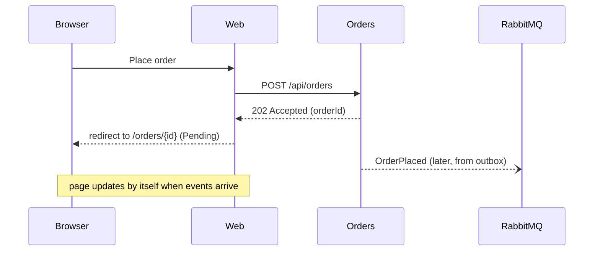
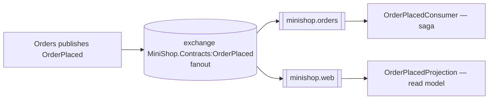
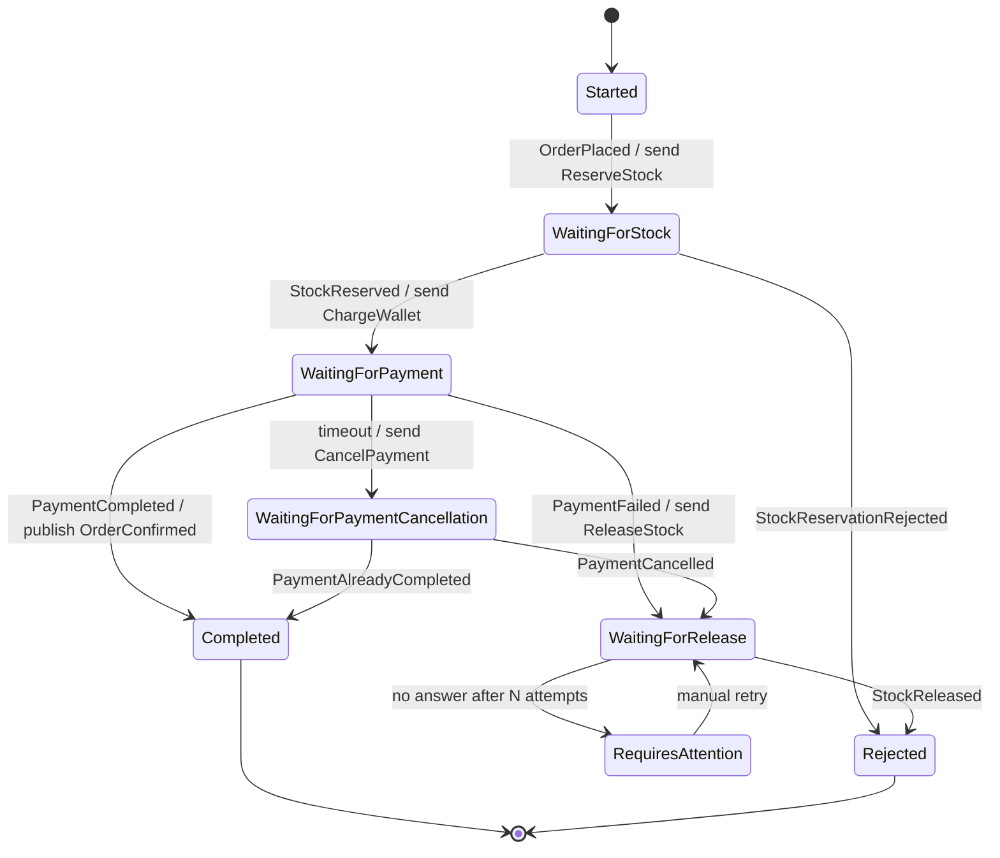
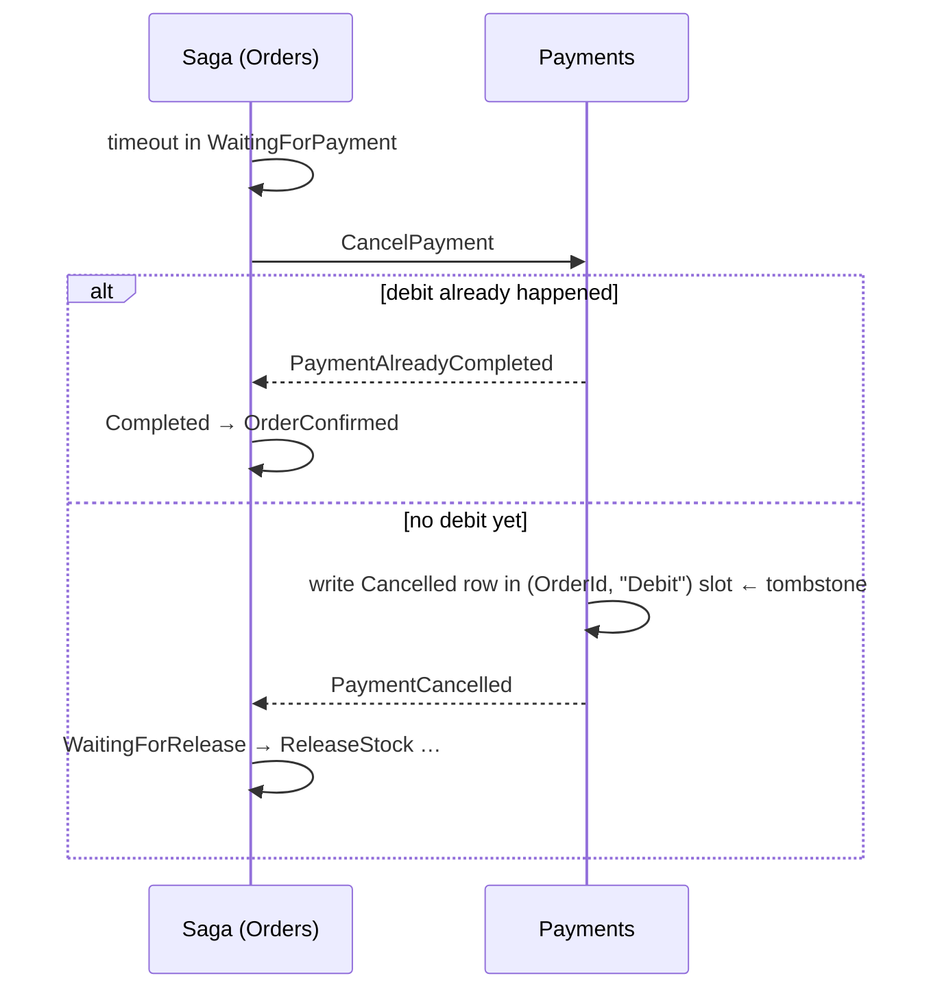
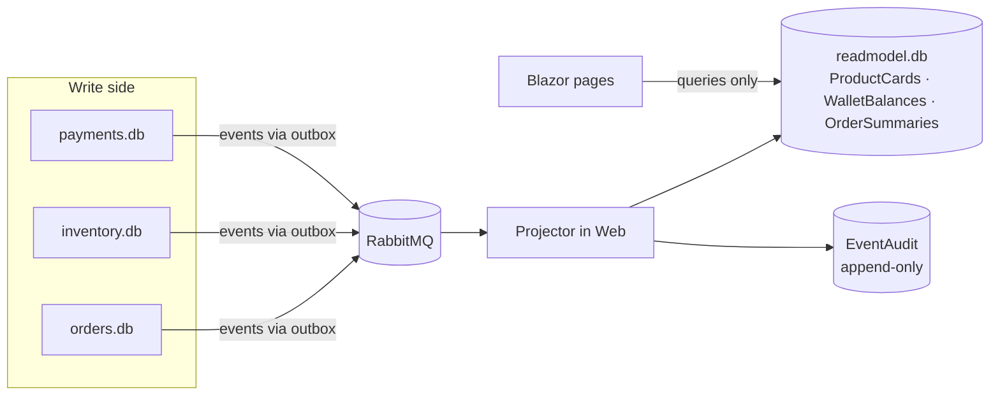

# دورهٔ آموزشی میکروسرویس با پروژهٔ MiniShop

> از مونولیت تا Saga، Outbox، Inbox، CQRS و RabbitMQ — همه روی یک پروژهٔ واقعی و قابل اجرا

این سند یک دورهٔ کامل و گام‌به‌گام است. هر مفهوم اول به زبان ساده توضیح داده می‌شود، بعد نشان داده
می‌شود که **دقیقاً کجای کد MiniShop** پیاده شده، و در آخر با یک **سناریوی واقعی** در Developer Console
دیده و آزمایش می‌شود. هدف این است که دانشجو نه فقط «تعریف» الگوها، بلکه **دلیل وجودشان** را بفهمد:
هر الگو جواب یک خرابی مشخص است.

---

## فهرست

- [پیش از شروع: نحوهٔ استفاده از این دوره](#پیش-از-شروع-نحوهٔ-استفاده-از-این-دوره)
- [ماژول ۰ — راه‌اندازی و یک دور در پروژه](#ماژول-۰--راهاندازی-و-یک-دور-در-پروژه)
- **بخش اول: مبانی**
  - [ماژول ۱ — مونولیت، میکروسرویس و هزینهٔ توزیع‌شدگی](#ماژول-۱--مونولیت-میکروسرویس-و-هزینهٔ-توزیعشدگی)
  - [ماژول ۲ — مرز سرویس‌ها و مالکیت داده](#ماژول-۲--مرز-سرویسها-و-مالکیت-داده)
  - [ماژول ۳ — ارتباط همگام و ناهمگام](#ماژول-۳--ارتباط-همگام-و-ناهمگام)
- **بخش دوم: پیام‌رسانی**
  - [ماژول ۴ — RabbitMQ و MassTransit از نزدیک](#ماژول-۴--rabbitmq-و-masstransit-از-نزدیک)
  - [ماژول ۵ — قرارداد پیام: Command، Event و Envelope](#ماژول-۵--قرارداد-پیام-command-event-و-envelope)
- **بخش سوم: قابلیت اطمینان**
  - [ماژول ۶ — تضمین تحویل و مسئلهٔ «نوشتن دوگانه»](#ماژول-۶--تضمین-تحویل-و-مسئلهٔ-نوشتن-دوگانه)
  - [ماژول ۷ — Transactional Outbox](#ماژول-۷--transactional-outbox)
  - [ماژول ۸ — Inbox و Idempotency](#ماژول-۸--inbox-و-idempotency)
  - [ماژول ۹ — Retry، Backoff و Dead Letter](#ماژول-۹--retry-backoff-و-dead-letter)
- **بخش چهارم: تراکنش‌های توزیع‌شده**
  - [ماژول ۱۰ — Saga: هماهنگی بدون تراکنش سراسری](#ماژول-۱۰--saga-هماهنگی-بدون-تراکنش-سراسری)
  - [ماژول ۱۱ — جبران، Timeout و آشتی دادن وضعیت](#ماژول-۱۱--جبران-timeout-و-آشتی-دادن-وضعیت)
  - [ماژول ۱۲ — هم‌زمانی و قفل خوش‌بینانه](#ماژول-۱۲--همزمانی-و-قفل-خوشبینانه)
- **بخش پنجم: سمت خواندن**
  - [ماژول ۱۳ — CQRS و Read Model](#ماژول-۱۳--cqrs-و-read-model)
- **بخش ششم: عملیات و کیفیت**
  - [ماژول ۱۴ — مشاهده‌پذیری (Observability)](#ماژول-۱۴--مشاهدهپذیری-observability)
  - [ماژول ۱۵ — تزریق خطا و آزمون مبتنی بر شواهد](#ماژول-۱۵--تزریق-خطا-و-آزمون-مبتنی-بر-شواهد)
  - [ماژول ۱۶ — استقرار با Docker Compose](#ماژول-۱۶--استقرار-با-docker-compose)
  - [ماژول ۱۷ — از دمو تا Production: چه چیزهایی ساده شده‌اند؟](#ماژول-۱۷--از-دمو-تا-production-چه-چیزهایی-ساده-شدهاند)
- **پیوست‌ها**
  - [پیوست الف — برنامهٔ پیشنهادی کلاس](#پیوست-الف--برنامهٔ-پیشنهادی-کلاس)
  - [پیوست ب — پروژه‌های پایانی و تمرین‌های بزرگ](#پیوست-ب--پروژههای-پایانی-و-تمرینهای-بزرگ)
  - [پیوست ج — واژه‌نامه](#پیوست-ج--واژهنامه)
  - [پیوست د — نقشهٔ فایل‌ها](#پیوست-د--نقشهٔ-فایلها)
  - [پیوست هـ — پاسخ پرسش‌های مرور](#پیوست-هـ--پاسخ-پرسشهای-مرور)

---

## پیش از شروع: نحوهٔ استفاده از این دوره

**مخاطب:** توسعه‌دهندهٔ #C/.NET که با ASP.NET Core و EF Core آشناست، ولی میکروسرویس را عملاً تجربه
نکرده است. آشنایی با Docker در حد اجرای `docker compose up` کافی است.

**ساختار هر ماژول:**

| بخش | توضیح |
|---|---|
| 🎯 هدف | چیزی که در پایان ماژول باید بتوانید توضیح دهید یا انجام دهید |
| 📖 مفهوم | توضیح نظری، با تمرکز بر «چرا» |
| 🔍 در کد MiniShop | فایل و کد مربوط، با توضیح خط‌به‌خط بخش‌های مهم |
| 🧪 آزمایش | سناریوی Scenario Lab یا کاری که در UI انجام می‌دهید و چیزی که باید ببینید |
| ⚠️ اشتباه رایج | خطاهایی که در پروژه‌های واقعی زیاد دیده می‌شود |
| ✍️ تمرین | تمرین عملی، معمولاً تغییر کوچکی در کد |
| ❓ پرسش مرور | برای سنجش فهم؛ پاسخ‌ها در پیوست هـ |

**قاعدهٔ طلایی دوره:** هر وقت چیزی را نفهمیدید، سناریوی مرتبط را اجرا کنید و در تب **Timeline**
روی تک‌تک ردیف‌ها کلیک کنید. هر چیزی که در UI می‌بینید از داده‌های واقعی سرویس‌ها ساخته شده است؛
هیچ انیمیشن ساختگی وجود ندارد.

---

## ماژول ۰ — راه‌اندازی و یک دور در پروژه

### 🎯 هدف
پروژه را اجرا کنید، یک خرید انجام دهید و بدانید هر بخش UI کجاست.

### اجرا

```bash
git clone https://github.com/mortezadalil/CleanArchMicroServices.git
cd CleanArchMicroServices
docker compose -f infra/compose.yaml up --build
```

| آدرس | چیست |
|---|---|
| http://localhost:5100 | فروشگاه (Store Mode) |
| http://localhost:5100/developer | کنسول توسعه‌دهنده (Developer Mode) |
| http://localhost:15672 | پنل مدیریت RabbitMQ (کاربر و رمز: `guest`) |

اجرای بدون Docker برای سرویس‌ها (نیازمند .NET 10 SDK):

```bash
docker compose -f infra/compose.yaml up -d rabbitmq
scripts/run-local.sh
```

### یک دور در پروژه

1. در فروشگاه یک ماوس به سبد اضافه کنید و سفارش دهید.
2. به صفحهٔ سفارش منتقل می‌شوید. وضعیت چند لحظه `Pending` یا `AwaitingPayment` است و بعد `Confirmed` می‌شود.
3. روی **Inspect flow** بزنید. در Developer Mode این‌ها را ببینید:
   - **Architecture Explorer:** پنج گره (Web، Orders، Inventory، Payments، RabbitMQ) و پیام‌هایی که روی یال‌ها حرکت می‌کنند.
   - **Saga Inspector:** سه انتقال وضعیت Saga.
   - **Timeline:** همهٔ رکوردها با زمان واقعی.
4. دکمهٔ **⟲ Reset data** در هدر همه چیز را به حالت اولیه برمی‌گرداند. هر وقت داده‌ها شلوغ شد از آن استفاده کنید.

### ✍️ تمرین ۰
در پنل RabbitMQ به تب **Queues** بروید. پنج صف `minishop.*` را پیدا کنید و برای هرکدام بنویسید کدام
سرویس آن را مصرف می‌کند. (راهنما: ستون Consumers و فایل `contracts/Topology.cs`)

---

# بخش اول: مبانی

## ماژول ۱ — مونولیت، میکروسرویس و هزینهٔ توزیع‌شدگی

### 🎯 هدف
بتوانید توضیح دهید میکروسرویس چه مشکلی را حل می‌کند و چه مشکلات تازه‌ای می‌سازد.

### 📖 مفهوم

**مونولیت** یعنی یک برنامهٔ واحد با یک دیتابیس. در یک فروشگاه مونولیت، ثبت سفارش این‌طور است:

```csharp
using var tx = db.BeginTransaction();
stock.Reserved += 1;          // موجودی
wallet.Balance -= 300_000;    // کیف پول
order.State = Confirmed;      // سفارش
tx.Commit();                  // یا همه، یا هیچ
```

این کد **ساده و درست** است، چون دیتابیس تضمین ACID می‌دهد: یا هر سه تغییر انجام می‌شود یا هیچ‌کدام.

**میکروسرویس** یعنی سیستم به چند برنامهٔ مستقل تقسیم شود که هرکدام دیتابیس خودش را دارد و جدا
مستقر (deploy) می‌شود. مزایا:

| مزیت | توضیح |
|---|---|
| استقلال تیم‌ها | تیم Payments بدون هماهنگی با تیم Inventory منتشر می‌کند |
| مقیاس‌پذیری جداگانه | فقط سرویس پرترافیک را چند نمونه می‌کنیم |
| ایزولهٔ خرابی | قطع Payments فروشگاه را از کار نمی‌اندازد؛ سفارش‌ها صف می‌شوند |
| آزادی فناوری | هر سرویس می‌تواند دیتابیس یا زبان مناسب خودش را داشته باشد |

اما **همان سه خط کد** حالا سه دیتابیس در سه پروسه است و دیگر هیچ `tx.Commit()` سراسری وجود ندارد.
تمام این دوره دربارهٔ همین است: **چطور بدون تراکنش سراسری، سیستمی درست بسازیم؟**

### هشت مغالطهٔ محاسبات توزیع‌شده

در شبکه این فرض‌ها **همه غلط‌اند** و MiniShop برای هرکدام سناریو دارد:

| فرض غلط | واقعیت | سناریوی مرتبط |
|---|---|---|
| شبکه همیشه در دسترس است | broker قطع می‌شود | S04 |
| تأخیر صفر است | پرداخت دیر می‌رسد | S10، S13 |
| پیام دقیقاً یک بار می‌رسد | پیام تکراری می‌رسد | S06، S11 |
| ترتیب پیام‌ها حفظ می‌شود | پیام قدیمی بعد از جدید می‌رسد | Projector (ماژول ۱۳) |
| سرویس‌ها همیشه روشن‌اند | پروسه restart می‌شود | S09 |
| دیتابیس همیشه موفق است | خطای گذرا رخ می‌دهد | S07 |

### ⚠️ اشتباه رایج
«میکروسرویس یعنی چند پروژهٔ Web API که با HTTP همدیگر را صدا می‌زنند.» این معمولاً به **مونولیت
توزیع‌شده** می‌رسد: همهٔ معایب توزیع‌شدگی (تأخیر، خرابی جزئی) بدون هیچ‌کدام از مزایا (استقلال)، چون
اگر یک سرویس بیفتد زنجیرهٔ فراخوانی‌ها می‌شکند.

### ❓ پرسش مرور
1. چرا در مونولیت به Saga نیاز نداریم؟
2. یک موقعیت نام ببرید که مونولیت انتخاب بهتری از میکروسرویس است.

---

## ماژول ۲ — مرز سرویس‌ها و مالکیت داده

### 🎯 هدف
بفهمید چرا هر سرویس دیتابیس خودش را دارد و «مالک» یک داده یعنی چه.

### 📖 مفهوم

**Bounded Context** (از Domain-Driven Design) یعنی محدوده‌ای که یک مدل و زبان مشخص در آن معتبر است.
«محصول» برای انبار یعنی موجودی و رزرو؛ برای حسابداری یعنی قیمت و مالیات. هر سرویس باید حول یک
Bounded Context ساخته شود.

**Database per Service:** هیچ سرویسی دیتابیس سرویس دیگر را مستقیم نمی‌خواند یا نمی‌نویسد. اگر این قانون
شکسته شود:
- تغییر schema یک سرویس، سرویس دیگر را می‌شکند (وابستگی پنهان).
- دیگر معلوم نیست invariantها (مثلاً «موجودی منفی نشود») را چه کسی تضمین می‌کند.

### 🔍 در کد MiniShop

| پروژه | مالک چه چیزی است | دیتابیس |
|---|---|---|
| `MiniShop.Orders` | سفارش، وضعیت سفارش، Saga | `orders.db` |
| `MiniShop.Inventory` | کاتالوگ، قیمت، موجودی، رزرو | `inventory.db` |
| `MiniShop.Payments` | کیف پول، دفتر کل (ledger) | `payments.db` |
| `MiniShop.Web` | فقط **کپی خواندنی** (read model) | `readmodel.db` |

به این نکته‌ها دقت کنید:

- **Inventory تنها منبع حقیقت قیمت است.** Orders قیمت را از مرورگر به‌صورت snapshot می‌گیرد، ولی
  Inventory هنگام رزرو آن را دوباره چک می‌کند (`ReserveStockConsumer.ValidateAsync`). اگر قیمت عوض شده
  باشد رزرو رد می‌شود. **مبلغ قابل پرداخت هرگز فقط به ورودی مرورگر اعتماد نمی‌کند.**
- **Web هیچ‌وقت فایل SQLite سرویس دیگری را باز نمی‌کند.** حتی Database Explorer داده‌ها را از
  endpointهای فقط‌خواندنی `/diagnostics/*` هر سرویس می‌گیرد.
- **هیچ پروژه‌ای به پروژهٔ دیگر Reference ندارد.** کد مشترک (`contracts/` و `shared/`) به‌صورت
  *linked source* در هر پروژه کامپایل می‌شود. فایل `.csproj` را ببینید:

```xml
<ItemGroup>
  <Compile Include="../../contracts/**/*.cs" LinkBase="Contracts" />
  <Compile Include="../../shared/**/*.cs" LinkBase="Shared" />
</ItemGroup>
```

در یک سیستم واقعی، `contracts` یک بستهٔ NuGet نسخه‌دار است تا هر سرویس بتواند با سرعت خودش به نسخهٔ
جدید قرارداد مهاجرت کند.

### 🧪 آزمایش
در Developer Mode، تب **Database** را باز کنید. چهار بخش `orders.db`، `inventory.db`، `payments.db` و
`readmodel.db` را می‌بینید. یک سفارش ثبت کنید و نشان دهید هر ستون در کدام دیتابیس تغییر کرد.

### ⚠️ اشتباه رایج
**دیتابیس مشترک با schemaهای جدا.** وسوسه‌انگیز است چون JOIN و تراکنش ممکن می‌ماند؛ اما در عمل
سرویس‌ها از طریق جدول‌های هم جفت می‌شوند و استقلال استقرار از بین می‌رود.

### ✍️ تمرین ۲
فرض کنید می‌خواهیم «امتیاز وفاداری» اضافه کنیم: هر خرید موفق ۱٪ مبلغ امتیاز بدهد. این قابلیت به کدام
سرویس تعلق دارد؟ آیا سرویس جدید لازم است؟ از کدام event باید مطلع شود؟ استدلال کنید.

### ❓ پرسش مرور
3. چرا Orders برای چک کردن قیمت به Inventory درخواست HTTP نمی‌زند؟
4. اگر Web مستقیم `inventory.db` را بخواند چه چیزی خراب می‌شود؟

---

## ماژول ۳ — ارتباط همگام و ناهمگام

### 🎯 هدف
تفاوت ارتباط Request/Response و Messaging را بدانید و بتوانید برای هر موقعیت انتخاب کنید.

### 📖 مفهوم

| | همگام (HTTP/gRPC) | ناهمگام (پیام از طریق broker) |
|---|---|---|
| فرستنده منتظر جواب می‌ماند؟ | بله | خیر |
| اگر گیرنده خاموش باشد | خطا | پیام در صف می‌ماند |
| جفت‌شدگی زمانی (temporal coupling) | زیاد | کم |
| سادگی و دیباگ | ساده | پیچیده‌تر |
| مناسب برای | پرس‌وجو، درخواست کاربر | گردش کار بین سرویس‌ها |

**تصحیح یک باور رایج:** REST و gRPC «ضد میکروسرویس» نیستند. MiniShop **عمداً** برای گردش کار بین
سرویس‌های دامنه از messaging استفاده می‌کند تا خرابی یک سرویس زنجیره را نشکند.

### 🔍 در کد MiniShop

فقط **یک** فراخوانی HTTP در جریان سفارش وجود دارد: Web → `POST /api/orders`. این **درگاه دستور**
(command gateway) است، نه وابستگی دامنه به دامنه. پاسخ آن هم فوری است:

```
POST /api/orders
Idempotency-Key: 4f2c...
→ 202 Accepted   { "orderId": "..." }
```

`202 Accepted` یعنی «درخواست را گرفتم و ثبت کردم»، نه «سفارش تأیید شد». تأیید نهایی چند صد میلی‌ثانیه
بعد از طریق پیام‌ها اتفاق می‌افتد و UI آن را از read model نشان می‌دهد.



### 🧪 آزمایش — سناریوی S05
**S05: Payments consumer paused** را اجرا کنید. مصرف‌کنندهٔ Payments متوقف شده، ولی:
- `POST /api/orders` همچنان فوراً `202` برمی‌گرداند.
- سفارش در `AwaitingPayment` منتظر می‌ماند.
- در legend گراف، صف `payments` یک پیام معطل (backlog) نشان می‌دهد.
- بعد از برداشتن fault، پردازش از همان‌جا ادامه پیدا می‌کند.

اگر Orders با HTTP همگام Payments را صدا می‌زد، درخواست کاربر یا timeout می‌شد یا خطا می‌گرفت.

### ❓ پرسش مرور
5. چرا پاسخ `POST /api/orders` کد `202` است و نه `200` یا `201`؟

---

# بخش دوم: پیام‌رسانی

## ماژول ۴ — RabbitMQ و MassTransit از نزدیک

### 🎯 هدف
اجزای RabbitMQ را بشناسید و مسیر یک پیام را از فرستنده تا مصرف‌کننده دنبال کنید.

### 📖 مفهوم

| جزء | نقش |
|---|---|
| **Exchange** | پیام را می‌گیرد و بر اساس قواعد به صف‌ها می‌فرستد. خودش چیزی نگه نمی‌دارد |
| **Queue** | پیام‌ها را تا زمان مصرف نگه می‌دارد (durable = بعد از restart هم می‌ماند) |
| **Binding** | قاعدهٔ اتصال exchange به queue |
| **Fanout exchange** | پیام را به **همهٔ** صف‌های متصل می‌فرستد (مناسب pub/sub) |
| **Ack** | مصرف‌کننده تأیید می‌کند پیام پردازش شد؛ بدون ack، پیام دوباره تحویل داده می‌شود |
| **Prefetch** | چند پیام هم‌زمان به یک مصرف‌کننده داده شود |

**MassTransit** کتابخانه‌ای روی RabbitMQ است که این‌ها را با قراردادهای مشخص می‌سازد:
- برای هر **نوع پیام** یک exchange از نوع fanout، مثل `MiniShop.Contracts:OrderPlaced`.
- برای هر **receive endpoint** یک صف و یک exchange هم‌نام.
- اگر مصرف‌کنندهٔ یک endpoint به event خاصی علاقه داشته باشد، MassTransit exchange آن event را به صف
  endpoint متصل می‌کند.
- برای هر صف، صف خطای `{queue}_error`.



### 🔍 در کد MiniShop

نام‌ها ثابت و مستندند (`contracts/Topology.cs`):

```csharp
public const string OrdersQueue = "minishop.orders";          // saga: integration events
public const string InventoryQueue = "minishop.inventory";    // ReserveStock / ReleaseStock + OrderConfirmed
public const string PaymentsQueue = "minishop.payments";      // ChargeWallet / CancelPayment
public const string WebQueue = "minishop.web";                // read-model projections
public const string WebDiagnosticsQueue = "minishop.web.diagnostics"; // telemetry only
```

تنظیمات مشترک هر endpoint (`shared/Messaging/ServiceHostingExtensions.cs`):

```csharp
endpoint.UseMessageRetry(r => r.Intervals(RetryPolicy.Intervals));
endpoint.PrefetchCount = 1;           // پیام‌های پردازش‌نشده در صف می‌مانند → backlog قابل مشاهده
endpoint.ConcurrentMessageLimit = 1;
```

`PrefetchCount = 1` یک انتخاب **آموزشی** است: وقتی مصرف‌کننده متوقف است، پیام‌ها واقعاً در صف
RabbitMQ می‌مانند و در پنل مدیریت دیده می‌شوند. در Production معمولاً عدد بزرگ‌تری انتخاب می‌شود.

### نکتهٔ مهم: broker انبار رویداد نیست

RabbitMQ یک event را فقط به صف‌هایی تحویل می‌دهد که **در لحظهٔ انتشار** وجود دارند. اولین نسخهٔ
MiniShop دقیقاً به همین مشکل خورد: در اولین `docker compose up`، Inventory کاتالوگ را قبل از ساخته شدن
صف Web منتشر می‌کرد و فروشگاه خالی می‌ماند. راه‌حل در ماژول ۱۳ آمده است (درخواست snapshot).

### 🧪 آزمایش
1. در پنل RabbitMQ تب **Exchanges** را باز کنید و `MiniShop.Contracts:OrderPlaced` را پیدا کنید.
   در بخش Bindings ببینید به کدام صف‌ها وصل است.
2. یک سفارش ثبت کنید و نمودار **Message rates** را ببینید.

### ✍️ تمرین ۴
یک سرویس فرضی «Notifications» می‌خواهد با هر `OrderConfirmed` ایمیل بفرستد. چه صفی و چه binding‌ای
ساخته می‌شود؟ آیا لازم است Orders تغییر کند؟ (پاسخ کوتاه: خیر؛ این قدرت pub/sub است.)

---

## ماژول ۵ — قرارداد پیام: Command، Event و Envelope

### 🎯 هدف
فرق command و event را بدانید و کاربرد هر شناسهٔ پیام را توضیح دهید.

### 📖 مفهوم

| | Command | Event |
|---|---|---|
| معنا | «این کار را بکن» | «این اتفاق افتاد» |
| زمان دستوری | امری: `ReserveStock` | گذشته: `StockReserved` |
| گیرنده | دقیقاً **یک** سرویس (send به صف آن) | **هر تعداد** مشترک (publish) |
| می‌تواند رد شود؟ | بله، گیرنده ممکن است «نه» بگوید | خیر، واقعیتی است که رخ داده |

در MiniShop:
- **Commands:** `ReserveStock`، `ReleaseStock` → صف Inventory؛ `ChargeWallet`، `CancelPayment` → صف Payments.
- **Events:** `OrderPlaced`، `StockReserved`، `StockReservationRejected`، `StockReleased`، `PaymentCompleted`،
  `PaymentFailed`، `PaymentCancelled`، `PaymentAlreadyCompleted`، `OrderConfirmed`، `OrderRejected`،
  `OrderRequiresAttention`، `ProductCatalogChanged`، `WalletBalanceChanged`، `ReadModelSnapshotRequested`.

**نکته:** هر دو از RabbitMQ عبور می‌کنند. فرق در **معنا و مقصد** است، نه در فناوری.

### Envelope: شناسنامهٔ هر پیام

همهٔ پیام‌ها از `contracts/Message.cs` ارث می‌برند:

```csharp
public abstract record Message
{
    public Guid MessageId { get; init; } = Guid.NewGuid();   // یکتا برای هر پیام → dedup
    public Guid CorrelationId { get; init; }                 // = OrderId → همهٔ پیام‌های یک سفارش
    public Guid? CausationId { get; init; }                  // MessageId پیامی که این پیام را ساخت
    public Guid? ScenarioId { get; init; }                   // برای محدود کردن faultها به یک آزمایش
    public DateTime OccurredAtUtc { get; init; } = DateTime.UtcNow;
    public int SchemaVersion { get; init; } = 1;             // تکامل قرارداد
    public string Producer { get; init; } = "";
}
```

| شناسه | به چه سؤالی جواب می‌دهد |
|---|---|
| `MessageId` | «این همان پیامی است که قبلاً پردازش کردم؟» |
| `CorrelationId` | «این پیام مربوط به کدام سفارش است؟» |
| `CausationId` | «چه پیامی باعث شد این پیام ساخته شود؟» → درخت علت و معلول |

پیام‌ها `record` هستند، یعنی **تغییرناپذیر** (immutable). برای ساخت پیام بعدی از `with` استفاده می‌شود:

```csharp
// src/MiniShop.Orders/Saga/OrderSaga.cs
private static Message Stamp(Message message, Order order, Guid? causationId) => message with
{
    CorrelationId = order.Id,
    CausationId = causationId,
    ScenarioId = order.ScenarioId,
    Producer = ServiceNames.Orders,
    OccurredAtUtc = DateTime.UtcNow,
};
```

### 🧪 آزمایش
در Timeline روی ردیف `StockReserved` کلیک کنید. `causationId` آن را کپی کنید و در تب **Messages**
جستجو کنید. باید به `ReserveStock` برسید و از آن به `OrderPlaced`. این زنجیرهٔ علت و معلول است.

### ⚠️ اشتباه رایج
**Event با معنای command.** مثلاً event‌ی به نام `ChargeWalletRequested` که فقط یک مشترک دارد و انتظار
دارد کاری انجام شود. این گیرنده را پنهان می‌کند و ردیابی مسئولیت را سخت می‌کند.

### ✍️ تمرین ۵
در `contracts/Events.cs` فیلد اختیاری `string? CouponCode` به `OrderPlaced` اضافه کنید. چرا اضافه
کردن فیلد **اختیاری** با مصرف‌کننده‌های قدیمی سازگار است ولی حذف یا تغییر نوع یک فیلد نه؟ `SchemaVersion`
چه زمانی باید بالا برود؟

### ❓ پرسش مرور
6. چرا `CorrelationId` و `MessageId` نمی‌توانند یکی باشند؟

---

# بخش سوم: قابلیت اطمینان

## ماژول ۶ — تضمین تحویل و مسئلهٔ «نوشتن دوگانه»

### 🎯 هدف
سه تضمین تحویل را بشناسید و بفهمید چرا «دقیقاً یک بار» در عمل یعنی «حداقل یک بار + idempotency».

### 📖 مفهوم

| تضمین | معنا | نتیجه |
|---|---|---|
| At-most-once | حداکثر یک بار؛ ممکن است گم شود | از دست رفتن پیام |
| At-least-once | حداقل یک بار؛ ممکن است تکرار شود | پیام تکراری |
| Exactly-once | دقیقاً یک بار | در سیستم توزیع‌شده عملاً قابل تضمین نیست |

MiniShop **at-least-once** را فرض می‌کند و ادعای exactly-once ندارد. به‌جایش **اثر** را یک‌باره می‌کند:
پیام ممکن است دو بار برسد، ولی کیف پول فقط یک بار کم می‌شود.

### مسئلهٔ نوشتن دوگانه (Dual Write)

ساده‌ترین کد ممکن برای ثبت سفارش:

```csharp
db.Orders.Add(order);
await db.SaveChangesAsync();          // ① در دیتابیس
await bus.Publish(new OrderPlaced()); // ② در broker
```

| اگر بین ① و ② ... | نتیجه |
|---|---|
| پروسه crash کند | سفارش ثبت شده ولی هیچ‌کس خبر ندارد؛ برای همیشه `Pending` |
| broker قطع باشد | همان |
| ترتیب را عوض کنیم (اول publish) و SaveChanges شکست بخورد | پیام برای سفارشی رفته که وجود ندارد |

نمی‌توان دیتابیس و broker را در یک تراکنش گذاشت (یا با 2PC که کند و شکننده است و RabbitMQ هم از آن
پشتیبانی نمی‌کند). راه‌حل استاندارد: **Transactional Outbox**.

### ❓ پرسش مرور
7. چرا نمی‌توان با `try/catch` دور `Publish` مشکل نوشتن دوگانه را حل کرد؟

---

## ماژول ۷ — Transactional Outbox

### 🎯 هدف
بتوانید Outbox را پیاده‌سازی کنید و بدانید چه چیزی را تضمین می‌کند و چه چیزی را نه.

### 📖 مفهوم

به‌جای ارسال مستقیم پیام، آن را در **جدولی در همان دیتابیس** و **در همان تراکنش** تغییر کسب‌وکار ذخیره
می‌کنیم. یک پروسهٔ پس‌زمینه (dispatcher) جدول را می‌خواند و پیام‌ها را می‌فرستد.

```mermaid
sequenceDiagram
  participant API as Orders API
  participant DB as orders.db
  participant D as OutboxDispatcher
  participant MQ as RabbitMQ
  API->>DB: BEGIN; INSERT Order; INSERT Saga; INSERT Outbox(OrderPlaced); COMMIT
  API-->>API: 202 Accepted
  loop every second (or on signal)
    D->>DB: SELECT unpublished rows
    D->>MQ: Publish(OrderPlaced, original MessageId)
    D->>DB: UPDATE PublishedAtUtc = now
  end
```

**تضمین:** اگر تغییر کسب‌وکار commit شد، پیام **حتماً روزی** فرستاده می‌شود (حتی بعد از restart).
**بدون تضمین:** پیام ممکن است **دو بار** فرستاده شود. اگر پروسه بعد از Publish و قبل از UPDATE بمیرد،
ردیف هنوز «منتشرنشده» است و دوباره ارسال می‌شود. این شکاف ذاتی است و Inbox آن را مهار می‌کند.

### 🔍 در کد MiniShop

**جدول** — `shared/Outbox/OutboxMessage.cs`:

```csharp
public sealed class OutboxMessage
{
    public long Id { get; set; }                 // ترتیب درج = ترتیب ارسال
    public Guid MessageId { get; set; }
    public string Type { get; set; } = "";        // "StockReserved"
    public string Payload { get; set; } = "";     // JSON کل پیام
    public string? DestinationQueue { get; set; } // null = event (publish)، مقدار = command (send)
    public DateTime? PublishedAtUtc { get; set; } // null = هنوز در انتظار
    public int Attempts { get; set; }
    public DateTime? NextAttemptUtc { get; set; } // backoff
    public string? LastError { get; set; }
}
```

**نوشتن در همان تراکنش** — `src/MiniShop.Orders/Api/OrdersEndpoints.cs`:

```csharp
// ONE transaction: the order, the saga instance and the OrderPlaced outbox row.
db.Orders.Add(order);
db.SagaInstances.Add(new OrderSagaState { CorrelationId = order.Id, ... });
db.PublishViaOutbox(placed);
await db.SaveChangesAsync(ct);   // یک SaveChanges = یک تراکنش
```

**ارسال** — `shared/Outbox/OutboxDispatcher.cs`. خلاصهٔ هر دور:

1. ردیف‌های `PublishedAtUtc == null` را که زمان backoff آن‌ها گذشته به ترتیب `Id` بخوان.
2. Payload را به نوع قرارداد deserialize کن (`ContractTypes.Resolve`).
3. با **همان MessageId اصلی** publish یا send کن.
4. `PublishedAtUtc` را بنویس.
5. در صورت خطا: `Attempts++`، `LastError` و backoff نمایی: ۱، ۲، ۴ ... تا سقف ۳۰ ثانیه.

نکتهٔ ظریف: dispatcher هر ثانیه poll می‌کند، ولی `OutboxSignal` بلافاصله بعد از commit بیدارش می‌کند تا
تأخیر کم باشد. اگر سیگنال گم شود، poll بعدی جبران می‌کند. سیگنال فقط بهینه‌سازی است و درستی به آن
وابسته نیست.

### 🧪 آزمایش — S04 و S11

- **S04 (قطع RabbitMQ):** broker را خاموش کنید (پروفایل `faults` یا دستی). سفارش همچنان `202` می‌گیرد،
  در تب **Outbox/Inbox** ردیف `OrderPlaced` با وضعیت ⏳ pending و `attempts` رو به افزایش دیده
  می‌شود. بعد از روشن کردن broker، ردیف منتشر و سفارش `Confirmed` می‌شود.
- **S11 (crash بعد از publish):** fault `Outbox.AfterPublish` پیام را منتشر می‌کند و قبل از علامت‌گذاری
  خطا می‌دهد. نتیجه: ارسال مجدد همان پیام و یک رکورد `InboxDuplicateIgnored` در Orders. اثر تجاری فقط
  یک بار رخ می‌دهد.

### ⚠️ اشتباهات رایج
- **ساختن MessageId جدید هنگام ارسال مجدد.** آن وقت Inbox نمی‌تواند تکراری بودن را تشخیص دهد.
- **فراموش کردن پاک‌سازی جدول Outbox.** در Production ردیف‌های قدیمیِ منتشرشده باید دوره‌ای حذف شوند.
- **چند نمونهٔ dispatcher بدون قفل.** با چند replica، دو dispatcher یک ردیف را هم‌زمان می‌فرستند. MiniShop
  تک‌نمونه است؛ در Production از `SELECT ... FOR UPDATE SKIP LOCKED` یا lease استفاده می‌شود.

### ✍️ تمرین ۷
یک `BackgroundService` بنویسید که هر ساعت ردیف‌های Outbox را که بیش از ۷ روز پیش منتشر شده‌اند حذف کند.
چرا حذف ردیف‌های **منتشرنشده** خطرناک است؟

### ❓ پرسش مرور
8. چرا Outbox به‌تنهایی برای «اثر یک‌باره» کافی نیست؟

---

## ماژول ۸ — Inbox و Idempotency

### 🎯 هدف
بفهمید چطور تکرار پیام بی‌ضرر می‌شود و فرق «dedup فنی» و «idempotency تجاری» را بدانید.

### 📖 مفهوم

**Idempotent** یعنی اجرای چندبارهٔ یک عمل همان نتیجهٔ یک بار را بدهد. دو لایه داریم:

| لایه | کلید | از چه محافظت می‌کند |
|---|---|---|
| **Inbox (فنی)** | `MessageId` | تحویل دوبارهٔ **همان پیام** |
| **Idempotency تجاری** | کلید کسب‌وکار، مثل `OrderId` | **پیام‌های متفاوت** که همان کار را می‌خواهند |

لایهٔ دوم چرا لازم است؟ چون Saga ممکن است پس از timeout یک `ReleaseStock` **جدید** (با MessageId تازه)
بفرستد، یا کاربر دو بار با دو کلید مختلف درخواست بدهد. Inbox این‌ها را تکراری نمی‌بیند.

### 🔍 در کد MiniShop — کلاس پایهٔ `IdempotentConsumer`

همهٔ مصرف‌کننده‌ها از `shared/Messaging/IdempotentConsumer.cs` ارث می‌برند. الگو در **یک تراکنش**:

```csharp
await using var transaction = await Db.Database.BeginTransactionAsync(ct);

// ۱. قبلاً پردازش شده؟
if (await Db.Inbox.AnyAsync(i => i.MessageId == message.MessageId, ct))
    return;                                    // InboxDuplicateIgnored

// ۲. منطق کسب‌وکار (aggregate + ردیف‌های outbox)
var result = await HandleAsync(context);

// ۳. ثبت در Inbox
Db.Inbox.Add(new InboxMessage { MessageId = message.MessageId, ... });

await Db.SaveChangesAsync(ct);
await transaction.CommitAsync(ct);             // همه با هم، یا هیچ‌کدام
```

چرا همه در یک تراکنش؟ اگر Inbox **بعد از** commit تجاری ثبت شود و پروسه وسط کار بمیرد، پیام دوباره
پردازش می‌شود. اگر **قبل از** آن ثبت شود و کار تجاری شکست بخورد، پیام دیگر هرگز پردازش نمی‌شود.

### کلیدهای تجاری در MiniShop

| کلید یکتا | محل | محافظت در برابر |
|---|---|---|
| `Orders.IdempotencyKey` | `OrdersDbContext` | دو بار کلیک روی «ثبت سفارش» (S14) |
| `Reservations.OrderId` | `InventoryDbContext` | دو رزرو برای یک سفارش |
| `WalletLedger(OrderId, OperationType)` | `PaymentsDbContext` | **دو برداشت برای یک سفارش** |

و کد پرداخت که از کلید تجاری استفاده می‌کند (`ChargeWalletConsumer`):

```csharp
var existing = await Db.Ledger.FirstOrDefaultAsync(
    l => l.OrderId == command.OrderId && l.OperationType == LedgerEntry.DebitOperation, ct);
if (existing is not null)
    return ReAnswer(existing, wallet, command);   // پاسخ قبلی را تکرار کن، پول جابه‌جا نکن
```

به `ReAnswer` دقت کنید: درخواست تکراری **بی‌جواب** نمی‌ماند. همان پاسخ قبلی دوباره منتشر می‌شود، چون
شاید پاسخ اول گم شده و Saga منتظر است.

### 🧪 آزمایش — S06، S14 و تست‌ها

- **S06:** dispatcher Orders مجبور می‌شود `OrderPlaced` و `ReserveStock` را دو بار بفرستد. در Timeline
  رکوردهای `InboxDuplicateIgnored` را ببینید و در تب Database ثابت کنید فقط یک رزرو و یک برداشت وجود دارد.
- **S14:** دو `POST` با یک `Idempotency-Key`. هر دو همان `orderId` را برمی‌گردانند.
- تست `Duplicate_delivery_and_duplicate_command_never_debit_twice` در
  `tests/MiniShop.Payments.Tests/LedgerTests.cs` هر دو لایه را جدا آزمایش می‌کند.

### ⚠️ اشتباه رایج
«ما Inbox داریم، پس idempotent هستیم.» نه. Inbox فقط تکرار **همان پیام** را می‌گیرد.

### ✍️ تمرین ۸
در `ChargeWalletConsumer` موقتاً بخش «existing» را کامنت کنید و S06 را اجرا کنید. آیا هنوز پاس می‌شود؟
حالا یک تست بنویسید که دو `ChargeWallet` **با MessageId متفاوت** برای یک سفارش بفرستد. چه اتفاقی
می‌افتد؟ (راهنما: unique index دیتابیس آخرین خط دفاع است و خطا می‌دهد.)

### ❓ پرسش مرور
9. چرا Inbox باید در همان تراکنش تغییر کسب‌وکار نوشته شود؟

---

## ماژول ۹ — Retry، Backoff و Dead Letter

### 🎯 هدف
خطای گذرا و دائمی را از هم تشخیص دهید و مسیر یک پیام ناموفق را تا صف خطا دنبال کنید.

### 📖 مفهوم

| نوع خطا | مثال | رفتار درست |
|---|---|---|
| گذرا (transient) | قفل دیتابیس، قطع لحظه‌ای شبکه | دوباره تلاش کن |
| دائمی | داده نامعتبر، باگ | بعد از چند تلاش کنار بگذار و خبر بده |
| تجاری | موجودی ناکافی | خطا نیست؛ یک **پاسخ** است (`StockReservationRejected`) |

**نکتهٔ مهم:** «موجودی ناکافی» نباید exception پرتاب کند. یک نتیجهٔ تجاری معتبر است و باید به‌صورت event
اعلام شود. exception فقط برای وقتی است که **نمی‌توانیم** تصمیم بگیریم.

### 🔍 در کد MiniShop

```csharp
// shared/Messaging/MessagingOptions.cs
public static readonly TimeSpan[] Intervals =
[
    TimeSpan.FromMilliseconds(500),
    TimeSpan.FromSeconds(1),
    TimeSpan.FromSeconds(2),
];
public static int MaxAttempts => Intervals.Length + 1;   // ۴ تلاش
```

بعد از تلاش چهارم، MassTransit پیام را به `{queue}_error` منتقل می‌کند. هیچ خطایی پنهان نمی‌ماند: هر
تلاش ناموفق یک رکورد `ConsumerFailed` و آخری `MessageDeadLettered` در Timeline ثبت می‌کند.

### 🧪 آزمایش — S07 و S10

- **S07:** `SaveChanges` در Inventory دو بار خطا می‌دهد (`FaultingSaveChangesInterceptor`). Timeline دو
  `ConsumerFailed` و سپس موفقیت را نشان می‌دهد. در دیتابیس هیچ نوشتهٔ نیمه‌کاره‌ای نیست، چون تراکنش
  rollback شده است.
- **S10:** `ChargeWallet` همیشه خطا می‌دهد، پس پیام به `minishop.payments_error` می‌رود. در پنل RabbitMQ آن
  را ببینید. ادامهٔ ماجرا (timeout و جبران) در ماژول ۱۱ است.

### ⚠️ اشتباهات رایج
- **Retry بی‌نهایت.** پیام سمی (poison message) صف را برای همیشه قفل می‌کند.
- **Retry روی خطای تجاری.** «موجودی ناکافی» با retry درست نمی‌شود.
- **Retry بدون idempotency.** اگر handler اثر جانبی خارج از تراکنش داشته باشد (مثلاً ایمیل)، هر retry آن
  را تکرار می‌کند.

### ✍️ تمرین ۹
پیام صف خطای S10 را از پنل RabbitMQ با **Move messages** به صف اصلی برگردانید. چه اتفاقی می‌افتد و چرا
پول کم نمی‌شود؟ (راهنما: tombstone در ماژول ۱۱.)

---

# بخش چهارم: تراکنش‌های توزیع‌شده

## ماژول ۱۰ — Saga: هماهنگی بدون تراکنش سراسری

### 🎯 هدف
Saga را تعریف کنید، دو سبک آن را مقایسه کنید و Saga ارکستر‌شدهٔ MiniShop را خط‌به‌خط بخوانید.

### 📖 مفهوم

**Saga** یک تراکنش طولانی است که به چند **تراکنش محلی** شکسته می‌شود. هر گام در سرویس خودش commit
می‌شود و اگر گامی شکست بخورد، گام‌های قبلی با **عملیات جبرانی** (compensation) خنثی می‌شوند.

| | Choreography | Orchestration |
|---|---|---|
| هماهنگ‌کننده | ندارد؛ هر سرویس به event دیگری واکنش می‌دهد | یک ارکستراتور مرکزی دستور می‌دهد |
| دید کلی جریان | پراکنده در سرویس‌ها | در یک جا |
| جفت‌شدگی | کم، ولی جریان پنهان | ارکستراتور همه را می‌شناسد |
| مناسب برای | جریان‌های ساده با ۲ یا ۳ گام | جریان با منطق جبران و timeout |

MiniShop **Orchestration** را انتخاب کرده و ارکستراتور در Orders است. منطق موجودی و پول اما **در
سرویس‌های مالک** باقی می‌ماند؛ Saga فقط تصمیم می‌گیرد «قدم بعدی چیست».

### نمودار حالت



### 🔍 در کد MiniShop: سه جزء با مسئولیت جدا

| جزء | فایل | مسئولیت |
|---|---|---|
| **OrderSaga** | `Saga/OrderSaga.cs` | تابع **خالص**: (وضعیت، پیام) → تصمیم. بدون دیتابیس، بدون bus، بدون ساعت |
| **SagaRunner** | `Saga/SagaRunner.cs` | اعمال تصمیم: به‌روزرسانی saga و order، نوشتن outbox و audit |
| **SagaTimeoutWorker** | `Saga/SagaTimeoutWorker.cs` | هر ثانیه sagaهایی را که `DeadlineUtc` آن‌ها گذشته پیدا می‌کند |

قلب Saga یک `switch` روی **جفت (وضعیت، پیام)** است:

```csharp
switch (saga.CurrentState, incoming)
{
    case (SagaStates.Started, OrderPlaced placed):
        return new SagaDecision(SagaStates.WaitingForStock, OrderState.Reserving,
            [Send(new ReserveStock(order.Id, placed.Lines), Topology.InventoryQueue, order, incoming)],
            "order placed → asking Inventory to reserve stock",
            WaitFor: TimeSpan.FromSeconds(options.StockTimeoutSeconds));

    case (SagaStates.WaitingForStock, StockReserved):
        return new SagaDecision(SagaStates.WaitingForPayment, OrderState.AwaitingPayment,
            [Send(new ChargeWallet(order.Id, order.CustomerId, order.Amount), Topology.PaymentsQueue, order, incoming)],
            "stock reserved → asking Payments to charge the wallet", ...);

    case (SagaStates.WaitingForPayment, PaymentCompleted):
        return Confirm(order, incoming, "payment completed → order confirmed");
    // ...
    default:
        return SagaDecision.Ignore(saga, order, $"{incoming.Type} is not expected in state {saga.CurrentState}");
}
```

**چرا تابع خالص؟** چون هر انتقال بدون دیتابیس و broker تست‌پذیر است. فایل
`tests/MiniShop.Orders.Tests/OrderSagaTests.cs` را ببینید: هر تست یک خط از نمودار حالت است.

**پیام غیرمنتظره چه می‌شود؟** نادیده گرفته می‌شود و ثبت می‌شود، ولی crash نمی‌کند. پیام‌ها ممکن است
دیر، تکراری یا بی‌ترتیب برسند. Saga در وضعیت پایانی (`Completed`، `Rejected`) هر پیامی را نادیده می‌گیرد.

### ماندگاری Saga

وضعیت Saga در جدول `SagaInstances` در `orders.db` است و **در همان تراکنش** Inbox و Outbox به‌روز
می‌شود. بنابراین:
- با restart چیزی از دست نمی‌رود؛ مهلت‌ها (`DeadlineUtc`) هم در دیتابیس‌اند.
- دستور بعدی دو بار ارسال نمی‌شود، چون outbox فقط با commit موفق ساخته می‌شود.

### 🧪 آزمایش — S01 و S09
- **S01:** در Saga Inspector سه انتقال را ببینید و در تب Replay قدم‌به‌قدم جلو بروید.
- **S09:** Inventory عمداً کند می‌شود تا Saga در `WaitingForStock` بماند؛ سپس Orders restart می‌شود (در
  Compose واقعاً پروسه exit می‌کند و Docker آن را بالا می‌آورد). Saga از وضعیت ذخیره‌شده ادامه می‌دهد و
  invariant «هر دستور دقیقاً یک بار» پاس می‌شود.

### ✍️ تمرین ۱۰
یک گام «ارسال کالا» (Shipping) بعد از پرداخت اضافه کنید: command `ShipOrder` و eventهای `OrderShipped` و
`ShippingFailed`. در `OrderSaga` حالت `WaitingForShipment` را اضافه کنید. اگر ارسال شکست بخورد، چه
جبران‌هایی و **به چه ترتیبی** لازم است؟ قبل از نوشتن کد، تست‌های `OrderSagaTests` را بنویسید.

### ❓ پرسش مرور
10. چرا 2PC (تراکنش دومرحله‌ای) برای میکروسرویس‌ها مناسب نیست؟
11. چه چیزی تضمین می‌کند که با restart Orders، `ChargeWallet` دو بار فرستاده نشود؟

---

## ماژول ۱۱ — جبران، Timeout و آشتی دادن وضعیت

### 🎯 هدف
جبران را درست طراحی کنید و بفهمید چرا «timeout» با «شکست» یکی نیست.

### 📖 مفهوم: جبران rollback نیست

جبران یک **عملیات تجاری جدید** است که اثر گام قبلی را خنثی می‌کند. «آزادسازی رزرو» یک دستور جدید است،
نه بازگرداندن دیتابیس به عقب. ویژگی‌های جبران درست:

1. **idempotent:** `ReleaseStock` دوباره نباید موجودی را دو بار برگرداند.
2. **تأییدشده:** سفارش فقط وقتی `Rejected` می‌شود که `StockReleased` آمده باشد.
3. **صادق در شکست:** اگر جبران هرگز تأیید نشد، وضعیت `RequiresAttention` است، نه `Rejected` دروغین.

### 🔍 جبران در MiniShop — S03

```
OrderPlaced → ReserveStock → StockReserved → ChargeWallet → PaymentFailed
            → ReleaseStock → StockReleased → OrderRejected
```

و در حالت جبران‌ناپذیر، S12: `ReleaseStock` همیشه شکست می‌خورد، Saga آن را تا
`MaxCompensationAttempts = 3` بار می‌فرستد و بعد:

```csharp
var reason = $"{commandName} was not confirmed after {options.MaxCompensationAttempts} attempts";
return new SagaDecision(SagaStates.RequiresAttention, OrderState.RequiresAttention,
    [Publish(new OrderRequiresAttention(order.Id, order.CustomerId, reason), order, (Guid?)null)],
    $"{reason} → RequiresAttention (NOT silently rejected)", ...);
```

اپراتور پس از رفع مشکل با `POST /api/orders/{id}/retry-compensation` (یا دکمهٔ Saga Inspector) جبران را
دوباره راه می‌اندازد.

### 📖 مفهوم: Timeout یعنی «نمی‌دانم»

فرض کنید Saga بیست ثانیه منتظر پرداخت مانده و جوابی نیامده. سه حالت ممکن است:
1. پرداخت انجام شده، ولی پاسخ هنوز در راه است.
2. پرداخت انجام نشده و پیام در صف معطل است.
3. پیام در صف خطاست.

اگر Saga فوراً رزرو را آزاد کند و سفارش را رد کند، در حالت ۱ **مشتری پول داده و کالا نگرفته است.**
پس قبل از جبران باید **وضعیت پایدار را آشتی داد** (reconcile).

### 🔍 راه‌حل MiniShop: CancelPayment و Tombstone



**Tombstone** یک ردیف «لغوشده» است که جای کلید یکتای `(OrderId, "Debit")` را اشغال می‌کند. اگر
`ChargeWallet` دیرتر برسد، `ChargeWalletConsumer` ردیف موجود را می‌بیند و به‌جای برداشت، `PaymentFailed`
برمی‌گرداند. **race condition از بین می‌رود، چون دیتابیس Payments داور نهایی است.**

Inventory همین ایده را دارد: اگر `ReleaseStock` قبل از `ReserveStock` برسد (مثلاً بعد از timeout رزرو)،
یک رزرو `Cancelled` ثبت می‌شود تا `ReserveStock` دیرهنگام رد شود
(`ReleaseStockConsumer` و تست `Release_before_reserve_leaves_a_tombstone_that_refuses_the_late_reservation`).

### 🧪 آزمایش — S10 و S13
- **S10:** پرداخت هرگز پردازش نمی‌شود (پیام در صف خطا). Saga بعد از ۲۰ ثانیه `CancelPayment` می‌فرستد؛ در
  `payments.db` یک ردیف `Cancelled` ظاهر می‌شود؛ سپس موجودی آزاد و سفارش رد می‌شود.
- **S13:** پرداخت ۳۰ ثانیه طول می‌کشد. Saga timeout می‌شود و `CancelPayment` می‌فرستد، ولی برداشت قبلاً
  انجام شده. Payments پاسخ `PaymentAlreadyCompleted` می‌دهد و سفارش **تأیید** می‌شود، نه رد. در Saga
  Inspector جملهٔ `LATE payment reconciled` را پیدا کنید.

### ⚠️ اشتباه رایج
«Timeout = شکست، پس جبران کن.» این در سیستم‌های پرداخت واقعی به برداشت‌های یتیم و تماس‌های پشتیبانی منجر
می‌شود.

### ✍️ تمرین ۱۱
طراحی کنید: اگر Payments پس از tombstone **به هر دلیلی** پول را برداشته بود (مثلاً باگ)، چگونه یک
«بازپرداخت» (Refund) ایمن و idempotent اضافه می‌کنید؟ کلید یکتای ledger چه باشد؟ (راهنما: `OperationType = "Refund"`.)

### ❓ پرسش مرور
12. چرا Saga بعد از timeout پرداخت مستقیماً `ReleaseStock` نمی‌فرستد؟
13. tombstone در Payments دقیقاً از چه race condition‌ای جلوگیری می‌کند؟

---

## ماژول ۱۲ — هم‌زمانی و قفل خوش‌بینانه

### 🎯 هدف
بفهمید دو پیام هم‌زمان چطور می‌توانند invariant را بشکنند و MiniShop چطور جلوی آن را می‌گیرد.

### 📖 مفهوم

**Lost update:** دو پردازش هم‌زمان مقدار `Reserved = 9` را می‌خوانند، هر دو `+1` می‌کنند و هر دو
`Reserved = 10` می‌نویسند. یکی از رزروها گم شده است.

**Optimistic concurrency:** هر ردیف یک ستون `Version` دارد. هنگام نوشتن شرط می‌گذاریم:
`UPDATE ... WHERE Version = @old`. اگر کسی زودتر نوشته باشد، هیچ ردیفی تغییر نمی‌کند و EF خطای
`DbUpdateConcurrencyException` می‌دهد؛ پیام retry می‌شود و این بار با داده‌های تازه تصمیم می‌گیرد.

### 🔍 در کد MiniShop

```csharp
// InventoryDbContext
b.Entity<Stock>(e => e.Property(s => s.Version).IsConcurrencyToken());

// ReserveStockConsumer
stock.Reserved += line.Quantity;
stock.Version++;   // هر نویسندهٔ هم‌زمان دیگر شکست می‌خورد و retry می‌کند
```

همین الگو برای `Wallet.Version` و `OrderSagaState.Version` هم استفاده شده است. Saga به‌خصوص مهم است:
`SagaTimeoutWorker` و یک پیام ورودی ممکن است هم‌زمان یک Saga را تغییر دهند و توکن هم‌زمانی تضمین می‌کند
فقط یکی برنده شود.

یک لایهٔ دیگر هم هست: SQLite تک‌نویسنده است و `BeginTransaction` قفل نوشتن می‌گیرد. برای همین faultهای
Delay/Pause **قبل از** شروع تراکنش اعمال می‌شوند تا قفل را طولانی نگه ندارند (این باگی بود که حین ساخت
پروژه پیدا و رفع شد).

### 🧪 آزمایش — S15
موجودی ماوس ۱ می‌شود و دو سفارش هم‌زمان ثبت می‌شوند. دقیقاً یکی `Confirmed` و دیگری `Rejected` می‌شود،
موجودی منفی نمی‌شود و فقط یک برداشت انجام می‌شود.

### ✍️ تمرین ۱۲
در تست `Two_orders_for_the_last_unit_only_one_wins` توضیح دهید چرا حتی اگر `ConcurrentMessageLimit` را
بالا ببرید، invariant حفظ می‌شود.

---

# بخش پنجم: سمت خواندن

## ماژول ۱۳ — CQRS و Read Model

### 🎯 هدف
CQRS واقعی را از «جدا کردن پوشه‌ها» تشخیص دهید و با سازگاری نهایی (eventual consistency) کار کنید.

### 📖 مفهوم

**CQRS (Command Query Responsibility Segregation):** مدل نوشتن و مدل خواندن جدا هستند.
- **سمت نوشتن:** aggregateها، invariantها، تراکنش‌ها. برای درستی بهینه شده است.
- **سمت خواندن:** جدول‌های تخت و آمادهٔ نمایش. برای سرعت و سادگی پرس‌وجو بهینه شده است.

در میکروسرویس‌ها CQRS تقریباً اجباری است: صفحهٔ «سفارش‌های من» به داده‌های سه سرویس نیاز دارد و JOIN بین
دیتابیس‌ها ممکن نیست. پس یک **read model** از روی eventها ساخته می‌شود.



### 🔍 در کد MiniShop

**Projectionها** (`src/MiniShop.Web/Projections/Projector.cs`) سه قاعدهٔ ایمنی دارند:

```csharp
// ۱. فقط upsert، هرگز «insert or fail»
// ۲. event قدیمی‌تر ردیف جدیدتر را بازنویسی نمی‌کند
var isOlder = e.OccurredAtUtc < order.UpdatedAtUtc;
// ۳. وضعیت پایانی هرگز به عقب برنمی‌گردد
var wouldDowngrade = TerminalStates.Contains(order.State) && !TerminalStates.Contains(newState);
if (isOlder || wouldDowngrade)
    return $"{e.Type}: ignored for projection (order already {order.State}, newer)";
```

این قواعد لازم‌اند چون در at-least-once و بدون تضمین ترتیب، ممکن است `OrderConfirmed` قبل از
`StockReserved` (تکراری) برسد.

**Queryها** (`Queries/ReadModelQueries.cs`): همهٔ صفحات فقط از این کلاس می‌خوانند و هیچ query‌ای به دیتابیس
سرویس‌های دیگر یا RabbitMQ نمی‌رود.

**EventAudit:** هر event دریافتی در یک جدول append-only ذخیره می‌شود. این جدول منبع **Rebuild** است
(`ReadModelRebuilder`): جدول‌های projection پاک و همهٔ eventها دوباره اعمال می‌شوند. چون RabbitMQ انبار
رویداد نیست، منبع replay باید جای دیگری باشد.

**مشترک دیرآمده (late subscriber):** وقتی Web بعد از سرویس‌ها بالا بیاید، eventهای کاتالوگ را از دست
داده است. `ReadModelBootstrapper` تا وقتی read model خالی است هر ۵ ثانیه `ReadModelSnapshotRequested`
منتشر می‌کند و Inventory و Payments داده‌هایشان را از طریق outbox دوباره اعلام می‌کنند. این الگوی
«snapshot request» در سیستم‌های رویدادمحور رایج است.

### 📖 سازگاری نهایی را پنهان نکنید، نشان دهید

UI نباید وانمود کند که read model همیشه به‌روز است:
- صفحهٔ سفارش وضعیت‌های میانی (`Pending`، `AwaitingPayment`) را با پیام «در حال پردازش» نشان می‌دهد.
- CQRS Explorer وضعیت **نوشتن** (از `orders.db`) و **خواندن** (از `readmodel.db`) را کنار هم می‌گذارد و
  تأخیر projection را بر حسب میلی‌ثانیه نشان می‌دهد.

### 🧪 آزمایش — S08 و S16
- **S08:** هر projection دو ثانیه تأخیر دارد. لحظه‌ای که Orders می‌گوید `Confirmed`، read model هنوز
  وضعیت قدیمی را دارد (assertion «read model lagged behind»). سپس همگرا می‌شود.
- **S16:** projection دو بار crash می‌کند. پس از retry همهٔ eventها دقیقاً یک بار اعمال شده‌اند (ProjectionInbox).
- دکمهٔ **Reset & rebuild read model from EventAudit** در تب CQRS را بزنید و ببینید نتیجه با قبل یکی است.

### ⚠️ اشتباهات رایج
- **Read-your-writes فرض کردن.** بعد از `POST`، read model ممکن است هنوز سفارش را نداشته باشد.
- **Projection غیر idempotent.** مثلاً `balance += amount` به‌جای `balance = event.Balance`. برای همین
  `WalletBalanceChanged` مقدار نهایی را حمل می‌کند، نه تغییر را.

### ✍️ تمرین ۱۳
یک projection جدید `CustomerStats` بسازید: تعداد سفارش‌های تأییدشده و مجموع خرید هر مشتری. مطمئن شوید با
`OrderConfirmed` تکراری عدد دو بار اضافه نمی‌شود. با Rebuild آزمایش کنید.

### ❓ پرسش مرور
14. چرا `WalletBalanceChanged` موجودی نهایی را حمل می‌کند و نه مبلغ تغییر را؟
15. چرا صف‌های RabbitMQ نمی‌توانند منبع Rebuild باشند؟

---

# بخش ششم: عملیات و کیفیت

## ماژول ۱۴ — مشاهده‌پذیری (Observability)

### 🎯 هدف
بتوانید در یک سیستم توزیع‌شده به سؤال «برای سفارش X چه اتفاقی افتاد؟» جواب دهید.

### 📖 مفهوم

در مونولیت یک stack trace کافی است. در میکروسرویس، یک درخواست از چند پروسه می‌گذرد و هر پروسه لاگ خودش
را دارد. سه ستون مشاهده‌پذیری:

| ستون | پرسش | در MiniShop |
|---|---|---|
| **Logs** | دقیقاً چه شد؟ | لاگ‌های ساختاریافتهٔ ASP.NET Core |
| **Traces** | این درخواست از کجاها گذشت؟ | `CorrelationId` + `CausationId` + EventAudit |
| **Metrics** | سیستم چقدر سالم است؟ | health checks، عمق صف‌ها، projection lag |

### 🔍 در کد MiniShop

**کانال تله‌متری جدا** (`shared/Diagnostics/DiagnosticsPublisher.cs`): هر سرویس رکوردهایی مثل
`MessagePublished`، `MessageConsumed`، `OutboxStored`، `SagaTransitioned` و `FaultInjected` را روی صف جدای
`minishop.web.diagnostics` می‌فرستد. اصول طراحی:
- **best-effort:** کد کسب‌وکار هرگز منتظر تله‌متری نمی‌ماند. اگر broker قطع باشد، رکوردها در حافظه (محدود)
  می‌مانند.
- **جدا از پیام‌های تجاری:** projection کند، کنسول را کند نمی‌کند و برعکس.
- **هرگز برای تصمیم‌گیری تجاری استفاده نمی‌شود.**
- **بعد از commit ارسال می‌شود** (`AfterCommit`)، تا کنسول هرگز انتقالی را نشان ندهد که rollback شده است.

درسی که حین ساخت پروژه آموخته شد: مصرف‌کنندهٔ تله‌متری ابتدا برای هر رکورد مصرف‌شده یک رکورد تله‌متری
جدید تولید می‌کرد و یک **حلقهٔ بازخورد** بی‌پایان ساخت که حجم پیام را تا ۸۷ مگابایت رساند. راه‌حل:
`EmitTelemetry => false` برای `DiagnosticEventConsumer`. **تله‌متری دربارهٔ تله‌متری نسازید.**

**Health checks** (`shared/Demo/HealthEndpoints.cs`):
- `/health/live`: پروسه زنده است (برای restart کردن).
- `/health/ready`: پروسه **و** وابستگی‌هایش (دیتابیس، اتصال RabbitMQ) آماده‌اند (برای دریافت ترافیک).

### 🧪 آزمایش
یک سفارش ثبت کنید و فقط با کنسول (بدون نگاه به کد) به این سؤال‌ها جواب دهید: ReserveStock چند میلی‌ثانیه
طول کشید؟ چه کسی ChargeWallet را فرستاد؟ موجودی بعد از رزرو چند بود؟ (راهنما: روی ردیف‌ها کلیک کنید و
`state snapshot after this step` را ببینید.)

### ✍️ تمرین ۱۴ (پیشرفته)
OpenTelemetry را به یکی از سرویس‌ها اضافه کنید و traceها را به Jaeger بفرستید. MassTransit به‌صورت پیش‌فرض
`ActivitySource` دارد. traceهای Jaeger را با Timeline کنسول مقایسه کنید.

---

## ماژول ۱۵ — تزریق خطا و آزمون مبتنی بر شواهد

### 🎯 هدف
بفهمید چرا تست مسیر خوشحال کافی نیست و چطور خرابی‌ها را به‌صورت کنترل‌شده بسازید.

### 📖 مفهوم

بیشتر باگ‌های سیستم‌های توزیع‌شده فقط هنگام خرابی ظاهر می‌شوند. **Fault injection** یعنی عمداً در نقاط
مشخص کد خرابی ایجاد کنیم و ببینیم سیستم درست واکنش نشان می‌دهد (همان ایدهٔ Chaos Engineering در مقیاس کوچک).

### 🔍 در کد MiniShop

**قوانین fault** (`shared/Faults/FaultRule.cs`): هر قانون این‌ها را دارد:
- `ActivationPoint`: نقطهٔ مشخص در کد، مثل `Payments.ChargeWallet` یا `Outbox.AfterPublish`.
- `Kind`: `Fail`، `Delay`، `Duplicate`، `Pause`، `Reject`.
- `ScenarioId`: **محدود به یک آزمایش**، تا سفارش‌های دیگر آسیب نبینند.
- `RemainingHits` و `ExpiresAtUtc`: قانون خودبه‌خود تمام می‌شود.

| نقطه | سناریوها |
|---|---|
| `Outbox.Dispatch` | S06 (Duplicate)، Pause |
| `Outbox.AfterPublish` | S11 |
| `Db.SaveChanges` | S07 (`FaultingSaveChangesInterceptor`) |
| `Inventory.ReserveStock` / `ReleaseStock` | S09 (Delay)، S12 (Fail) |
| `Payments.ChargeWallet` | S05 (Pause)، S10 (Fail)، S13 (Delay) |
| `Web.Projection` | S08 (Delay)، S16 (Fail) |

**امنیت:** کنترل fault فقط در Development فعال است، هدر `X-Demo-Token` لازم دارد و در Production اصلاً
map نمی‌شود. تنها جزئی که به Docker دسترسی دارد کانتینر runner است، با فهرست مجاز از عملیات و کانتینرها.
مرورگر هرگز به Docker socket دسترسی ندارد.

### آزمون مبتنی بر شواهد

هر سناریو در `src/MiniShop.Web/Scenarios/ScenarioCatalog.cs` مثل یک تست خوانده می‌شود:

```csharp
private static async Task S03(ScenarioContext ctx)
{
    var before = await ctx.StockAsync();
    var orderId = await ctx.PlaceOrderAsync(null, DemoProducts.MouseLine(1));     // act
    await ctx.WaitForOrderStateAsync(orderId, Short, "Rejected");                  // wait on DURABLE state

    await ctx.AssertDebitsAsync(orderId, 0);                                       // evidence from payments.db
    await ctx.AssertReservationStateAsync(orderId, "Released");                    // evidence from inventory.db
    await ctx.AssertStockAsync(DemoProducts.Mouse, before[DemoProducts.Mouse].OnHand, 0, "stock restored after release");
    // ... (one more assertion: exactly one order)
    await ctx.AssertNoReservationHeldAsync(orderId);
}
```

سه اصل:
1. **روی وضعیت پایدار صبر کن، نه روی انیمیشن یا رسیدن event.**
2. **invariant را در دیتابیس مالک بررسی کن.** رسیدن `OrderRejected` کافی نیست؛ باید ثابت شود پولی کم نشده
   و رزروی باقی نمانده است.
3. **صادق باش:** اگر صبر از حد گذشت، نتیجه `INCONCLUSIVE` است، نه `PASSED`.

### هرم تست در پروژه

| سطح | پروژه | سرعت | چه چیزی |
|---|---|---|---|
| Unit | `MiniShop.Orders.Tests` | میلی‌ثانیه | همهٔ انتقال‌های Saga (تابع خالص) |
| Integration | `MiniShop.Inventory.Tests`، `MiniShop.Payments.Tests` | ثانیه | consumer واقعی + SQLite درون‌حافظه + transport درون‌حافظهٔ MassTransit |
| End-to-end | `MiniShop.E2E` | دقیقه | ۱۶ سناریو روی stack واقعی |

```bash
dotnet test MiniShop.slnx --filter "FullyQualifiedName!~MiniShop.E2E"
dotnet test tests/MiniShop.E2E        # stack باید در حال اجرا باشد
```

### ✍️ تمرین ۱۵
سناریوی **S17** بنویسید: «قیمت محصول بین افزودن به سبد و ثبت سفارش تغییر می‌کند.» انتظار: رزرو رد شود
و هیچ پولی کم نشود. (راهنما: یک endpoint دمو برای تغییر قیمت در Inventory لازم دارید که `Version` را بالا ببرد
و `ProductCatalogChanged` منتشر کند.)

---

## ماژول ۱۶ — استقرار با Docker Compose

### 🎯 هدف
فایل Compose پروژه را بخوانید و تصمیم‌های آن را توضیح دهید.

### 🔍 در `infra/compose.yaml`

| تصمیم | چرا |
|---|---|
| یک volume جدا برای هر فایل SQLite | مالکیت داده در سطح زیرساخت هم رعایت می‌شود |
| `depends_on: rabbitmq: condition: service_healthy` | سرویس‌ها تا آماده شدن broker صبر می‌کنند |
| `healthcheck` با `curl /health/live` | Docker وضعیت واقعی را می‌داند |
| `restart: unless-stopped` | در S09، Orders عمداً exit می‌کند و Docker آن را برمی‌گرداند |
| Dockerfile چندمرحله‌ای با context ریشهٔ مخزن | `contracts/` و `shared/` در build در دسترس‌اند |
| runner در profile `faults` | دسترسی به Docker socket اختیاری، محدود و جدا از مرورگر است |

**نکتهٔ مهم:** `depends_on` فقط **ترتیب شروع** را کنترل می‌کند، نه اینکه «سرویس آمادهٔ کار است». برای
همین سرویس‌ها باید خودشان در برابر نبودِ وابستگی مقاوم باشند: outbox با retry، bootstrapper با درخواست
snapshot، و MassTransit با اتصال مجدد خودکار.

### ✍️ تمرین ۱۶
دو نمونه از Payments اجرا کنید (`docker compose up --scale payments=2`، بعد از حذف `container_name` و پورت
ثابت). چه چیزی خراب می‌شود؟ (راهنما: هر دو یک فایل SQLite روی یک volume دارند. ماژول ۱۷ را بخوانید.)

---

## ماژول ۱۷ — از دمو تا Production: چه چیزهایی ساده شده‌اند؟

MiniShop یک ابزار آموزشی است. این فهرست صادقانه می‌گوید برای Production چه باید تغییر کند:

| در MiniShop | در Production |
|---|---|
| SQLite، تک‌نویسنده | PostgreSQL / SQL Server با پشتیبانی هم‌زمانی واقعی |
| `EnsureCreated` | EF Core Migrations با استقرار کنترل‌شده |
| یک نمونه از هر سرویس | چند replica؛ dispatcher با `SKIP LOCKED` یا lease |
| Outbox و Inbox بدون پاک‌سازی | سیاست نگهداری (retention) و حذف دوره‌ای |
| قراردادها به‌صورت linked source | بستهٔ NuGet نسخه‌دار، یا schema registry |
| بدون احراز هویت کاربر | OAuth2/OIDC، و مجوز سرویس‌به‌سرویس |
| توکن ثابت دمو | Secrets management (Key Vault، Vault) |
| تله‌متری اختصاصی | OpenTelemetry + Prometheus + Grafana + Jaeger/Tempo |
| `guest/guest` در RabbitMQ | کاربر جدا برای هر سرویس با حداقل دسترسی، TLS |
| Docker Compose | Kubernetes با readiness/liveness probe و autoscaling |
| بدون API Gateway | Gateway (YARP، Kong) برای مسیریابی، rate limit و auth |
| یک broker | خوشهٔ RabbitMQ با quorum queues |

**همهٔ الگوهای اصلی (Outbox، Inbox، Saga، CQRS، idempotency، reconciliation) بدون تغییر مفهومی به
Production منتقل می‌شوند.** فقط زیرساخت زیر آن‌ها قوی‌تر می‌شود.

### چه زمانی میکروسرویس نسازیم؟
- تیم کوچک است (کمتر از حدود ۱۰ نفر) و دامنه هنوز در حال کشف است.
- نیاز به تراکنش قوی بین همهٔ بخش‌ها دارید.
- زیرساخت عملیاتی (مانیتورینگ، CI/CD، on-call) آماده نیست.

در این موارد **مونولیت ماژولار** با مرزهای روشن انتخاب بهتری است و بعدها می‌توان آن را جدا کرد. فایل
`docs/README.fa.md` و ساختار پوشه‌های MiniShop نشان می‌دهد مرزها از روز اول کجا بوده‌اند.

---

# پیوست‌ها

## پیوست الف — برنامهٔ پیشنهادی کلاس

دوره‌ای ۱۰ جلسه‌ای، هر جلسه حدود ۳ ساعت:

| جلسه | ماژول‌ها | سناریوها و فعالیت |
|---|---|---|
| ۱ | ۰، ۱، ۲ | راه‌اندازی، خرید اول، تمرین ۲ (امتیاز وفاداری) |
| ۲ | ۳، ۴ | S05، گشت در پنل RabbitMQ، تمرین ۴ |
| ۳ | ۵، ۶ | زنجیرهٔ causation در Timeline، تمرین ۵ |
| ۴ | ۷ | S04، S11، تمرین ۷ (پاک‌سازی outbox) |
| ۵ | ۸، ۹ | S06، S07، S14، تمرین ۸ و ۹ |
| ۶ | ۱۰ | S01، S09، خواندن `OrderSaga.cs`، تمرین ۱۰ (طراحی Shipping) |
| ۷ | ۱۱، ۱۲ | S03، S10، S12، S13، S15 |
| ۸ | ۱۳ | S08، S16، Rebuild، تمرین ۱۳ |
| ۹ | ۱۴، ۱۵ | خواندن ScenarioCatalog، نوشتن S17 |
| ۱۰ | ۱۶، ۱۷ | Compose، تمرین ۱۶، جمع‌بندی و ارائهٔ پروژه‌های پایانی |

**نکتهٔ تدریس:** هر جلسه را با **یک خرابی** شروع کنید، نه با تعریف. اول سناریو را بدون fault اجرا کنید،
بعد fault را فعال کنید و از دانشجوها بپرسید «حدس بزنید چه می‌شود». سپس الگو را به‌عنوان جواب معرفی کنید.

## پیوست ب — پروژه‌های پایانی و تمرین‌های بزرگ

1. **سرویس Shipping** (ادامهٔ تمرین ۱۰): پروژهٔ پنجم با دیتابیس خودش، گام جدید در Saga و جبران‌ها.
2. **Choreography به‌جای Orchestration:** همین جریان را بدون Saga مرکزی پیاده کنید و دو نسخه را از نظر
   خوانایی، تست‌پذیری و ردیابی مقایسه کنید.
3. **مهاجرت به PostgreSQL:** دیتابیس Payments را عوض کنید و dispatcher را با `SKIP LOCKED` برای دو replica
   ایمن کنید. S06 و S15 باید همچنان پاس شوند.
4. **نسخه‌بندی قرارداد:** `OrderPlaced` نسخهٔ ۲ با فیلد اجباری جدید. هر دو نسخه را در دورهٔ گذار پشتیبانی کنید.
5. **OpenTelemetry کامل:** trace یک سفارش از کلیک کاربر تا تأیید در Jaeger.
6. **سرویس Notifications:** با `OrderConfirmed` و `OrderRejected` ایمیل بفرستید (یا شبیه‌سازی کنید)، طوری که
   با تحویل تکراری دو ایمیل ارسال نشود.

## پیوست ج — واژه‌نامه

| اصطلاح | معادل فارسی | توضیح کوتاه |
|---|---|---|
| Bounded Context | زمینهٔ محدود | محدوده‌ای که یک مدل دامنه در آن معتبر است |
| Aggregate | تجمع | مجموعه‌ای از اشیا که invariantهایشان با هم حفظ می‌شود |
| Invariant | قید ثابت | قاعده‌ای که همیشه باید درست باشد (موجودی منفی نشود) |
| Broker | کارگزار پیام | RabbitMQ؛ واسطهٔ تحویل پیام |
| Exchange / Queue / Binding | مبادله‌گر / صف / اتصال | اجزای مسیریابی RabbitMQ |
| Command / Event | دستور / رویداد | «انجام بده» / «انجام شد» |
| Correlation ID | شناسهٔ همبستگی | شناسهٔ مشترک همهٔ پیام‌های یک جریان |
| Causation ID | شناسهٔ علت | شناسهٔ پیامی که این پیام را ساخت |
| At-least-once | حداقل یک بار | تضمین تحویل با امکان تکرار |
| Idempotency | خودتوانی / تکرارپذیری بی‌اثر | تکرار عمل، نتیجه را تغییر نمی‌دهد |
| Dual write | نوشتن دوگانه | نوشتن در دو سیستم بدون تراکنش مشترک |
| Outbox / Inbox | صندوق خروجی / ورودی | جدول پیام‌های خروجی / پیام‌های پردازش‌شده |
| Dead letter queue | صف پیام‌های مرده | صف خطا برای پیام‌هایی که پردازش نشدند |
| Saga | ساگا | تراکنش طولانی از چند تراکنش محلی |
| Orchestration / Choreography | ارکستراسیون / رقص‌آرایی | هماهنگی مرکزی / غیرمتمرکز |
| Compensation | جبران | عملیات خنثی‌کنندهٔ یک گام قبلی |
| Reconciliation | آشتی دادن | تطبیق وضعیت با منبع حقیقت قبل از تصمیم |
| Tombstone | سنگ قبر | ردیفی که نشان می‌دهد عملیاتی لغو شده و جای کلید را اشغال می‌کند |
| Optimistic concurrency | هم‌زمانی خوش‌بینانه | تشخیص تداخل با شمارهٔ نسخه هنگام نوشتن |
| CQRS | تفکیک مسئولیت دستور و پرس‌وجو | مدل جدا برای نوشتن و خواندن |
| Projection | تصویرسازی | ساختن read model از روی eventها |
| Eventual consistency | سازگاری نهایی | داده‌ها با تأخیر، ولی حتماً همگرا می‌شوند |
| Poison message | پیام سمی | پیامی که همیشه باعث خطا می‌شود |
| Backpressure / Backlog | فشار برگشتی / انباشت | پیام‌های منتظر در صف |

## پیوست د — نقشهٔ فایل‌ها

| برای فهمیدن... | این فایل را بخوانید |
|---|---|
| قالب پیام | `contracts/Message.cs` |
| فهرست commandها و eventها | `contracts/Commands.cs`، `contracts/Events.cs` |
| نام صف‌ها | `contracts/Topology.cs` |
| Outbox | `shared/Outbox/OutboxMessage.cs`، `shared/Outbox/OutboxDispatcher.cs` |
| Inbox و تراکنش consumer | `shared/Messaging/IdempotentConsumer.cs` |
| Retry | `shared/Messaging/MessagingOptions.cs` |
| تزریق خطا | `shared/Faults/FaultRegistry.cs`، `shared/Faults/FaultRule.cs` |
| ثبت سفارش و Idempotency-Key | `src/MiniShop.Orders/Api/OrdersEndpoints.cs` |
| Saga | `src/MiniShop.Orders/Saga/OrderSaga.cs`، `SagaRunner.cs`، `SagaTimeoutWorker.cs` |
| رزرو، آزادسازی، tombstone | `src/MiniShop.Inventory/Consumers/` |
| یک برداشت برای هر سفارش، لغو پرداخت | `src/MiniShop.Payments/Consumers/` |
| Projection و قواعد ترتیب | `src/MiniShop.Web/Projections/Projector.cs` |
| Rebuild و snapshot | `src/MiniShop.Web/Projections/ReadModelRebuilder.cs`، `ReadModelBootstrapper.cs` |
| سناریوها | `src/MiniShop.Web/Scenarios/ScenarioCatalog.cs` |
| ریست کامل | `src/MiniShop.Web/Services/DemoResetService.cs` |
| تست‌ها | `tests/` |
| استقرار | `infra/compose.yaml` |

## پیوست هـ — پاسخ پرسش‌های مرور

1. **چرا در مونولیت به Saga نیاز نداریم؟** همهٔ داده‌ها در یک دیتابیس‌اند و یک تراکنش ACID همه را با هم
   commit یا rollback می‌کند.
2. **مونولیت بهتر است وقتی** تیم کوچک است، دامنه هنوز روشن نیست، یا نیاز به تراکنش قوی سراسری دارید.
3. **چرا Orders قیمت را با HTTP از Inventory نمی‌پرسد؟** چون جفت‌شدگی زمانی می‌سازد: اگر Inventory در
   دسترس نباشد، ثبت سفارش شکست می‌خورد. در عوض Inventory هنگام رزرو قیمت را تأیید می‌کند.
4. **اگر Web مستقیم `inventory.db` را بخواند،** به schema داخلی Inventory وابسته می‌شود و هر تغییر آن
   Web را می‌شکند. همچنین روی SQLite قفل می‌گیرد و استقلال استقرار از بین می‌رود.
5. **`202`** یعنی درخواست پذیرفته و ثبت شده ولی پردازش هنوز تمام نشده است. `200` یا `201` این پیام غلط را
   می‌دهند که سفارش نهایی است.
6. **`MessageId` یکتای هر پیام است** (برای dedup)؛ `CorrelationId` بین همهٔ پیام‌های یک سفارش مشترک است
   (برای ردیابی). اگر یکی باشند، پیام‌های مختلف یک سفارش تکراری تشخیص داده می‌شوند.
7. **چون پروسه ممکن است بین commit و publish بمیرد** و دیگر هیچ catch‌ای اجرا نشود. مشکل خطای قابل
   گرفتن نیست؛ نبودِ تراکنش مشترک است.
8. **چون Outbox ممکن است یک پیام را دو بار بفرستد** (crash بعد از publish و قبل از mark). سمت مصرف‌کننده
   باید Inbox و idempotency داشته باشد.
9. **اگر جدا باشد،** crash بین دو نوشتن باعث می‌شود پیام یا دوباره پردازش شود (Inbox دیر نوشته شده) یا
   هرگز پردازش نشود (Inbox زود نوشته شده و کار تجاری rollback شده).
10. **2PC** همهٔ شرکت‌کنندگان را تا پایان قفل می‌کند، با خرابی هماهنگ‌کننده گیر می‌کند، کند است و
    RabbitMQ و بسیاری از دیتابیس‌های مدرن از آن پشتیبانی نمی‌کنند.
11. **دستور `ChargeWallet` فقط در outbox و در همان تراکنشی ساخته می‌شود** که وضعیت Saga را به
    `WaitingForPayment` می‌برد و Inbox پیام `StockReserved` را ثبت می‌کند. بعد از restart، `StockReserved`
    تکراری توسط Inbox نادیده گرفته می‌شود و Saga هم دیگر در `WaitingForStock` نیست.
12. **چون timeout یعنی «نمی‌دانم»؛** ممکن است پرداخت انجام شده باشد. آزاد کردن رزرو در آن حالت یعنی مشتری
    پول داده و کالا نگرفته است. اول باید با `CancelPayment` وضعیت قطعی را از Payments گرفت.
13. **از race بین `CancelPayment` و `ChargeWallet` دیرهنگام.** بدون tombstone ممکن بود Payments لغو را
    تأیید کند و کمی بعد `ChargeWallet` قدیمی پول را بردارد. tombstone کلید یکتای `(OrderId, "Debit")` را
    اشغال می‌کند و برداشت بعدی ممکن نیست.
14. **چون projection باید idempotent باشد.** اگر مبلغ تغییر را حمل کند، تحویل تکراری موجودی را دو بار
    تغییر می‌دهد. با موجودی نهایی، اعمال دوباره همان نتیجه را می‌دهد.
15. **چون RabbitMQ پیام را بعد از ack حذف می‌کند** و فقط به صف‌های موجود در لحظهٔ انتشار تحویل می‌دهد.
    منبع replay باید یک لاگ append-only ماندگار باشد (در MiniShop جدول `EventAudit`).

---

> این دوره همراه با کد MiniShop تکامل پیدا می‌کند. اگر بخشی از کد تغییر کرد، جدول «نقشهٔ فایل‌ها» و
> قطعه‌کدهای این سند را هم به‌روز کنید. پیشنهاد، اصلاح و تمرین تازه را با Pull Request اضافه کنید.
