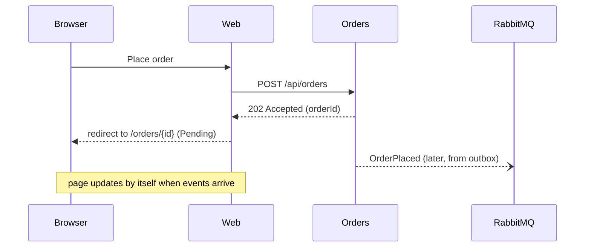
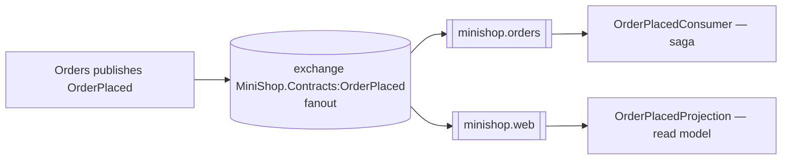
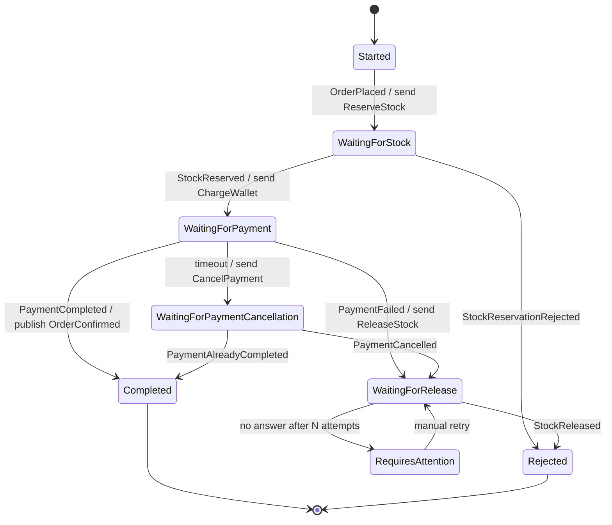
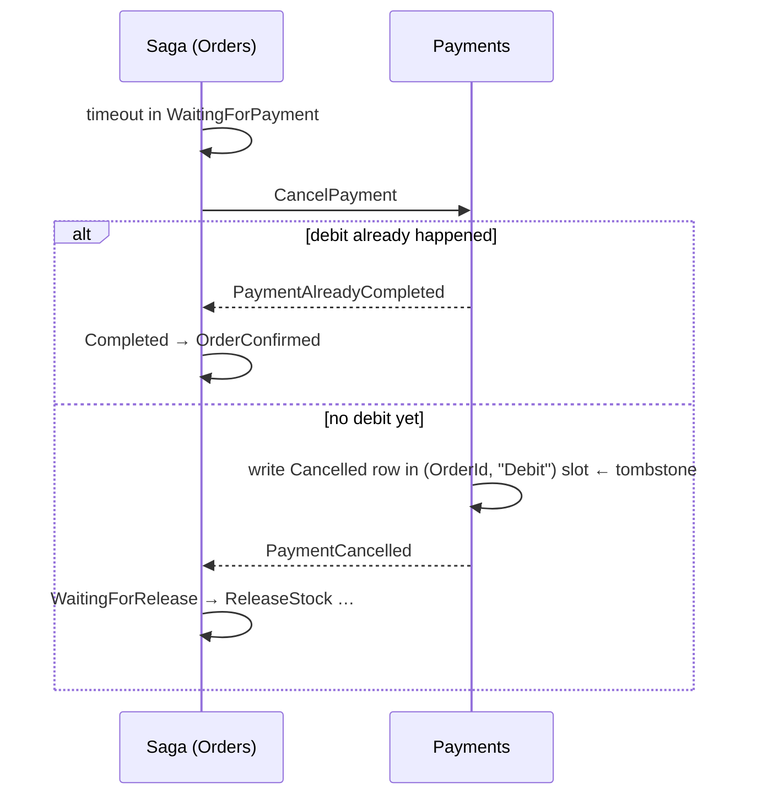
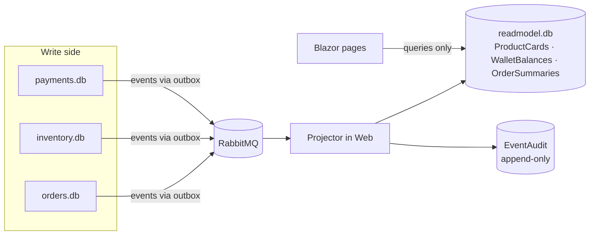

# دورهٔ آموزشی میکروسرویس با پروژهٔ MiniShop

> از مونولیت تا Saga، Outbox، Inbox، CQRS و RabbitMQ — همه روی یک پروژهٔ واقعی و قابل اجرا

این سند یک دورهٔ کامل و گام‌به‌گام است. هر مفهوم اول به زبان ساده توضیح داده می‌شود، بعد نشان داده
می‌شود که **دقیقاً کجای کد MiniShop** پیاده شده، و در آخر با یک **سناریوی واقعی** در Developer Console
دیده و آزمایش می‌شود. هدف این است که دانشجو نه فقط «تعریف» الگوها، بلکه **دلیل وجودشان** را بفهمد:
هر الگو جواب یک خرابی مشخص است.

---

## فهرست

- [پیش از شروع: نحوهٔ استفاده از این دوره](#پیش-از-شروع-نحوهٔ-استفاده-از-این-دوره)
- [ماژول ۰ — راه‌اندازی و یک دور در پروژه](#ماژول-۰--راهاندازی-و-یک-دور-در-پروژه)
- **بخش اول: مبانی**
  - [ماژول ۱ — مونولیت، میکروسرویس و هزینهٔ توزیع‌شدگی](#ماژول-۱--مونولیت-میکروسرویس-و-هزینهٔ-توزیعشدگی)
  - [ماژول ۲ — مرز سرویس‌ها و مالکیت داده](#ماژول-۲--مرز-سرویسها-و-مالکیت-داده)
  - [ماژول ۳ — ارتباط همگام و ناهمگام](#ماژول-۳--ارتباط-همگام-و-ناهمگام)
- **بخش دوم: پیام‌رسانی**
  - [ماژول ۴ — RabbitMQ و MassTransit از نزدیک](#ماژول-۴--rabbitmq-و-masstransit-از-نزدیک)
  - [ماژول ۵ — قرارداد پیام: Command، Event و Envelope](#ماژول-۵--قرارداد-پیام-command-event-و-envelope)
- **بخش سوم: قابلیت اطمینان**
  - [ماژول ۶ — تضمین تحویل و مسئلهٔ «نوشتن دوگانه»](#ماژول-۶--تضمین-تحویل-و-مسئلهٔ-نوشتن-دوگانه)
  - [ماژول ۷ — Transactional Outbox](#ماژول-۷--transactional-outbox)
  - [ماژول ۸ — Inbox و Idempotency](#ماژول-۸--inbox-و-idempotency)
  - [ماژول ۹ — Retry، Backoff و Dead Letter](#ماژول-۹--retry-backoff-و-dead-letter)
- **بخش چهارم: تراکنش‌های توزیع‌شده**
  - [ماژول ۱۰ — Saga: هماهنگی بدون تراکنش سراسری](#ماژول-۱۰--saga-هماهنگی-بدون-تراکنش-سراسری)
  - [ماژول ۱۱ — جبران، Timeout و آشتی دادن وضعیت](#ماژول-۱۱--جبران-timeout-و-آشتی-دادن-وضعیت)
  - [ماژول ۱۲ — هم‌زمانی و قفل خوش‌بینانه](#ماژول-۱۲--همزمانی-و-قفل-خوشبینانه)
- **بخش پنجم: سمت خواندن**
  - [ماژول ۱۳ — CQRS و Read Model](#ماژول-۱۳--cqrs-و-read-model)
- **بخش ششم: عملیات و کیفیت**
  - [ماژول ۱۴ — مشاهده‌پذیری (Observability)](#ماژول-۱۴--مشاهدهپذیری-observability)
  - [ماژول ۱۵ — تزریق خطا و آزمون مبتنی بر شواهد](#ماژول-۱۵--تزریق-خطا-و-آزمون-مبتنی-بر-شواهد)
  - [ماژول ۱۶ — استقرار با Docker Compose](#ماژول-۱۶--استقرار-با-docker-compose)
  - [ماژول ۱۷ — از دمو تا Production: چه چیزهایی ساده شده‌اند؟](#ماژول-۱۷--از-دمو-تا-production-چه-چیزهایی-ساده-شدهاند)
- **پیوست‌ها**
  - [پیوست الف — برنامهٔ پیشنهادی کلاس](#پیوست-الف--برنامهٔ-پیشنهادی-کلاس)
  - [پیوست ب — پروژه‌های پایانی و تمرین‌های بزرگ](#پیوست-ب--پروژههای-پایانی-و-تمرینهای-بزرگ)
  - [پیوست ج — واژه‌نامه](#پیوست-ج--واژهنامه)
  - [پیوست د — نقشهٔ فایل‌ها](#پیوست-د--نقشهٔ-فایلها)
  - [پیوست هـ — پاسخ پرسش‌های مرور](#پیوست-هـ--پاسخ-پرسشهای-مرور)

---

## پیش از شروع: نحوهٔ استفاده از این دوره

**مخاطب:** توسعه‌دهندهٔ #C/.NET که با ASP.NET Core و EF Core آشناست، ولی میکروسرویس را عملاً تجربه
نکرده است. آشنایی با Docker در حد اجرای `docker compose up` کافی است.

**ساختار هر ماژول:**

| بخش | توضیح |
|---|---|
| 🎯 هدف | چیزی که در پایان ماژول باید بتوانید توضیح دهید یا انجام دهید |
| 📖 مفهوم | توضیح نظری، با تمرکز بر «چرا» |
| 🔍 در کد MiniShop | فایل و کد مربوط، با توضیح خط‌به‌خط بخش‌های مهم |
| 🧪 آزمایش | سناریوی Scenario Lab یا کاری که در UI انجام می‌دهید و چیزی که باید ببینید |
| ⚠️ اشتباه رایج | خطاهایی که در پروژه‌های واقعی زیاد دیده می‌شود |
| ✍️ تمرین | تمرین عملی، معمولاً تغییر کوچکی در کد |
| 💡 پاسخ تمرین | پاسخ تشریحی هر تمرین، در یک بلوک بازشونده زیر خود تمرین. اول خودتان تلاش کنید، بعد باز کنید |
| ❓ پرسش مرور | برای سنجش فهم؛ پاسخ‌های تشریحی در پیوست هـ |

**قاعدهٔ طلایی دوره:** هر وقت چیزی را نفهمیدید، سناریوی مرتبط را اجرا کنید و در تب **Timeline**
روی تک‌تک ردیف‌ها کلیک کنید. هر چیزی که در UI می‌بینید از داده‌های واقعی سرویس‌ها ساخته شده است؛
هیچ انیمیشن ساختگی وجود ندارد.

### نقشهٔ دوره در یک نگاه

هر الگوی این دوره پاسخ یک خرابی مشخص است. این جدول را مثل نقشهٔ راه نگه دارید؛ هر وقت گم شدید به آن
برگردید و ببینید الگویی که می‌خوانید «جواب کدام درد» است:

| خرابی / مسئله | الگوی پاسخ | ماژول | سناریوی شاهد |
|---|---|---|---|
| سه دیتابیس، بدون تراکنش سراسری | Saga (orchestration) | ۱۰ | S01، S03 |
| پروسه بین commit و publish می‌میرد | Transactional Outbox | ۷ | S04، S11 |
| پیام دو بار تحویل داده می‌شود | Inbox + idempotency تجاری | ۸ | S06، S11، S14 |
| خطای گذرا در دیتابیس یا شبکه | Retry با backoff، صف خطا | ۹ | S07، S10 |
| پرداخت شکست می‌خورد بعد از رزرو | Compensation | ۱۱ | S03، S12 |
| جوابی نمی‌آید و نمی‌دانیم چه شد | Timeout + reconciliation + tombstone | ۱۱ | S10، S13 |
| دو پیام هم‌زمان یک ردیف را تغییر می‌دهند | Optimistic concurrency | ۱۲ | S15 |
| صفحهٔ UI به دادهٔ سه سرویس نیاز دارد | CQRS و read model | ۱۳ | S08، S16 |
| مشترک بعد از انتشار event بالا می‌آید | Snapshot request | ۱۳ | اولین `docker compose up` |
| «برای سفارش X چه شد؟» | CorrelationId، CausationId، EventAudit | ۱۴ | همهٔ سناریوها |
| باگ فقط هنگام خرابی ظاهر می‌شود | Fault injection و آزمون مبتنی بر شواهد | ۱۵ | S01 تا S16 |

### جریان یک سفارش موفق، قبل از هر چیز

قبل از ورود به ماژول‌ها، مسیر کامل یک خرید را یک بار ببینید. هر خط این جدول بعداً یک ماژول می‌شود:

| # | کجا | چه اتفاقی می‌افتد | الگو |
|---|---|---|---|
| ۱ | مرورگر → Web | کاربر «ثبت سفارش» می‌زند؛ Web یک `Idempotency-Key` می‌سازد | ماژول ۳ |
| ۲ | Web → Orders | `POST /api/orders`؛ پاسخ فوری `202 Accepted` | ماژول ۳ |
| ۳ | Orders | در **یک تراکنش**: ردیف `Order`، ردیف `SagaInstance`، ردیف Outbox برای `OrderPlaced` | ماژول ۷ |
| ۴ | Orders → RabbitMQ | `OutboxDispatcher` رویداد `OrderPlaced` را publish می‌کند | ماژول ۴، ۷ |
| ۵ | Orders (Saga) | `OrderPlaced` را می‌خواند؛ دستور `ReserveStock` را به صف Inventory می‌فرستد | ماژول ۱۰ |
| ۶ | Inventory | در یک تراکنش: Inbox، رزرو، `Reserved += qty`، Outbox برای `StockReserved` | ماژول ۸، ۱۲ |
| ۷ | Orders (Saga) | `StockReserved` → دستور `ChargeWallet` به صف Payments | ماژول ۱۰ |
| ۸ | Payments | در یک تراکنش: Inbox، ردیف ledger، `Balance -= amount`، Outbox برای `PaymentCompleted` | ماژول ۸ |
| ۹ | Orders (Saga) | `PaymentCompleted` → `OrderConfirmed` منتشر می‌شود؛ Saga به `Completed` می‌رود | ماژول ۱۰ |
| ۱۰ | Inventory | `OrderConfirmed` → رزرو به مصرف واقعی تبدیل می‌شود (`OnHand -= qty`) | ماژول ۱۱ |
| ۱۱ | Web | همهٔ eventها در `readmodel.db` projection می‌شوند؛ صفحهٔ سفارش خودش به‌روز می‌شود | ماژول ۱۳ |
| ۱۲ | همه → Web | هر گام یک رکورد تله‌متری به صف `minishop.web.diagnostics` می‌فرستد؛ Timeline از آن ساخته می‌شود | ماژول ۱۴ |

---

## ماژول ۰ — راه‌اندازی و یک دور در پروژه

### 🎯 هدف
پروژه را اجرا کنید، یک خرید انجام دهید و بدانید هر بخش UI کجاست.

### اجرا

```bash
git clone https://github.com/mortezadalil/CleanArchMicroServices.git
cd CleanArchMicroServices
docker compose -f infra/compose.yaml up --build
```

| آدرس | چیست |
|---|---|
| http://localhost:5100 | فروشگاه (Store Mode) |
| http://localhost:5100/developer | کنسول توسعه‌دهنده (Developer Mode) |
| http://localhost:15672 | پنل مدیریت RabbitMQ (کاربر و رمز: `guest`) |

اجرای بدون Docker برای سرویس‌ها (نیازمند .NET 10 SDK):

```bash
docker compose -f infra/compose.yaml up -d rabbitmq
scripts/run-local.sh
```

اسکریپت `run-local.sh` چهار پروژه را با `dotnet run` و `ASPNETCORE_ENVIRONMENT=Development` روی این پورت‌ها
بالا می‌آورد. همین پورت‌ها در Compose هم به بیرون map شده‌اند:

| سرویس | پورت محلی | چه چیزی روی آن است |
|---|---|---|
| Web | 5100 | فروشگاه، Developer Console، `/demo/*` و `/health/*` |
| Orders | 5101 | `POST /api/orders`، `/diagnostics/*`، `/demo/*`، `/health/*` |
| Inventory | 5102 | فقط `/diagnostics/*`، `/demo/*`، `/health/*` (هیچ API تجاری ندارد؛ worker است) |
| Payments | 5103 | مثل Inventory |
| RabbitMQ | 5672 (AMQP)، 15672 (پنل مدیریت) | broker |

**نکته:** همهٔ endpointهای `/demo/*` و `/diagnostics/*` فقط در Development فعال‌اند و هدر
`X-Demo-Token: minishop-dev` می‌خواهند (مقدار در `compose.yaml` و `appsettings.Development.json`). Web این
هدر را خودش اضافه می‌کند؛ اگر با `curl` آزمایش می‌کنید باید خودتان بفرستید:

```bash
curl -s -H "X-Demo-Token: minishop-dev" http://localhost:5102/diagnostics/stock | jq
```

### اولین اجرا: پشت صحنه چه می‌گذرد؟

وقتی `docker compose up` می‌زنید، این اتفاق‌ها به ترتیب می‌افتد و دانستن آن‌ها بعداً در ماژول ۴ و ۱۳ به
کار می‌آید:

1. **RabbitMQ** بالا می‌آید و `healthcheck` آن (`rabbitmq-diagnostics ping`) سبز می‌شود. سرویس‌ها به خاطر
   `depends_on: condition: service_healthy` تا این لحظه صبر می‌کنند.
2. هر سرویس فایل SQLite خودش را با `EnsureCreated` می‌سازد و `PRAGMA journal_mode=WAL` را فعال می‌کند.
3. **Inventory** سه محصول (Headphones، Keyboard، Mouse) را با ۱۰ عدد موجودی seed می‌کند و برای هر کدام
   یک `ProductCatalogChanged` در Outbox خودش می‌نویسد. **Payments** کیف پول `demo-customer` را با
   ۲٬۰۰۰٬۰۰۰ تومان seed می‌کند و `WalletBalanceChanged` می‌نویسد.
4. MassTransit در هر سرویس صف و exchangeهای خودش را می‌سازد. اگر Web **دیرتر** از Inventory بالا بیاید،
   eventهای مرحلهٔ ۳ به صف Web نمی‌رسند، چون صفی وجود نداشته (RabbitMQ انبار رویداد نیست).
5. **Web** تا وقتی read model خالی است هر ۵ ثانیه `ReadModelSnapshotRequested` منتشر می‌کند؛ Inventory و
   Payments داده‌هایشان را دوباره از طریق Outbox اعلام می‌کنند و فروشگاه پر می‌شود.

### نقشهٔ Developer Console

| بخش | چه نشان می‌دهد | از کجا ساخته می‌شود |
|---|---|---|
| **Architecture Explorer** | پنج گره (Web، Orders، Inventory، Payments، RabbitMQ)، وضعیت سلامت هر کدام و پیام‌های در حال عبور | `ServiceHealthMonitor` (`/health/ready` هر سرویس + API مدیریت RabbitMQ) و رکوردهای تله‌متری |
| **Saga Inspector** | وضعیت فعلی Saga سفارش انتخاب‌شده، آخرین انتقال، دکمهٔ Retry compensation | جدول `SagaSnapshots` در `readmodel.db` که از رکوردهای `SagaTransitioned` ساخته می‌شود |
| **Timeline** | همهٔ رکوردهای یک سفارش به ترتیب زمان؛ با کلیک، payload و `state snapshot after this step` | `EventAudit` فیلترشده با `CorrelationId` |
| **Messages** | همهٔ رکوردها با فیلتر سرویس، سناریو و جستجو | `EventAudit` |
| **Outbox/Inbox** | ردیف‌های Outbox و Inbox هر سرویس، تعداد pending و شمارنده‌ها | `/diagnostics/outbox` و `/diagnostics/inbox` هر سرویس |
| **Database** | محتوای چهار دیتابیس (سفارش، رزرو، ledger، read model) | `/diagnostics/*` هر سرویس مالک، هرگز فایل SQLite دیگران |
| **CQRS** | وضعیت نوشتن (از Orders) و خواندن (از `readmodel.db`) کنار هم، تأخیر projection، دکمهٔ Rebuild | `/diagnostics/orders/{id}` و `ProjectionCheckpoint` |
| **Replay** | پخش قدم‌به‌قدم رکوردهای یک سفارش | `EventAudit` |
| **Faults** | قوانین fault فعال در هر سرویس، افزودن/حذف دستی | `/demo/faults` هر سرویس |
| **Scenario runs** | تاریخچهٔ اجرای سناریوها با نتیجه و گزارش کامل | `ScenarioRuns` و `ScenarioAssertions` |

### یک دور در پروژه

1. در فروشگاه یک ماوس به سبد اضافه کنید و سفارش دهید.
2. به صفحهٔ سفارش منتقل می‌شوید. وضعیت چند لحظه `Pending` یا `AwaitingPayment` است و بعد `Confirmed` می‌شود.
3. روی **Inspect flow** بزنید. در Developer Mode این‌ها را ببینید:
   - **Architecture Explorer:** پنج گره (Web، Orders، Inventory، Payments، RabbitMQ) و پیام‌هایی که روی یال‌ها حرکت می‌کنند.
   - **Saga Inspector:** سه انتقال وضعیت Saga.
   - **Timeline:** همهٔ رکوردها با زمان واقعی.
4. دکمهٔ **⟲ Reset data** در هدر همه چیز را به حالت اولیه برمی‌گرداند. هر وقت داده‌ها شلوغ شد از آن استفاده کنید.

### ✍️ تمرین ۰
در پنل RabbitMQ به تب **Queues** بروید. پنج صف `minishop.*` را پیدا کنید و برای هرکدام بنویسید کدام
سرویس آن را مصرف می‌کند. (راهنما: ستون Consumers و فایل `contracts/Topology.cs`)

<details>
<summary>💡 پاسخ تمرین ۰</summary>

پنج صف اصلی و مصرف‌کنندهٔ هرکدام (هر سرویس **دقیقاً یک** receive endpoint دارد، به جز Web که دو تا دارد):

| صف | مصرف‌کننده | چه پیام‌هایی به آن می‌رسد | چطور می‌رسد |
|---|---|---|---|
| `minishop.orders` | Orders (هشت consumer کوچک Saga در `SagaConsumers.cs`) | `OrderPlaced`، `StockReserved`، `StockReservationRejected`، `StockReleased`، `PaymentCompleted`، `PaymentFailed`، `PaymentCancelled`، `PaymentAlreadyCompleted` | همه **event** هستند؛ exchange هر event به این صف bind شده |
| `minishop.inventory` | Inventory (`ReserveStockConsumer`، `ReleaseStockConsumer`، `OrderConfirmedConsumer`، `SnapshotRequestedConsumer`) | `ReserveStock`، `ReleaseStock` (command، با `Send` مستقیم به صف) + `OrderConfirmed`، `ReadModelSnapshotRequested` (event، با binding) | ترکیبی از send و publish |
| `minishop.payments` | Payments (`ChargeWalletConsumer`، `CancelPaymentConsumer`، `SnapshotRequestedConsumer`) | `ChargeWallet`، `CancelPayment` (command) + `ReadModelSnapshotRequested` (event) | ترکیبی |
| `minishop.web` | Web (سیزده `ProjectionConsumer`) | همهٔ eventهای تجاری | فقط binding |
| `minishop.web.diagnostics` | Web (`DiagnosticEventConsumer`) | `DiagnosticEvent` از هر چهار سرویس | binding؛ `PrefetchCount = 16` چون حجم بالاست |

علاوه بر این پنج صف، برای هر کدام یک صف `{name}_error` می‌بینید (مقصد پیام‌هایی که بعد از همهٔ retryها شکست
خورده‌اند؛ ماژول ۹) و احتمالاً صف‌های `_skipped` (وقتی پیامی به صفی برسد که consumer آن نوع را ندارد).
ستون **Consumers** برای هر صف اصلی عدد ۱ را نشان می‌دهد، چون هر سرویس یک نمونه دارد و `PrefetchCount = 1`
است. برای صف‌های `_error` عدد ۰ است: کسی از آن‌ها نمی‌خواند، تا وقتی اپراتور دستی پیام را برگرداند.

</details>

---

# بخش اول: مبانی

## ماژول ۱ — مونولیت، میکروسرویس و هزینهٔ توزیع‌شدگی

### 🎯 هدف
بتوانید توضیح دهید میکروسرویس چه مشکلی را حل می‌کند و چه مشکلات تازه‌ای می‌سازد.

### 📖 مفهوم

**مونولیت** یعنی یک برنامهٔ واحد با یک دیتابیس. در یک فروشگاه مونولیت، ثبت سفارش این‌طور است:

```csharp
using var tx = db.BeginTransaction();
stock.Reserved += 1;          // موجودی
wallet.Balance -= 300_000;    // کیف پول
order.State = Confirmed;      // سفارش
tx.Commit();                  // یا همه، یا هیچ
```

این کد **ساده و درست** است، چون دیتابیس تضمین ACID می‌دهد: یا هر سه تغییر انجام می‌شود یا هیچ‌کدام.

**میکروسرویس** یعنی سیستم به چند برنامهٔ مستقل تقسیم شود که هرکدام دیتابیس خودش را دارد و جدا
مستقر (deploy) می‌شود. مزایا:

| مزیت | توضیح |
|---|---|
| استقلال تیم‌ها | تیم Payments بدون هماهنگی با تیم Inventory منتشر می‌کند |
| مقیاس‌پذیری جداگانه | فقط سرویس پرترافیک را چند نمونه می‌کنیم |
| ایزولهٔ خرابی | قطع Payments فروشگاه را از کار نمی‌اندازد؛ سفارش‌ها صف می‌شوند |
| آزادی فناوری | هر سرویس می‌تواند دیتابیس یا زبان مناسب خودش را داشته باشد |

اما **همان سه خط کد** حالا سه دیتابیس در سه پروسه است و دیگر هیچ `tx.Commit()` سراسری وجود ندارد.
تمام این دوره دربارهٔ همین است: **چطور بدون تراکنش سراسری، سیستمی درست بسازیم؟**

### هزینهٔ توزیع‌شدگی، قلم به قلم

وقتی سه خط بالا سه پروسه می‌شوند، این هزینه‌ها را می‌پردازید. هرکدام در MiniShop یک «جواب» دارد:

| هزینه | یعنی چه | جواب MiniShop |
|---|---|---|
| **خرابی جزئی (partial failure)** | در مونولیت یا همه چیز کار می‌کند یا هیچ. در میکروسرویس Payments می‌تواند خاموش باشد در حالی که Orders روشن است | messaging و صف (ماژول ۳)، Saga با timeout (ماژول ۱۱) |
| **سازگاری ضعیف‌تر** | بین «رزرو شد» و «پول کم شد» یک پنجرهٔ زمانی هست که سیستم در وضعیت میانی است | وضعیت‌های صریح میانی مثل `AwaitingPayment` و `Compensating`؛ هرگز وانمود نکردن (ماژول ۱۳) |
| **تحویل ناقص یا تکراری** | شبکه و broker نه «دقیقاً یک بار» می‌دهند و نه ترتیب تضمین می‌کنند | Outbox، Inbox، projection idempotent (ماژول ۷، ۸، ۱۳) |
| **دیباگ سخت** | stack trace فقط داخل یک پروسه را نشان می‌دهد | `CorrelationId` و `CausationId` روی هر پیام، EventAudit، Timeline (ماژول ۱۴) |
| **تست سخت** | «مسیر خوشحال» کار می‌کند، ولی باگ‌ها موقع خرابی ظاهر می‌شوند | fault injection و سناریوهای مبتنی بر شواهد (ماژول ۱۵) |
| **زیرساخت بیشتر** | broker، چند دیتابیس، health check، استقرار جداگانه | Docker Compose (ماژول ۱۶)، فهرست صادقانهٔ ساده‌سازی‌ها (ماژول ۱۷) |

به عبارت ساده: **میکروسرویس پیچیدگی را حذف نمی‌کند، جابه‌جا می‌کند.** پیچیدگی از «کد بزرگ در یک جا»
به «هماهنگی بین چند جا» منتقل می‌شود. این معامله فقط وقتی سود دارد که استقلال تیم‌ها و مقیاس‌پذیری
جداگانه واقعاً برای شما مسئله باشد.

### هشت مغالطهٔ محاسبات توزیع‌شده

این فهرست را Peter Deutsch و همکارانش در Sun در دههٔ ۹۰ نوشتند و هنوز هم هر سیستم توزیع‌شده‌ای که
«برای اولین بار» ساخته می‌شود دست‌کم به چند تای آن می‌خورد. در شبکه این فرض‌ها **همه غلط‌اند** و
MiniShop برای بیشترشان سناریو دارد:

| # | فرض غلط | واقعیت | سناریوی مرتبط |
|---|---|---|---|
| ۱ | شبکه قابل اعتماد است | broker قطع می‌شود، پیام گم یا تکرار می‌شود | S04، S06، S11 |
| ۲ | تأخیر صفر است | پرداخت دیر می‌رسد و Saga باید تصمیم بگیرد | S10، S13 |
| ۳ | پهنای باند بی‌نهایت است | حلقهٔ بازخورد تله‌متری حجم پیام را به ۸۷ مگابایت رساند (ماژول ۱۴) | درس آموخته‌شده |
| ۴ | شبکه امن است | کنترل fault فقط در Development و با توکن؛ `guest/guest` فقط برای دمو | ماژول ۱۵، ۱۷ |
| ۵ | توپولوژی تغییر نمی‌کند | پروسه restart می‌شود و آدرس/اتصال عوض می‌شود | S09 |
| ۶ | یک مدیر وجود دارد | هر سرویس مالک دیتابیس و تنظیمات خودش است | ماژول ۲ |
| ۷ | هزینهٔ انتقال صفر است | serialize و deserialize هر پیام، حجم payload (eventهای «چاق»، ماژول ۵) | ماژول ۵ |
| ۸ | شبکه همگن است | نسخه‌های مختلف قرارداد باید هم‌زیستی کنند | تمرین ۵، پروژهٔ پایانی ۴ |

و چند فرض غلط دیگر که مخصوص پیام‌رسانی‌اند و این دوره روی آن‌ها زیاد تأکید می‌کند:

| فرض غلط | واقعیت | کجا |
|---|---|---|
| پیام دقیقاً یک بار می‌رسد | پیام تکراری می‌رسد | S06، S11، ماژول ۶ |
| ترتیب پیام‌ها حفظ می‌شود | پیام قدیمی بعد از جدید می‌رسد | Projector (ماژول ۱۳) |
| دیتابیس همیشه موفق است | خطای گذرا رخ می‌دهد | S07 |
| «جواب نیامد» یعنی «انجام نشد» | شاید انجام شده و جواب در راه است | S13، ماژول ۱۱ |

### ⚠️ اشتباه رایج
«میکروسرویس یعنی چند پروژهٔ Web API که با HTTP همدیگر را صدا می‌زنند.» این معمولاً به **مونولیت
توزیع‌شده** می‌رسد: همهٔ معایب توزیع‌شدگی (تأخیر، خرابی جزئی) بدون هیچ‌کدام از مزایا (استقلال)، چون
اگر یک سرویس بیفتد زنجیرهٔ فراخوانی‌ها می‌شکند.

تصور کنید MiniShop این‌طور نوشته شده بود:

```csharp
// نسخهٔ «مونولیت توزیع‌شده» از ثبت سفارش (این کد در MiniShop وجود ندارد)
var reserved = await inventoryHttp.PostAsync("/reserve", lines);    // اگر Inventory خاموش باشد؟
var charged  = await paymentsHttp.PostAsync("/charge", amount);     // اگر این‌جا timeout شود؟ رزرو چه می‌شود؟
order.State = Confirmed;
await db.SaveChangesAsync();                                        // اگر این‌جا crash کند؟ پول رفته، سفارش ثبت نشده
```

سه خط، سه نقطهٔ خرابی، و هیچ‌کدام جواب روشنی ندارد. علامت‌های یک مونولیت توزیع‌شده:
- یک درخواست کاربر به زنجیره‌ای از فراخوانی‌های همگام تبدیل می‌شود.
- سرویس‌ها فقط با هم قابل انتشار (deploy) هستند، چون قراردادها ناپایدارند.
- یک دیتابیس مشترک یا JOIN بین دیتابیس‌ها وجود دارد.
- وقتی یکی از سرویس‌ها کند می‌شود، همه کند می‌شوند.

### ❓ پرسش مرور
1. چرا در مونولیت به Saga نیاز نداریم؟
2. یک موقعیت نام ببرید که مونولیت انتخاب بهتری از میکروسرویس است.

---

## ماژول ۲ — مرز سرویس‌ها و مالکیت داده

### 🎯 هدف
بفهمید چرا هر سرویس دیتابیس خودش را دارد و «مالک» یک داده یعنی چه.

### 📖 مفهوم

**Bounded Context** (از Domain-Driven Design) یعنی محدوده‌ای که یک مدل و زبان مشخص در آن معتبر است.
«محصول» برای انبار یعنی موجودی و رزرو؛ برای حسابداری یعنی قیمت و مالیات. هر سرویس باید حول یک
Bounded Context ساخته شود.

**Database per Service:** هیچ سرویسی دیتابیس سرویس دیگر را مستقیم نمی‌خواند یا نمی‌نویسد. اگر این قانون
شکسته شود:
- تغییر schema یک سرویس، سرویس دیگر را می‌شکند (وابستگی پنهان).
- دیگر معلوم نیست invariantها (مثلاً «موجودی منفی نشود») را چه کسی تضمین می‌کند.

**یک مفهوم، چند مدل.** در MiniShop «محصول» در سه جا با سه شکل متفاوت وجود دارد و این **عمدی** است:

| کجا | کلاس | چه چیزی از «محصول» برایش مهم است | مالک است؟ |
|---|---|---|---|
| Inventory | `Product` + `Stock` | قیمت، `Version` قیمت، `OnHand`، `Reserved`، `IsActive` | **بله**، تنها منبع حقیقت |
| Orders | `OrderItem` | `ProductNameSnapshot`، `UnitPriceSnapshot`، `Quantity` | خیر؛ فقط **عکس لحظهٔ خرید** را نگه می‌دارد |
| Web | `ProductCard` | نام، قیمت و موجودی قابل نمایش، `Available` | خیر؛ کپی خواندنی از روی `ProductCatalogChanged` |

به این «کپی کردن داده» نگویید تکرار بیهوده. Orders باید بداند مشتری **چه قیمتی دید**، حتی اگر قیمت فردا
عوض شود؛ این یک واقعیت تاریخی است و به Inventory تعلق ندارد. Web باید بدون پرسیدن از کسی بتواند صفحه را
رندر کند. هر کپی **معنای خودش** را دارد و از طریق event به‌روز می‌ماند، نه با JOIN.

**چطور مرز را پیدا کنیم؟** چند پرسش عملی که در طراحی MiniShop جواب داده شده:

1. **کدام invariant باید اتمی بماند؟** «موجودی منفی نشود» به رزرو و `OnHand` یک محصول نیاز دارد → هر دو
   در Inventory. «یک برداشت برای هر سفارش» به ledger و کیف پول نیاز دارد → هر دو در Payments.
2. **چه کسی زبان این مفهوم را تعریف می‌کند؟** «رزرو» واژهٔ انبار است؛ «ledger» واژهٔ مالی است. اگر یک واژه در
   دو تیم دو معنی دارد، احتمالاً دو Bounded Context دارید.
3. **چه چیزی با هم تغییر می‌کند؟** اگر هر بار قانون قیمت‌گذاری عوض شود باید Orders را هم تغییر دهید،
   مرز اشتباه است.

### 🔍 در کد MiniShop

| پروژه | مالک چه چیزی است | دیتابیس |
|---|---|---|
| `MiniShop.Orders` | سفارش، وضعیت سفارش، Saga | `orders.db` |
| `MiniShop.Inventory` | کاتالوگ، قیمت، موجودی، رزرو | `inventory.db` |
| `MiniShop.Payments` | کیف پول، دفتر کل (ledger) | `payments.db` |
| `MiniShop.Web` | فقط **کپی خواندنی** (read model) | `readmodel.db` |

به این نکته‌ها دقت کنید:

- **Inventory تنها منبع حقیقت قیمت است.** Orders قیمت را از مرورگر به‌صورت snapshot می‌گیرد، ولی
  Inventory هنگام رزرو آن را دوباره چک می‌کند (`ReserveStockConsumer.ValidateAsync`). اگر قیمت عوض شده
  باشد رزرو رد می‌شود. **مبلغ قابل پرداخت هرگز فقط به ورودی مرورگر اعتماد نمی‌کند.**
- **Web هیچ‌وقت فایل SQLite سرویس دیگری را باز نمی‌کند.** حتی Database Explorer داده‌ها را از
  endpointهای فقط‌خواندنی `/diagnostics/*` هر سرویس می‌گیرد.
- **هیچ پروژه‌ای به پروژهٔ دیگر Reference ندارد.** کد مشترک (`contracts/` و `shared/`) به‌صورت
  *linked source* در هر پروژه کامپایل می‌شود. فایل `.csproj` را ببینید:

```xml
<ItemGroup>
  <Compile Include="../../contracts/**/*.cs" LinkBase="Contracts" />
  <Compile Include="../../shared/**/*.cs" LinkBase="Shared" />
</ItemGroup>
```

در یک سیستم واقعی، `contracts` یک بستهٔ NuGet نسخه‌دار است تا هر سرویس بتواند با سرعت خودش به نسخهٔ
جدید قرارداد مهاجرت کند.

چرا linked source و نه project reference؟ چون project reference یک **پروژهٔ پنجم** می‌ساخت که همه به آن وابسته‌اند
و تغییر آن همه را هم‌زمان می‌شکند؛ دقیقاً همان چیزی که می‌خواهیم از آن فرار کنیم. با linked source هر سرویس
کد قرارداد را **در باینری خودش** دارد و در Docker هم فقط پوشه‌های `contracts/` و `shared/` در build context کپی
می‌شوند (به `Dockerfile` هر سرویس نگاه کنید). محتوای این دو پوشه:

| پوشه | چه چیزی داخلش است | چه کسی به آن وابسته است |
|---|---|---|
| `contracts/` | `Message` (envelope)، commandها، eventها، `Topology`، `DiagnosticEvent` | **همه**؛ این «زبان مشترک» است و باید با احتیاط تغییر کند |
| `shared/` | `IdempotentConsumer`، `OutboxDispatcher`، `FaultRegistry`، `DiagnosticsPublisher`، health و demo endpoints | همه، ولی **می‌تواند** متفاوت باشد؛ یک سرویس می‌توانست Outbox خودش را با زبان دیگری بنویسد |

### 🧪 آزمایش
در Developer Mode، تب **Database** را باز کنید. چهار بخش `orders.db`، `inventory.db`، `payments.db` و
`readmodel.db` را می‌بینید. یک سفارش ثبت کنید و نشان دهید هر ستون در کدام دیتابیس تغییر کرد.

چیزی که باید ببینید (برای خرید یک ماوس ۳۰۰٬۰۰۰ تومانی):

| دیتابیس | جدول | تغییر |
|---|---|---|
| `orders.db` | `Orders` | ردیف جدید، `State` از `Pending` تا `Confirmed`، `Amount = 300000` |
| `orders.db` | `SagaInstances` | `CurrentState` از `Started` تا `Completed`، `DeadlineUtc` در حالت‌های انتظار پر و در پایان خالی |
| `orders.db` | `OrderAudit` | چهار ردیف: `Api`، `OrderPlaced`، `StockReserved`، `PaymentCompleted` |
| `inventory.db` | `Stock` (Mouse) | `Reserved` ابتدا ۰→۱، بعد از `OrderConfirmed`: `OnHand` ۱۰→۹ و `Reserved` ۱→۰ |
| `inventory.db` | `Reservations` | ردیف جدید، `State` از `Reserved` به `Committed` |
| `payments.db` | `Wallets` | `Balance` ۲٬۰۰۰٬۰۰۰ → ۱٬۷۰۰٬۰۰۰، `Version + 1` |
| `payments.db` | `Ledger` | یک ردیف `Debit` با `State = Completed` |
| `readmodel.db` | `Orders` (OrderSummary)، `ProductCards`، `WalletBalances` | همان مقادیر، ولی **با تأخیر** و فقط از روی eventها |

نکتهٔ مهم: هیچ ستونی در دو دیتابیس «همان ستون» نیست. `Wallets.Balance` در Payments مالک است و
`WalletBalances.Balance` در Web فقط یک کپی است که ممکن است چند میلی‌ثانیه عقب باشد.

### ⚠️ اشتباه رایج
**دیتابیس مشترک با schemaهای جدا.** وسوسه‌انگیز است چون JOIN و تراکنش ممکن می‌ماند؛ اما در عمل
سرویس‌ها از طریق جدول‌های هم جفت می‌شوند و استقلال استقرار از بین می‌رود.

### ✍️ تمرین ۲
فرض کنید می‌خواهیم «امتیاز وفاداری» اضافه کنیم: هر خرید موفق ۱٪ مبلغ امتیاز بدهد. این قابلیت به کدام
سرویس تعلق دارد؟ آیا سرویس جدید لازم است؟ از کدام event باید مطلع شود؟ استدلال کنید.

<details>
<summary>💡 پاسخ تمرین ۲</summary>

**۱. به کدام سرویس تعلق دارد؟** به هیچ‌کدام از سه سرویس فعلی. سه پرسش ماژول را اعمال کنید:

- *invariant اتمی:* «هر سفارش فقط یک بار امتیاز بگیرد» و «مجموع امتیاز منفی نشود». این قیدها به ledger پول
  (Payments) یا موجودی (Inventory) ربطی ندارند؛ موجودیت جدیدی به نام «حساب امتیاز» دارند.
- *زبان:* «امتیاز» واژهٔ بازاریابی است، نه مالی. اگر فردا قانون شود «محصولات پرفروش امتیاز دوبرابر می‌گیرند»،
  تیم Payments نباید درگیر شود.
- *چه چیزی با هم تغییر می‌کند:* قوانین امتیاز (درصد، سقف، انقضا) مستقل از قوانین کیف پول تغییر می‌کنند.

پس یک **Bounded Context جدید** به نام Loyalty است. اینکه «پروژهٔ پنجم» شود یا فعلاً یک ماژول داخل Payments
با جدول‌های جدا باشد یک تصمیم **عملیاتی** است، نه مدل‌سازی: اگر تیم کوچک است، به‌عنوان ماژول مستقل داخل
Payments شروع کنید ولی هیچ JOIN یا تراکنش مشترکی بین `Ledger` و `LoyaltyAccount` نگذارید، تا جدا کردنش
بعداً فقط جابه‌جایی فایل باشد (همان ایدهٔ مونولیت ماژولار ماژول ۱۷).

**۲. از کدام event مطلع شود؟** فقط `OrderConfirmed`. دلایل:

- `OrderPlaced` خیلی زود است: سفارش ممکن است رد شود (S02، S03).
- `PaymentCompleted` هم کافی نیست: در S13 پرداخت انجام شده ولی سفارش هنوز می‌توانست به `Rejected` برود اگر
  طراحی متفاوت بود؛ «خرید موفق» از دید کسب‌وکار یعنی `OrderConfirmed`، که Saga آن را **فقط یک بار و فقط
  در پایان** منتشر می‌کند. مقدار `Amount` هم داخل آن است، پس Loyalty به هیچ سرویس دیگری HTTP نمی‌زند.

**۳. اسکلت پیاده‌سازی** (همان الگوی هر consumer دیگر در MiniShop):

```csharp
public sealed class OrderConfirmedLoyaltyConsumer(LoyaltyDbContext db, DiagnosticsPublisher d, OutboxSignal s,
    FaultRegistry f, ILogger<OrderConfirmedLoyaltyConsumer> l)
    : IdempotentConsumer<OrderConfirmed, LoyaltyDbContext>(db, d, s, f, l)
{
    protected override async Task<HandleResult> HandleAsync(ConsumeContext<OrderConfirmed> context)
    {
        var e = context.Message;
        // کلید تجاری: یک اعطای امتیاز برای هر سفارش (unique index روی OrderId)
        if (await Db.Grants.AnyAsync(g => g.OrderId == e.OrderId))
            return new HandleResult("points already granted for this order");

        var account = await Db.Accounts.FirstOrDefaultAsync(a => a.CustomerId == e.CustomerId)
                      ?? Db.Accounts.Add(new LoyaltyAccount { CustomerId = e.CustomerId }).Entity;
        var points = e.Amount / 100;                       // ۱٪
        account.Points += points;
        account.Version++;
        Db.Grants.Add(new PointsGrant { OrderId = e.OrderId, Points = points });
        Db.PublishViaOutbox(new LoyaltyPointsChanged(e.CustomerId, account.Points) { CorrelationId = e.CorrelationId, CausationId = e.MessageId, Producer = "Loyalty" });
        return new HandleResult($"granted {points} points");
    }
}
```

چهار نکته‌ای که این کد رعایت می‌کند و در ماژول‌های بعد توضیح داده می‌شوند: Inbox برای همان پیام (ماژول ۸)،
unique index روی `OrderId` برای پیام‌های متفاوت (ماژول ۸)، Outbox برای اعلام تغییر به Web (ماژول ۷)، و
event حامل **مقدار نهایی** امتیاز نه مقدار تغییر (ماژول ۱۳). Orders **هیچ تغییری** نمی‌کند؛ این قدرت pub/sub است.

**۴. چه چیزی عوض نمی‌شود؟** Orders، Inventory و Payments حتی نمی‌فهمند Loyalty وجود دارد. فقط `contracts/`
یک event جدید (`LoyaltyPointsChanged`) می‌گیرد و Web یک projection و یک کارت جدید.

</details>

### ❓ پرسش مرور
3. چرا Orders برای چک کردن قیمت به Inventory درخواست HTTP نمی‌زند؟
4. اگر Web مستقیم `inventory.db` را بخواند چه چیزی خراب می‌شود؟

---

## ماژول ۳ — ارتباط همگام و ناهمگام

### 🎯 هدف
تفاوت ارتباط Request/Response و Messaging را بدانید و بتوانید برای هر موقعیت انتخاب کنید.

### 📖 مفهوم

| | همگام (HTTP/gRPC) | ناهمگام (پیام از طریق broker) |
|---|---|---|
| فرستنده منتظر جواب می‌ماند؟ | بله | خیر |
| اگر گیرنده خاموش باشد | خطا | پیام در صف می‌ماند |
| جفت‌شدگی زمانی (temporal coupling) | زیاد | کم |
| سادگی و دیباگ | ساده | پیچیده‌تر |
| مناسب برای | پرس‌وجو، درخواست کاربر | گردش کار بین سرویس‌ها |

**تصحیح یک باور رایج:** REST و gRPC «ضد میکروسرویس» نیستند. MiniShop **عمداً** برای گردش کار بین
سرویس‌های دامنه از messaging استفاده می‌کند تا خرابی یک سرویس زنجیره را نشکند.

**جفت‌شدگی زمانی (temporal coupling)** مهم‌ترین واژهٔ این ماژول است: یعنی «برای اینکه A کارش را تمام کند،
B باید **همین الان** روشن و پاسخگو باشد». HTTP همگام این جفت‌شدگی را دارد؛ صف آن را از بین می‌برد. در
S05 می‌بینید که Payments می‌تواند دقایقی متوقف باشد و فروشگاه همچنان سفارش می‌پذیرد.

**راهنمای انتخاب** (قاعده‌هایی که MiniShop دنبال می‌کند):

| موقعیت | انتخاب | چرا |
|---|---|---|
| کاربر دکمه‌ای زده و منتظر تأیید «دریافت» است | HTTP همگام با پاسخ سریع (`202`) | کاربر باید بداند درخواستش رسید؛ ولی نباید منتظر کل جریان بماند |
| پرس‌وجوی خواندنی برای نمایش | HTTP به read model خودمان | خواندن نیاز به گردش کار ندارد |
| گام‌های یک گردش کار بین سرویس‌ها (رزرو، پرداخت) | command از طریق صف | هر گام باید بعد از خرابی هم انجام شود |
| اطلاع‌رسانی «چیزی رخ داد» به هر تعداد علاقه‌مند | event (publish) | فرستنده نباید گیرنده‌ها را بشناسد |
| دادهٔ مرجع (کاتالوگ، موجودی کیف پول) برای نمایش | event + کپی محلی (read model) | نه HTTP هر بار (جفت‌شدگی زمانی)، نه خواندن دیتابیس دیگران (ماژول ۲) |

**سؤال رایج: پس «request/reply» روی صف چه می‌شود؟** MassTransit آن را پشتیبانی می‌کند، ولی MiniShop عمداً
از آن استفاده نمی‌کند: request/reply روی صف همان جفت‌شدگی زمانی HTTP است با لباس دیگر، چون فرستنده باز
هم منتظر جواب می‌ماند. به‌جای آن، Saga «دستور می‌فرستد و وضعیت خودش را ذخیره می‌کند» و جواب **هر وقت
بیاید** (حتی بعد از restart) به‌عنوان یک event مستقل پردازش می‌شود. این تفاوت در ماژول ۱۰ روشن می‌شود.

### 🔍 در کد MiniShop

فقط **یک** فراخوانی HTTP در جریان سفارش وجود دارد: Web → `POST /api/orders`. این **درگاه دستور**
(command gateway) است، نه وابستگی دامنه به دامنه. پاسخ آن هم فوری است:

```
POST /api/orders
Idempotency-Key: 4f2c...
→ 202 Accepted   { "orderId": "..." }
```

`202 Accepted` یعنی «درخواست را گرفتم و ثبت کردم»، نه «سفارش تأیید شد». تأیید نهایی چند صد میلی‌ثانیه
بعد از طریق پیام‌ها اتفاق می‌افتد و UI آن را از read model نشان می‌دهد.

ببینید endpoint در `OrdersEndpoints.cs` دقیقاً چه می‌کند و چه **نمی‌کند**:

| می‌کند | نمی‌کند |
|---|---|
| هدر `Idempotency-Key` را اجباری می‌کند (`400` اگر نباشد) | به Inventory یا Payments HTTP نمی‌زند |
| اعتبارسنجی ساختاری: حداقل یک خط، تعداد مثبت، قیمت نامنفی | قیمت را **تأیید** نمی‌کند؛ این کار Inventory است |
| اگر کلید تکراری باشد همان `orderId` قبلی را با `duplicate = true` برمی‌گرداند | هیچ پیامی را **مستقیم** publish نمی‌کند |
| در یک `SaveChanges`: Order + SagaInstance + ردیف Outbox + ردیف OrderAudit | منتظر هیچ جوابی از broker نمی‌ماند |
| `OutboxSignal.Notify()` تا dispatcher فوراً بیدار شود | وضعیت نهایی را نمی‌داند؛ `Location` به `/api/orders/{id}` اشاره می‌کند |

**اگر Orders خودش خاموش باشد چه؟** این تنها نقطهٔ همگام است، پس مرورگر خطا می‌گیرد. اما چون Web برای
هر تلاش همان `Idempotency-Key` را دوباره می‌فرستد، کاربر می‌تواند با خیال راحت دکمه را دوباره بزند و
هیچ سفارش دوبله‌ای ساخته نمی‌شود (S14). به عبارت دیگر، همگام بودن این یک فراخوانی را با idempotency
بی‌خطر کرده‌ایم.



### 🧪 آزمایش — سناریوی S05
**S05: Payments consumer paused** را اجرا کنید. مصرف‌کنندهٔ Payments متوقف شده، ولی:
- `POST /api/orders` همچنان فوراً `202` برمی‌گرداند.
- سفارش در `AwaitingPayment` منتظر می‌ماند.
- در legend گراف، صف `payments` یک پیام معطل (backlog) نشان می‌دهد.
- بعد از برداشتن fault، پردازش از همان‌جا ادامه پیدا می‌کند.

اگر Orders با HTTP همگام Payments را صدا می‌زد، درخواست کاربر یا timeout می‌شد یا خطا می‌گرفت.

### ❓ پرسش مرور
5. چرا پاسخ `POST /api/orders` کد `202` است و نه `200` یا `201`؟

---

# بخش دوم: پیام‌رسانی

## ماژول ۴ — RabbitMQ و MassTransit از نزدیک

### 🎯 هدف
اجزای RabbitMQ را بشناسید و مسیر یک پیام را از فرستنده تا مصرف‌کننده دنبال کنید.

### 📖 مفهوم

| جزء | نقش |
|---|---|
| **Exchange** | پیام را می‌گیرد و بر اساس قواعد به صف‌ها می‌فرستد. خودش چیزی نگه نمی‌دارد |
| **Queue** | پیام‌ها را تا زمان مصرف نگه می‌دارد (durable = بعد از restart هم می‌ماند) |
| **Binding** | قاعدهٔ اتصال exchange به queue |
| **Fanout exchange** | پیام را به **همهٔ** صف‌های متصل می‌فرستد (مناسب pub/sub) |
| **Ack** | مصرف‌کننده تأیید می‌کند پیام پردازش شد؛ بدون ack، پیام دوباره تحویل داده می‌شود |
| **Prefetch** | چند پیام هم‌زمان به یک مصرف‌کننده داده شود |

**MassTransit** کتابخانه‌ای روی RabbitMQ است که این‌ها را با قراردادهای مشخص می‌سازد:
- برای هر **نوع پیام** یک exchange از نوع fanout، مثل `MiniShop.Contracts:OrderPlaced`.
- برای هر **receive endpoint** یک صف و یک exchange هم‌نام.
- اگر مصرف‌کنندهٔ یک endpoint به event خاصی علاقه داشته باشد، MassTransit exchange آن event را به صف
  endpoint متصل می‌کند.
- برای هر صف، صف خطای `{queue}_error`.



### 🔍 در کد MiniShop

نام‌ها ثابت و مستندند (`contracts/Topology.cs`):

```csharp
public const string OrdersQueue = "minishop.orders";          // saga: integration events
public const string InventoryQueue = "minishop.inventory";    // ReserveStock / ReleaseStock + OrderConfirmed
public const string PaymentsQueue = "minishop.payments";      // ChargeWallet / CancelPayment
public const string WebQueue = "minishop.web";                // read-model projections
public const string WebDiagnosticsQueue = "minishop.web.diagnostics"; // telemetry only
```

تنظیمات مشترک هر endpoint (`shared/Messaging/ServiceHostingExtensions.cs`):

```csharp
endpoint.UseMessageRetry(r => r.Intervals(RetryPolicy.Intervals));
endpoint.PrefetchCount = 1;           // پیام‌های پردازش‌نشده در صف می‌مانند → backlog قابل مشاهده
endpoint.ConcurrentMessageLimit = 1;
```

`PrefetchCount = 1` یک انتخاب **آموزشی** است: وقتی مصرف‌کننده متوقف است، پیام‌ها واقعاً در صف
RabbitMQ می‌مانند و در پنل مدیریت دیده می‌شوند. در Production معمولاً عدد بزرگ‌تری انتخاب می‌شود.

### توپولوژی کامل MiniShop

این جدول دقیقاً همان چیزی است که MassTransit هنگام اولین اجرا در RabbitMQ می‌سازد. آن را با تب
**Exchanges** و **Queues** پنل مدیریت مقایسه کنید:

| exchange (نوع) | به کجا bind شده | چه کسی به آن می‌نویسد |
|---|---|---|
| `MiniShop.Contracts:OrderPlaced` (fanout) | `minishop.orders`، `minishop.web` | OutboxDispatcher سرویس Orders |
| `MiniShop.Contracts:StockReserved` / `StockReservationRejected` / `StockReleased` (fanout) | `minishop.orders`، `minishop.web` | OutboxDispatcher سرویس Inventory |
| `MiniShop.Contracts:PaymentCompleted` / `PaymentFailed` / `PaymentCancelled` / `PaymentAlreadyCompleted` (fanout) | `minishop.orders`، `minishop.web` | OutboxDispatcher سرویس Payments |
| `MiniShop.Contracts:OrderConfirmed` (fanout) | `minishop.inventory`، `minishop.web` | Orders |
| `MiniShop.Contracts:OrderRejected` / `OrderRequiresAttention` (fanout) | `minishop.web` | Orders |
| `MiniShop.Contracts:ProductCatalogChanged` (fanout) | `minishop.web` | Inventory |
| `MiniShop.Contracts:WalletBalanceChanged` (fanout) | `minishop.web` | Payments |
| `MiniShop.Contracts:ReadModelSnapshotRequested` (fanout) | `minishop.inventory`، `minishop.payments` | Web (`ReadModelBootstrapper`) |
| `MiniShop.Contracts.Diagnostics:DiagnosticEvent` (fanout) | `minishop.web.diagnostics` | هر چهار سرویس |
| `minishop.orders`، `minishop.inventory`، ... (fanout، هم‌نام با صف) | صف هم‌نام | **commandها** با `Send` مستقیم به این‌جا می‌روند |

دو نکتهٔ مهم در این جدول:

1. **برای command هیچ exchange نوعی ساخته نمی‌شود.** وقتی Saga `ReserveStock` را `Send` می‌کند، MassTransit
   آن را به exchange هم‌نام صف (`minishop.inventory`) می‌فرستد. اگر فردا سرویس دیگری هم بخواهد `ReserveStock`
   بگیرد، نمی‌تواند «مشترک» شود؛ باید Orders آدرس آن را بداند. این دقیقاً تفاوت معنایی command و event
   (ماژول ۵) است که در سطح broker هم دیده می‌شود.
2. **صف Web به سیزده exchange وصل است** فقط به این دلیل که سیزده کلاس `ProjectionConsumer<T>` ثبت شده‌اند.
   اگر یکی از آن کلاس‌ها را حذف کنید، binding آن هم با اجرای بعدی حذف نمی‌شود (RabbitMQ آن را نگه می‌دارد)
   و پیام‌ها به صف `minishop.web_skipped` می‌روند. این یکی از دلایلی است که توپولوژی را باید **مستند و
   ثابت** نگه داشت.

### مسیر یک پیام، قدم به قدم

وقتی Orders رویداد `OrderPlaced` را منتشر می‌کند، این اتفاق‌ها می‌افتد:

1. `OutboxDispatcher` با `bus.Publish(message, messageType, ...)` پیام را روی **کانال AMQP** می‌فرستد و با
   `ctx.MessageId = message.MessageId` شناسهٔ envelope را روی header هم می‌گذارد (تا پنل RabbitMQ و consumer
   همان شناسه را ببینند).
2. RabbitMQ پیام را به exchange `MiniShop.Contracts:OrderPlaced` می‌دهد؛ چون fanout است، یک **کپی** در
   `minishop.orders` و یک کپی در `minishop.web` می‌گذارد. صف‌ها durable هستند و پیام‌ها persistent، پس restart
   broker آن‌ها را گم نمی‌کند.
3. Consumer سرویس Orders با `PrefetchCount = 1` یک پیام می‌گیرد. تا وقتی consumer `ack` نفرستاده، پیام در ستون
   **Unacked** پنل است و پیام‌های بعدی در **Ready** می‌مانند. این همان backlog است که در S05 می‌بینید.
4. اگر consumer موفق شود، MassTransit `ack` می‌فرستد و پیام حذف می‌شود. اگر exception بدهد، MassTransit
   **در همان پروسه** طبق `RetryPolicy` دوباره تلاش می‌کند (پیام همچنان unacked است) و در نهایت آن را به
   `minishop.orders_error` منتقل و `ack` می‌کند (ماژول ۹).
5. اگر اتصال consumer وسط کار قطع شود (crash پروسه)، RabbitMQ پیام unacked را دوباره به **Ready** برمی‌گرداند
   و به consumer بعدی می‌دهد. این یکی از منابع «تحویل تکراری» است که ماژول ۶ درباره‌اش حرف می‌زند.

### نکتهٔ مهم: broker انبار رویداد نیست

RabbitMQ یک event را فقط به صف‌هایی تحویل می‌دهد که **در لحظهٔ انتشار** وجود دارند. اولین نسخهٔ
MiniShop دقیقاً به همین مشکل خورد: در اولین `docker compose up`، Inventory کاتالوگ را قبل از ساخته شدن
صف Web منتشر می‌کرد و فروشگاه خالی می‌ماند. راه‌حل در ماژول ۱۳ آمده است (درخواست snapshot).

### 🧪 آزمایش
1. در پنل RabbitMQ تب **Exchanges** را باز کنید و `MiniShop.Contracts:OrderPlaced` را پیدا کنید.
   در بخش Bindings ببینید به کدام صف‌ها وصل است.
2. یک سفارش ثبت کنید و نمودار **Message rates** را ببینید.

### ✍️ تمرین ۴
یک سرویس فرضی «Notifications» می‌خواهد با هر `OrderConfirmed` ایمیل بفرستد. چه صفی و چه binding‌ای
ساخته می‌شود؟ آیا لازم است Orders تغییر کند؟ (پاسخ کوتاه: خیر؛ این قدرت pub/sub است.)

<details>
<summary>💡 پاسخ تمرین ۴</summary>

**چه چیزی ساخته می‌شود؟** در `Program.cs` سرویس جدید فقط این را می‌نویسید:

```csharp
cfg.ReceiveEndpoint("minishop.notifications", e =>
{
    e.UseMiniShopDefaults();
    e.ConfigureConsumer<OrderConfirmedEmailConsumer>(context);
});
```

با اولین اجرا، MassTransit این‌ها را در RabbitMQ می‌سازد:

| شیء | نام | توضیح |
|---|---|---|
| queue | `minishop.notifications` | durable، مخصوص این سرویس |
| exchange | `minishop.notifications` (fanout) | هم‌نام صف، به صف bind شده |
| binding | `MiniShop.Contracts:OrderConfirmed` → `minishop.notifications` | چون consumer از `IConsumer<OrderConfirmed>` است |
| queue | `minishop.notifications_error` | برای پیام‌های شکست‌خورده |

از این لحظه، هر `OrderConfirmed` که Orders منتشر می‌کند **سه** کپی می‌گیرد: Inventory، Web و Notifications.
Orders حتی نمی‌فهمد مشترک سومی اضافه شده؛ نه کدش عوض می‌شود، نه تنظیماتش، نه نیاز به restart دارد.
یک `Topology.NotificationsQueue` به `contracts/Topology.cs` اضافه کردن خوب است، ولی فقط برای مستندسازی.

**سه نکتهٔ عملی که این تمرین باید یادتان بدهد:**

1. **eventهای قبل از ساخته شدن صف از دست رفته‌اند.** اگر Notifications را هفتهٔ بعد مستقر کنید، سفارش‌های
   این هفته ایمیل نمی‌گیرند. broker انبار رویداد نیست (ماژول ۱۳). اگر به تاریخچه نیاز دارید، باید از منبعی مثل
   `EventAudit` یا دیتابیس Orders backfill کنید.
2. **ارسال ایمیل idempotent نیست و خارج از تراکنش است.** با تحویل تکراری (S06، S11) دو ایمیل می‌رود. راه‌حل:
   Inbox (همان `IdempotentConsumer`) **و** ثبت `(OrderId, "ConfirmationEmail")` در جدولی با unique index **قبل**
   از ارسال، و ارسال واقعی ایمیل را به یک Outbox داخلی بسپارید (مثل پروژهٔ پایانی ۶).
3. **صف جدید به اندازهٔ صف‌های دیگر ایزوله است.** اگر سرویس ایمیل کند یا خراب شود، backlog فقط در
   `minishop.notifications` جمع می‌شود و Orders، Inventory و Web هیچ کندی‌ای حس نمی‌کنند.

</details>

---

## ماژول ۵ — قرارداد پیام: Command، Event و Envelope

### 🎯 هدف
فرق command و event را بدانید و کاربرد هر شناسهٔ پیام را توضیح دهید.

### 📖 مفهوم

| | Command | Event |
|---|---|---|
| معنا | «این کار را بکن» | «این اتفاق افتاد» |
| زمان دستوری | امری: `ReserveStock` | گذشته: `StockReserved` |
| گیرنده | دقیقاً **یک** سرویس (send به صف آن) | **هر تعداد** مشترک (publish) |
| می‌تواند رد شود؟ | بله، گیرنده ممکن است «نه» بگوید | خیر، واقعیتی است که رخ داده |

در MiniShop:
- **Commands:** `ReserveStock`، `ReleaseStock` → صف Inventory؛ `ChargeWallet`، `CancelPayment` → صف Payments.
- **Events:** `OrderPlaced`، `StockReserved`، `StockReservationRejected`، `StockReleased`، `PaymentCompleted`،
  `PaymentFailed`، `PaymentCancelled`، `PaymentAlreadyCompleted`، `OrderConfirmed`، `OrderRejected`،
  `OrderRequiresAttention`، `ProductCatalogChanged`، `WalletBalanceChanged`، `ReadModelSnapshotRequested`.

**نکته:** هر دو از RabbitMQ عبور می‌کنند. فرق در **معنا و مقصد** است، نه در فناوری.

**یک قاعدهٔ طلایی برای command:** «گیرندهٔ command **همیشه** باید با یک event جواب بدهد، حتی وقتی رد می‌کند.»
در `contracts/Commands.cs` هر command دقیقاً دو جواب ممکن دارد و Saga روی همین جواب‌ها حرکت می‌کند:

| command | جواب مثبت | جواب منفی / جایگزین |
|---|---|---|
| `ReserveStock` | `StockReserved` | `StockReservationRejected` |
| `ReleaseStock` | `StockReleased` | (همیشه موفق است؛ idempotent) |
| `ChargeWallet` | `PaymentCompleted` | `PaymentFailed` |
| `CancelPayment` | `PaymentCancelled` | `PaymentAlreadyCompleted` |

اگر command جواب نداشته باشد، Saga برای همیشه منتظر می‌ماند یا مجبور می‌شود حدس بزند. به همین دلیل
حتی وقتی Inventory رزرو را به خاطر tombstone رد می‌کند، باز هم `StockReservationRejected` می‌فرستد.

**event «چاق» یا «لاغر»؟** MiniShop eventهای **چاق** (fat) می‌فرستد: `StockReserved` فقط نمی‌گوید «رزرو شد»،
بلکه `StockAfter` (موجودی همهٔ محصولات بعد از رزرو) را هم حمل می‌کند. `WalletBalanceChanged` موجودی نهایی را
حمل می‌کند، نه مبلغ تغییر. مزیت: مصرف‌کننده برای ساختن read model یا نمایش «قبل/بعد» به هیچ درخواست
اضافه‌ای نیاز ندارد و projection به‌طور طبیعی idempotent می‌شود (ماژول ۱۳). هزینه: payload بزرگ‌تر و این‌که
schema event به جزئیات داخلی مالک نزدیک‌تر می‌شود. انتخاب لاغر (فقط شناسه، گیرنده برود بپرسد) جفت‌شدگی
زمانی برمی‌گرداند (ماژول ۳) و در این دوره عمداً استفاده نشده.

### Envelope: شناسنامهٔ هر پیام

همهٔ پیام‌ها از `contracts/Message.cs` ارث می‌برند:

```csharp
public abstract record Message
{
    public Guid MessageId { get; init; } = Guid.NewGuid();   // یکتا برای هر پیام → dedup
    public Guid CorrelationId { get; init; }                 // = OrderId → همهٔ پیام‌های یک سفارش
    public Guid? CausationId { get; init; }                  // MessageId پیامی که این پیام را ساخت
    public Guid? ScenarioId { get; init; }                   // برای محدود کردن faultها به یک آزمایش
    public DateTime OccurredAtUtc { get; init; } = DateTime.UtcNow;
    public int SchemaVersion { get; init; } = 1;             // تکامل قرارداد
    public string Producer { get; init; } = "";
}
```

| شناسه | به چه سؤالی جواب می‌دهد |
|---|---|
| `MessageId` | «این همان پیامی است که قبلاً پردازش کردم؟» |
| `CorrelationId` | «این پیام مربوط به کدام سفارش است؟» |
| `CausationId` | «چه پیامی باعث شد این پیام ساخته شود؟» → درخت علت و معلول |

پیام‌ها `record` هستند، یعنی **تغییرناپذیر** (immutable). برای ساخت پیام بعدی از `with` استفاده می‌شود:

```csharp
// src/MiniShop.Orders/Saga/OrderSaga.cs
private static Message Stamp(Message message, Order order, Guid? causationId) => message with
{
    CorrelationId = order.Id,
    CausationId = causationId,
    ScenarioId = order.ScenarioId,
    Producer = ServiceNames.Orders,
    OccurredAtUtc = DateTime.UtcNow,
};
```

هر سرویس نسخهٔ خودش از `Stamp` را دارد (`ReserveStockConsumer.Stamp`، `ChargeWalletConsumer.Stamp`) و
همه یک کار می‌کنند: `CorrelationId` را **عیناً** از پیام ورودی کپی می‌کنند، `CausationId` را برابر `MessageId`
پیام ورودی می‌گذارند و `Producer` را نام خودشان. فقط `MessageId` را دست نمی‌زنند، چون `record` در لحظهٔ
ساخت یک `Guid.NewGuid()` تازه می‌گیرد. نتیجه این است که برای یک سفارش موفق، درخت علت و معلول این شکلی است:

```
OrderPlaced (Orders)                                   CorrelationId = OrderId
└─ ReserveStock (Orders, causation = OrderPlaced)
   └─ StockReserved (Inventory, causation = ReserveStock)
      └─ ChargeWallet (Orders, causation = StockReserved)
         └─ PaymentCompleted (Payments, causation = ChargeWallet)
            └─ OrderConfirmed (Orders, causation = PaymentCompleted)
```

**استثنا:** پیام‌هایی که timeout تولید می‌کند (`CancelPayment`، `ReleaseStock` بعد از مهلت) `CausationId = null`
دارند، چون هیچ پیامی باعثشان نشده، بلکه **گذر زمان** باعث شده. در Timeline این پیام‌ها ریشهٔ زیردرخت جدیدی
هستند و `OrderAudit.Trigger` آن‌ها `"Timeout"` است.

### envelope روی سیم: header در برابر body

`OutboxDispatcher.Stamp` همین شناسه‌ها را روی **headerهای** AMQP هم می‌گذارد:

```csharp
ctx.MessageId = message.MessageId;        // پنل RabbitMQ و MassTransit همین را می‌بینند
ctx.CorrelationId = message.CorrelationId;
ctx.InitiatorId = causation;              // اسم MassTransit برای CausationId
ctx.Headers.Set("x-scenario-id", ...);
ctx.Headers.Set("x-producer", ...);
```

چرا دو بار؟ چون body قرارداد **ماست** و header قرارداد **زیرساخت**. ابزارهایی مثل پنل RabbitMQ، OpenTelemetry
و فیلترهای MassTransit فقط header را می‌فهمند؛ consumerهای ما فقط body را. یکی بودن این دو باعث می‌شود
وقتی در پنل RabbitMQ یک پیام unacked می‌بینید، بتوانید همان `MessageId` را در Timeline پیدا کنید.

### serialization و بازیابی نوع

Outbox پیام را به JSON و **نام کوتاه نوع** (`"StockReserved"`) ذخیره می‌کند. `ContractTypes.Resolve` با reflection
روی assembly، همهٔ زیرکلاس‌های `Message` را یک بار جمع می‌کند و نام را به `Type` برمی‌گرداند. دو پیامد عملی:

- اگر نام کلاس یک event را عوض کنید، ردیف‌های Outbox و `EventAudit` قدیمی دیگر deserialize نمی‌شوند
  (`InvalidOperationException: Unknown message type`). تغییر نام = تغییر ناسازگار.
- دو event با یک نام در دو namespace مختلف با هم تداخل می‌کنند (`ToDictionary` خطا می‌دهد). نام event باید
  در کل `contracts/` یکتا باشد.

### 🧪 آزمایش
در Timeline روی ردیف `StockReserved` کلیک کنید. `causationId` آن را کپی کنید و در تب **Messages**
جستجو کنید. باید به `ReserveStock` برسید و از آن به `OrderPlaced`. این زنجیرهٔ علت و معلول است.

کار دوم: همان سفارش را در S13 (پرداخت دیرهنگام) تکرار کنید. ردیف `CancelPayment` را پیدا کنید؛
`causationId` آن خالی است و `Trigger` در Saga Inspector برابر `Timeout`. حالا `PaymentAlreadyCompleted` را
ببینید: `causationId` آن به `CancelPayment` اشاره می‌کند، نه به `ChargeWallet`. یعنی Payments به **سؤال لغو**
جواب داده، نه به دستور برداشت.

### ⚠️ اشتباه رایج
**Event با معنای command.** مثلاً event‌ی به نام `ChargeWalletRequested` که فقط یک مشترک دارد و انتظار
دارد کاری انجام شود. این گیرنده را پنهان می‌کند و ردیابی مسئولیت را سخت می‌کند.

### ✍️ تمرین ۵
در `contracts/Events.cs` فیلد اختیاری `string? CouponCode` به `OrderPlaced` اضافه کنید. چرا اضافه
کردن فیلد **اختیاری** با مصرف‌کننده‌های قدیمی سازگار است ولی حذف یا تغییر نوع یک فیلد نه؟ `SchemaVersion`
چه زمانی باید بالا برود؟

<details>
<summary>💡 پاسخ تمرین ۵</summary>

**تغییر کد:**

```csharp
public sealed record OrderPlaced(Guid OrderId, string CustomerId, long Amount, IReadOnlyList<OrderLine> Lines,
    string? CouponCode = null) : Message;
```

مقدار پیش‌فرض `null` باعث می‌شود همهٔ جاهایی که `new OrderPlaced(...)` با چهار آرگومان می‌سازند
(`OrdersEndpoints`، تست‌ها) بدون تغییر کامپایل شوند.

**چرا افزودن فیلد اختیاری سازگار است؟** چون پیام روی سیم JSON است و دو طرف با **tolerant reader** کار می‌کنند:

| ترکیب | چه اتفاقی می‌افتد |
|---|---|
| producer جدید (با `couponCode`) → consumer قدیمی (بدون فیلد) | `System.Text.Json` property ناشناخته را **نادیده** می‌گیرد؛ consumer همان رفتار قبلی را دارد |
| producer قدیمی (بدون فیلد) → consumer جدید | property در JSON نیست؛ مقدار پیش‌فرض (`null`) می‌نشیند؛ consumer باید `null` را معتبر بداند |
| ردیف‌های قدیمی `EventAudit` در Rebuild | مثل مورد دوم؛ Rebuild همچنان کار می‌کند |

**چرا حذف یا تغییر نوع سازگار نیست؟**

- *حذف* `Amount`: consumer قدیمی مقدار را می‌خواند، `0` می‌گیرد و بی‌سروصدا **پول صفر** برمی‌دارد. خطای کامپایل
  نمی‌گیرید؛ باگ تجاری می‌گیرید.
- *تغییر نوع* `Amount` از `long` به `decimal` یا به `string`: deserialize در consumer قدیمی exception می‌دهد →
  retry → صف خطا، برای **همهٔ** پیام‌ها. یک deploy، کل سیستم را از کار می‌اندازد.
- *تغییر نام* فیلد یا کلاس: همان نتیجه، به‌علاوهٔ خراب شدن `ContractTypes.Resolve` برای ردیف‌های قدیمی Outbox.
- *تغییر معنا* بدون تغییر نوع (مثلاً `Amount` از تومان به ریال): بدترین حالت، چون هیچ ابزاری متوجه نمی‌شود.

قاعده: **فقط اضافه کنید، آن هم اختیاری.** هر چیز دیگری یک «نسخهٔ جدید قرارداد» است.

**`SchemaVersion` کی بالا می‌رود؟** وقتی تغییری می‌دهید که consumer باید **بداند** تا درست رفتار کند:

1. فیلد **اجباری** جدید اضافه می‌کنید (مثلاً `Currency`) و consumer نباید بدون آن تصمیم بگیرد.
2. معنای فیلدی عوض می‌شود (واحد پول، مبنای زمان).
3. فیلدی حذف می‌شود و consumer باید مقدارش را از جای دیگری بگیرد.

و consumer این‌طور از آن استفاده می‌کند:

```csharp
if (e.SchemaVersion < 2)
    currency = "IRT";              // پیام‌های قدیمی همیشه تومان بودند
```

در عمل، چون پیام‌های قدیمی ممکن است هفته‌ها در صف خطا یا `EventAudit` بمانند، consumer باید **همهٔ نسخه‌ها**
را تا زمان نامعلومی پشتیبانی کند. پروژهٔ پایانی ۴ همین را تمرین می‌کند: `OrderPlaced` نسخهٔ ۲ با فیلد اجباری،
دو نسخه هم‌زمان در جریان، و حذف نسخهٔ ۱ فقط بعد از اینکه ثابت شد هیچ پیام نسخهٔ ۱ دیگر وجود ندارد.

</details>

### ❓ پرسش مرور
6. چرا `CorrelationId` و `MessageId` نمی‌توانند یکی باشند؟

---

# بخش سوم: قابلیت اطمینان

## ماژول ۶ — تضمین تحویل و مسئلهٔ «نوشتن دوگانه»

### 🎯 هدف
سه تضمین تحویل را بشناسید و بفهمید چرا «دقیقاً یک بار» در عمل یعنی «حداقل یک بار + idempotency».

### 📖 مفهوم

| تضمین | معنا | نتیجه |
|---|---|---|
| At-most-once | حداکثر یک بار؛ ممکن است گم شود | از دست رفتن پیام |
| At-least-once | حداقل یک بار؛ ممکن است تکرار شود | پیام تکراری |
| Exactly-once | دقیقاً یک بار | در سیستم توزیع‌شده عملاً قابل تضمین نیست |

MiniShop **at-least-once** را فرض می‌کند و ادعای exactly-once ندارد. به‌جایش **اثر** را یک‌باره می‌کند:
پیام ممکن است دو بار برسد، ولی کیف پول فقط یک بار کم می‌شود.

### چرا «دقیقاً یک بار» ممکن نیست؟

فرض کنید consumer پیامی را پردازش می‌کند، در دیتابیس commit می‌کند و بعد باید به broker بگوید «تمام شد»
(`ack`). دقیقاً بین commit و `ack` پروسه می‌میرد. broker هیچ `ack`ی ندیده، پس پیام را دوباره تحویل می‌دهد:
**تکرار.** حالا ترتیب را عوض کنید: اول `ack`، بعد commit. بین این دو پروسه بمیرد: broker پیام را حذف کرده و
دیتابیس چیزی ندارد: **از دست رفتن.** هیچ ترتیبی از دو عمل روی دو سیستم مستقل وجود ندارد که هر دو خطر را
هم‌زمان حذف کند. این همان مسئلهٔ «دو ژنرال» است و تنها راه خروج این است که **یک** طرف (دیتابیس) هم اثر و هم
«این پیام را دیدم» را در یک تراکنش بنویسد؛ یعنی Inbox (ماژول ۸).

### پیام تکراری از کجا می‌آید؟

at-least-once یک فرض نظری نیست؛ در MiniShop حداقل چهار منبع واقعی برای تکرار وجود دارد:

| منبع تکرار | کی رخ می‌دهد | سناریو |
|---|---|---|
| Outbox dispatcher بعد از publish و قبل از `UPDATE PublishedAtUtc` می‌میرد | crash یا خطای گذرای دیتابیس در همان لحظه | S11 |
| RabbitMQ پیام unacked را بعد از قطع اتصال consumer دوباره تحویل می‌دهد | crash consumer وسط پردازش (بعد از commit، قبل از `ack`) | S09 (قابل مشاهده در Inbox) |
| Saga همان command را با `MessageId` تازه دوباره می‌فرستد | timeout جبران (`RetryOrGiveUp`) یا retry دستی اپراتور | S12 |
| کاربر دو بار درخواست می‌دهد | دوبار کلیک، retry شبکه | S14 |

دو ردیف اول «**همان پیام**» هستند (یک `MessageId`) و Inbox آن‌ها را می‌گیرد. دو ردیف آخر «**پیام متفاوت با
همان خواسته**» هستند و فقط کلید تجاری (`OrderId`، `Idempotency-Key`) آن‌ها را می‌گیرد. این تفکیک موضوع
ماژول ۸ است.

### مسئلهٔ نوشتن دوگانه (Dual Write)

ساده‌ترین کد ممکن برای ثبت سفارش:

```csharp
db.Orders.Add(order);
await db.SaveChangesAsync();          // ① در دیتابیس
await bus.Publish(new OrderPlaced()); // ② در broker
```

| اگر بین ① و ② ... | نتیجه |
|---|---|
| پروسه crash کند | سفارش ثبت شده ولی هیچ‌کس خبر ندارد؛ برای همیشه `Pending` |
| broker قطع باشد | همان |
| ترتیب را عوض کنیم (اول publish) و SaveChanges شکست بخورد | پیام برای سفارشی رفته که وجود ندارد |

نمی‌توان دیتابیس و broker را در یک تراکنش گذاشت (یا با 2PC که کند و شکننده است و RabbitMQ هم از آن
پشتیبانی نمی‌کند). راه‌حل استاندارد: **Transactional Outbox**.

**چرا این مشکل «نادر» نیست؟** چون پنجرهٔ بین ① و ② فقط چند میلی‌ثانیه است، وسوسه می‌شوید بگویید «عملاً پیش
نمی‌آید». اما:
- هر deploy یک restart است و restart دقیقاً پروسه‌های وسط کار را می‌کُشد.
- broker هنگام upgrade یا failover چند ثانیه در دسترس نیست و در همان چند ثانیه ده‌ها سفارش ثبت می‌شود.
- در مقیاس چند هزار پیام در دقیقه، «یک در میلیون» یعنی هر چند روز یک سفارش گم‌شده که هیچ لاگی ندارد و
  فقط با تماس مشتری پیدا می‌شود.

S04 این وضعیت را عمداً می‌سازد: broker خاموش می‌شود و با وجود آن، سفارش ثبت می‌شود و بعداً به نتیجه
می‌رسد. اگر کد بالا را داشتیم، همان سفارش برای همیشه `Pending` می‌ماند.

### 🧪 آزمایش ذهنی
قبل از رفتن به ماژول ۷، این را روی کاغذ حل کنید: فرض کنید همان کد ساده را دارید و بعد از crash، یک job
شبانه سفارش‌های `Pending` قدیمی را پیدا و `OrderPlaced` را دوباره publish می‌کند. چه چیزی را حل کرده‌اید و چه
چیزی را نه؟ (پاسخ: از دست رفتن را حل کرده‌اید، ولی ① تأخیر یک شب دارید، ② اگر پیام اول رفته بود و فقط
وضعیت به‌روز نشده بود، حالا تکرار دارید، ③ عملاً یک Outbox ابتدایی ساخته‌اید که «جدولش» جدول Orders است.
Outbox همین ایده است، منتها عمومی، سریع و صریح.)

### ❓ پرسش مرور
7. چرا نمی‌توان با `try/catch` دور `Publish` مشکل نوشتن دوگانه را حل کرد؟

---

## ماژول ۷ — Transactional Outbox

### 🎯 هدف
بتوانید Outbox را پیاده‌سازی کنید و بدانید چه چیزی را تضمین می‌کند و چه چیزی را نه.

### 📖 مفهوم

به‌جای ارسال مستقیم پیام، آن را در **جدولی در همان دیتابیس** و **در همان تراکنش** تغییر کسب‌وکار ذخیره
می‌کنیم. یک پروسهٔ پس‌زمینه (dispatcher) جدول را می‌خواند و پیام‌ها را می‌فرستد.

```mermaid
sequenceDiagram
  participant API as Orders API
  participant DB as orders.db
  participant D as OutboxDispatcher
  participant MQ as RabbitMQ
  API->>DB: BEGIN; INSERT Order; INSERT Saga; INSERT Outbox(OrderPlaced); COMMIT
  API-->>API: 202 Accepted
  loop every second (or on signal)
    D->>DB: SELECT unpublished rows
    D->>MQ: Publish(OrderPlaced, original MessageId)
    D->>DB: UPDATE PublishedAtUtc = now
  end
```

**تضمین:** اگر تغییر کسب‌وکار commit شد، پیام **حتماً روزی** فرستاده می‌شود (حتی بعد از restart).
**بدون تضمین:** پیام ممکن است **دو بار** فرستاده شود. اگر پروسه بعد از Publish و قبل از UPDATE بمیرد،
ردیف هنوز «منتشرنشده» است و دوباره ارسال می‌شود. این شکاف ذاتی است و Inbox آن را مهار می‌کند.

### 🔍 در کد MiniShop

**جدول** — `shared/Outbox/OutboxMessage.cs`:

```csharp
public sealed class OutboxMessage
{
    public long Id { get; set; }                 // ترتیب درج = ترتیب ارسال
    public Guid MessageId { get; set; }
    public string Type { get; set; } = "";        // "StockReserved"
    public string Payload { get; set; } = "";     // JSON کل پیام
    public string? DestinationQueue { get; set; } // null = event (publish)، مقدار = command (send)
    public DateTime? PublishedAtUtc { get; set; } // null = هنوز در انتظار
    public int Attempts { get; set; }
    public DateTime? NextAttemptUtc { get; set; } // backoff
    public string? LastError { get; set; }
}
```

**نوشتن در همان تراکنش** — `src/MiniShop.Orders/Api/OrdersEndpoints.cs`:

```csharp
// ONE transaction: the order, the saga instance and the OrderPlaced outbox row.
db.Orders.Add(order);
db.SagaInstances.Add(new OrderSagaState { CorrelationId = order.Id, ... });
db.PublishViaOutbox(placed);
await db.SaveChangesAsync(ct);   // یک SaveChanges = یک تراکنش
```

**ارسال** — `shared/Outbox/OutboxDispatcher.cs`. خلاصهٔ هر دور:

1. ردیف‌های `PublishedAtUtc == null` را که زمان backoff آن‌ها گذشته به ترتیب `Id` بخوان.
2. Payload را به نوع قرارداد deserialize کن (`ContractTypes.Resolve`).
3. با **همان MessageId اصلی** publish یا send کن.
4. `PublishedAtUtc` را بنویس.
5. در صورت خطا: `Attempts++`، `LastError` و backoff نمایی: ۱، ۲، ۴ ... تا سقف ۳۰ ثانیه.

نکتهٔ ظریف: dispatcher هر ثانیه poll می‌کند، ولی `OutboxSignal` بلافاصله بعد از commit بیدارش می‌کند تا
تأخیر کم باشد. اگر سیگنال گم شود، poll بعدی جبران می‌کند. سیگنال فقط بهینه‌سازی است و درستی به آن
وابسته نیست.

### حلقهٔ dispatcher، خط به خط

```csharp
// OutboxDispatcher.ExecuteAsync
while (!stoppingToken.IsCancellationRequested)
{
    var dispatchedSomething = await DispatchBatchAsync(stoppingToken);
    if (!dispatchedSomething)
        await signal.WaitAsync(PollInterval, stoppingToken);   // ۱ ثانیه یا تا اولین Notify()
}
```

| جزء | مقدار | چرا این‌طور است |
|---|---|---|
| `BatchSize` | ۵۰ | هر دور حداکثر ۵۰ ردیف، تا یک انفجار پیام حافظه را پر نکند و حلقه پاسخگو بماند |
| ترتیب | `OrderBy(m => m.Id)` | `Id` خودافزا است، پس ترتیب درج = ترتیب ارسال (**در همان سرویس**) |
| شرط انتخاب | `PublishedAtUtc == null && (NextAttemptUtc == null \|\| NextAttemptUtc <= now)` | ردیف‌های در حال backoff رد می‌شوند، بقیه ادامه می‌دهند |
| `PublishTimeout` | ۵ ثانیه | اگر broker جواب ندهد، publish بی‌نهایت معلق نمی‌ماند؛ تبدیل به خطا و backoff می‌شود |
| backoff | `min(30, 2^(Attempts-1))` ثانیه | ۱، ۲، ۴، ۸، ۱۶، ۳۰، ۳۰، ... تا broker برگردد؛ بی‌نهایت تلاش، چون پیام **باید** برود |
| `OutboxSignal` | `SemaphoreSlim(0, 1)` | چند `Notify()` پشت سر هم فقط یک بیدارباش می‌سازند؛ dispatcher بعد از هر batch موفق بلافاصله دور بعدی را می‌زند |

**نکته دربارهٔ ترتیب:** ترتیب فقط «به‌طور معمول» حفظ می‌شود. اگر ردیف ۱۰ شکست بخورد و به backoff برود،
ردیف ۱۱ قبل از آن ارسال می‌شود. به همین دلیل مصرف‌کننده‌ها (به‌ویژه Projector در ماژول ۱۳) باید بی‌ترتیبی
را تحمل کنند. Outbox «حتماً روزی» را تضمین می‌کند، نه «به ترتیب».

**Outbox فقط برای API نیست.** هر consumer هم پیام‌های خروجی‌اش را در Outbox می‌نویسد. به
`IdempotentConsumer` نگاه کنید: بعد از `HandleAsync`، ردیف‌های `OutboxMessage` با وضعیت `Added` را از
`ChangeTracker` جمع می‌کند، همه را در همان تراکنش commit می‌کند و بعد از commit `outboxSignal.Notify()`
را صدا می‌زند. پس «تغییر aggregate + ثبت Inbox + ردیف‌های Outbox» همیشه با هم commit می‌شوند؛ چه در
API باشیم چه در consumer.

### Outbox و تله‌متری: دو کانال، دو تضمین

دقت کنید `DiagnosticsPublisher` (ماژول ۱۴) **از Outbox استفاده نمی‌کند** و مستقیم به broker می‌فرستد. چرا؟
چون تله‌متری «best-effort» است: اگر گم شود، کسب‌وکار آسیب نمی‌بیند. Outbox فقط برای پیام‌هایی است که از
دست رفتنشان **یعنی باگ**. این تفکیک آگاهانه است: هر پیامی ارزش هزینهٔ یک ردیف دیتابیس را ندارد.

### 🧪 آزمایش — S04 و S11

- **S04 (قطع RabbitMQ):** broker را خاموش کنید (پروفایل `faults` یا دستی). سفارش همچنان `202` می‌گیرد،
  در تب **Outbox/Inbox** ردیف `OrderPlaced` با وضعیت ⏳ pending و `attempts` رو به افزایش دیده
  می‌شود. بعد از روشن کردن broker، ردیف منتشر و سفارش `Confirmed` می‌شود.
- **S11 (crash بعد از publish):** fault `Outbox.AfterPublish` پیام را منتشر می‌کند و قبل از علامت‌گذاری
  خطا می‌دهد. نتیجه: ارسال مجدد همان پیام و یک رکورد `InboxDuplicateIgnored` در Orders. اثر تجاری فقط
  یک بار رخ می‌دهد.

### ⚠️ اشتباهات رایج
- **ساختن MessageId جدید هنگام ارسال مجدد.** آن وقت Inbox نمی‌تواند تکراری بودن را تشخیص دهد.
- **فراموش کردن پاک‌سازی جدول Outbox.** در Production ردیف‌های قدیمیِ منتشرشده باید دوره‌ای حذف شوند.
- **چند نمونهٔ dispatcher بدون قفل.** با چند replica، دو dispatcher یک ردیف را هم‌زمان می‌فرستند. MiniShop
  تک‌نمونه است؛ در Production از `SELECT ... FOR UPDATE SKIP LOCKED` یا lease استفاده می‌شود.

### ✍️ تمرین ۷
یک `BackgroundService` بنویسید که هر ساعت ردیف‌های Outbox را که بیش از ۷ روز پیش منتشر شده‌اند حذف کند.
چرا حذف ردیف‌های **منتشرنشده** خطرناک است؟

<details>
<summary>💡 پاسخ تمرین ۷</summary>

**کد** (در `shared/Outbox/OutboxCleanupWorker.cs`، تا هر سه سرویس بتوانند ثبتش کنند):

```csharp
public sealed class OutboxCleanupWorker<TDbContext>(IServiceScopeFactory scopes, ILogger<OutboxCleanupWorker<TDbContext>> logger)
    : BackgroundService
    where TDbContext : DbContext, IOutboxDbContext
{
    private static readonly TimeSpan Interval = TimeSpan.FromHours(1);
    private static readonly TimeSpan Retention = TimeSpan.FromDays(7);

    protected override async Task ExecuteAsync(CancellationToken stoppingToken)
    {
        while (!stoppingToken.IsCancellationRequested)
        {
            try
            {
                using var scope = scopes.CreateScope();
                var db = scope.ServiceProvider.GetRequiredService<TDbContext>();
                var cutoff = DateTime.UtcNow - Retention;

                // فقط ردیف‌های منتشرشده و قدیمی. ردیف‌های PublishedAtUtc == null هرگز دست نمی‌خورند.
                var deleted = await db.Outbox
                    .Where(m => m.PublishedAtUtc != null && m.PublishedAtUtc < cutoff)
                    .ExecuteDeleteAsync(stoppingToken);

                // هشدار (نه حذف) برای ردیف‌های منتشرنشده‌ای که بیش از حد مانده‌اند: نشانهٔ broker قطع یا باگ.
                var stuck = await db.Outbox.CountAsync(m => m.PublishedAtUtc == null && m.CreatedAtUtc < DateTime.UtcNow.AddMinutes(-10), stoppingToken);
                if (stuck > 0)
                    logger.LogWarning("{Count} outbox row(s) unpublished for more than 10 minutes", stuck);

                logger.LogInformation("Outbox cleanup: {Deleted} row(s) removed", deleted);
            }
            catch (Exception ex) when (ex is not OperationCanceledException)
            {
                logger.LogError(ex, "Outbox cleanup failed; will retry next hour");
            }
            await Task.Delay(Interval, stoppingToken);
        }
    }
}
```

و در `Program.cs` هر سرویس: `builder.Services.AddHostedService<OutboxCleanupWorker<OrdersDbContext>>();`.
با `ExecuteDeleteAsync` حذف در یک دستور SQL انجام می‌شود، بدون بارگذاری ردیف‌ها در حافظه. در Production
حذف را **دسته‌ای** کنید (مثلاً ۱۰٬۰۰۰ ردیف در هر دور) تا قفل طولانی روی جدول نگیرد.

**چرا حذف ردیف‌های منتشرنشده خطرناک است؟** چون ردیف منتشرنشده **تنها نسخهٔ** پیام است. تغییر تجاری
(سفارش، رزرو، برداشت) قبلاً commit شده و از دید سرویس «انجام شده» است؛ فقط بقیهٔ دنیا هنوز خبر ندارند.
اگر ردیف را حذف کنید:

- `OrderPlaced` منتشر نمی‌شود → Saga هرگز شروع نمی‌شود → سفارش برای همیشه `Pending`.
- `StockReserved` منتشر نمی‌شود → Saga در `WaitingForStock` می‌ماند، timeout می‌شود، `ReleaseStock` می‌فرستد و
  سفارشی را رد می‌کند که می‌توانست موفق باشد.
- `PaymentCompleted` منتشر نمی‌شود → بدترین حالت: پول کم شده، Saga timeout می‌کند، `CancelPayment` می‌فرستد؛
  خوشبختانه Payments با `PaymentAlreadyCompleted` نجاتش می‌دهد (S13)، ولی فقط چون reconciliation داریم.

یعنی حذف ردیف منتشرنشده دقیقاً همان «از دست رفتن پیام» است که Outbox برای جلوگیری از آن ساخته شده.
ردیف منتشرنشدهٔ قدیمی **خبر** است، نه زباله: یا broker مدت طولانی قطع بوده، یا payload خراب است و
`ContractTypes.Resolve` خطا می‌دهد (به `LastError` نگاه کنید). واکنش درست هشدار و بررسی انسانی است.

</details>

### ❓ پرسش مرور
8. چرا Outbox به‌تنهایی برای «اثر یک‌باره» کافی نیست؟

---

## ماژول ۸ — Inbox و Idempotency

### 🎯 هدف
بفهمید چطور تکرار پیام بی‌ضرر می‌شود و فرق «dedup فنی» و «idempotency تجاری» را بدانید.

### 📖 مفهوم

**Idempotent** یعنی اجرای چندبارهٔ یک عمل همان نتیجهٔ یک بار را بدهد. دو لایه داریم:

| لایه | کلید | از چه محافظت می‌کند |
|---|---|---|
| **Inbox (فنی)** | `MessageId` | تحویل دوبارهٔ **همان پیام** |
| **Idempotency تجاری** | کلید کسب‌وکار، مثل `OrderId` | **پیام‌های متفاوت** که همان کار را می‌خواهند |

لایهٔ دوم چرا لازم است؟ چون Saga ممکن است پس از timeout یک `ReleaseStock` **جدید** (با MessageId تازه)
بفرستد، یا کاربر دو بار با دو کلید مختلف درخواست بدهد. Inbox این‌ها را تکراری نمی‌بیند.

### 🔍 در کد MiniShop — کلاس پایهٔ `IdempotentConsumer`

همهٔ مصرف‌کننده‌ها از `shared/Messaging/IdempotentConsumer.cs` ارث می‌برند. الگو در **یک تراکنش**:

```csharp
await using var transaction = await Db.Database.BeginTransactionAsync(ct);

// ۱. قبلاً پردازش شده؟
if (await Db.Inbox.AnyAsync(i => i.MessageId == message.MessageId, ct))
    return;                                    // InboxDuplicateIgnored

// ۲. منطق کسب‌وکار (aggregate + ردیف‌های outbox)
var result = await HandleAsync(context);

// ۳. ثبت در Inbox
Db.Inbox.Add(new InboxMessage { MessageId = message.MessageId, ... });

await Db.SaveChangesAsync(ct);
await transaction.CommitAsync(ct);             // همه با هم، یا هیچ‌کدام
```

چرا همه در یک تراکنش؟ اگر Inbox **بعد از** commit تجاری ثبت شود و پروسه وسط کار بمیرد، پیام دوباره
پردازش می‌شود. اگر **قبل از** آن ثبت شود و کار تجاری شکست بخورد، پیام دیگر هرگز پردازش نمی‌شود.

کد کامل `IdempotentConsumer.Consume` چند جزئیات بیشتر دارد که ارزش دیدن دارند:

| گام | کد | چرا این‌جا |
|---|---|---|
| ۰ | `Fault = await faults.ApplyAsync(FaultPoint, message, ct)` | **قبل از** تراکنش، تا یک Delay یا Pause تزریقی قفل نوشتن SQLite را نگه ندارد (ماژول ۱۲) |
| ۱ | `BeginTransactionAsync` | از این‌جا قفل نوشتن گرفته شده؛ بلوک باید کوتاه بماند |
| ۲ | `Db.Inbox.AnyAsync(i => i.MessageId == ...)` | چک سریع؛ اگر بود، `return` بدون commit (تراکنش با `Dispose` rollback می‌شود) |
| ۳ | `HandleAsync(context)` | منطق تجاری؛ **نباید** `SaveChanges` صدا بزند |
| ۴ | `Db.Inbox.Add(...)` | کلید اصلی `MessageId` است؛ اگر دو consumer هم‌زمان همین پیام را پردازش کنند، دومی در `SaveChanges` خطای کلید تکراری می‌گیرد، rollback می‌شود، retry می‌کند و در گام ۲ ردیف را می‌بیند |
| ۵ | جمع‌آوری `OutboxMessage`های `Added` از `ChangeTracker` | برای تله‌متری و `Notify()` بعد از commit |
| ۶ | `SaveChangesAsync` + `CommitAsync` | یک commit برای Inbox + aggregate + Outbox |
| ۷ | `outboxSignal.Notify()`، `result.AfterCommit?.Invoke()`، تله‌متری | **بعد از** commit؛ هیچ‌کدام نمی‌توانند تراکنش را خراب کنند و هیچ‌کدام چیزی را نشان نمی‌دهند که rollback شده |
| خطا | `catch` → تله‌متری `ConsumerFailed` یا `MessageDeadLettered` → `throw` | exception دوباره پرتاب می‌شود تا MassTransit retry کند؛ consumer خودش هیچ retry‌ای نمی‌کند |

دو تصمیم طراحی در این کلاس که در پروژه‌های واقعی زیاد اشتباه می‌شوند:

- **Inbox با `MessageId` کار می‌کند، نه با hash محتوا.** دو پیام با محتوای یکسان و `MessageId` متفاوت دو پیام
  **متفاوت** هستند (مثلاً دو `ReleaseStock` از دو timeout). تشخیص آن‌ها کار کلید تجاری است.
- **Inbox حتی برای پیام‌های «بی‌اثر» هم نوشته می‌شود.** مثلاً Saga در وضعیت `Completed` پیامی را نادیده می‌گیرد،
  ولی Inbox آن را ثبت می‌کند. اگر ثبت نشود، همان پیام با هر redelivery دوباره «نادیده گرفته» می‌شود و
  Timeline شلوغ می‌شود؛ بی‌ضرر، ولی غیرضروری.

### کلیدهای تجاری در MiniShop

| کلید یکتا | محل | محافظت در برابر |
|---|---|---|
| `Orders.IdempotencyKey` | `OrdersDbContext` | دو بار کلیک روی «ثبت سفارش» (S14) |
| `Reservations.OrderId` | `InventoryDbContext` | دو رزرو برای یک سفارش |
| `WalletLedger(OrderId, OperationType)` | `PaymentsDbContext` | **دو برداشت برای یک سفارش** |

و کد پرداخت که از کلید تجاری استفاده می‌کند (`ChargeWalletConsumer`):

```csharp
var existing = await Db.Ledger.FirstOrDefaultAsync(
    l => l.OrderId == command.OrderId && l.OperationType == LedgerEntry.DebitOperation, ct);
if (existing is not null)
    return ReAnswer(existing, wallet, command);   // پاسخ قبلی را تکرار کن، پول جابه‌جا نکن
```

به `ReAnswer` دقت کنید: درخواست تکراری **بی‌جواب** نمی‌ماند. همان پاسخ قبلی دوباره منتشر می‌شود، چون
شاید پاسخ اول گم شده و Saga منتظر است.

`ReAnswer` سه حالت دارد و هر کدام یک درس است:

| ردیف ledger موجود | جواب | چرا |
|---|---|---|
| `Completed` | `PaymentCompleted` دوباره، با همان مبلغ و موجودی فعلی | Saga شاید جواب اول را ندیده (crash، پیام گم‌شده) و بدون این جواب timeout می‌شود |
| `Cancelled` (tombstone) | `PaymentFailed` با دلیل «payment window was cancelled» | پول **نباید** کم شود؛ Saga قبلاً تصمیمش را گرفته (ماژول ۱۱) |
| `Failed` | `PaymentFailed` با همان دلیل قبلی | تکرار یک «نه» باید همان «نه» باشد؛ موجودی کیف پول شاید از آن موقع بیشتر شده، ولی تصمیم برای این سفارش بسته است |

همین الگو در `ReserveStockConsumer.ReAnswerAsync` هست: `Reserved`/`Committed` → `StockReserved` دوباره؛
`Cancelled` → `StockReservationRejected`؛ `Rejected` → همان رد قبلی. تست
`Different_messages_for_the_same_order_reserve_once` این را ثابت می‌کند: دو `ReserveStock` با `MessageId` متفاوت،
یک رزرو، ولی **دو** `StockReserved` در Outbox.

**یک قاعدهٔ کلی:** «اثر یک‌باره» به معنای «جواب یک‌باره» نیست. اثر (پول، موجودی) باید یک بار باشد؛ جواب
می‌تواند و باید هر بار تکرار شود، چون گیرنده‌ها idempotent هستند (Saga در وضعیت پایانی نادیده می‌گیرد، Projector
با `OccurredAtUtc` قدیمی‌تر را رد می‌کند).

### سه لایهٔ دفاع در Payments

برای تمرین ۸ مفید است بدانید دقیقاً چه چیزهایی جلوی «دو برداشت» را می‌گیرند، به ترتیب از زودترین:

1. **Inbox** (`MessageId`): همان پیام دوبار → بار دوم حتی وارد `HandleAsync` نمی‌شود.
2. **چک تجاری** در `HandleAsync`: ردیف `(OrderId, "Debit")` هست → `ReAnswer`، بدون تغییر موجودی.
3. **Unique index** دیتابیس روی `(OrderId, OperationType)`: اگر دو پیام متفاوت **هم‌زمان** از لایهٔ ۲ رد شوند
   (هر دو `existing == null` می‌بینند)، فقط یکی commit می‌شود؛ دومی `DbUpdateException` می‌گیرد، rollback و retry
   می‌شود و این بار لایهٔ ۲ آن را می‌گیرد.

لایهٔ ۳ «آخرین خط دفاع» است: کند و پرسروصدا (exception، retry، تله‌متری `ConsumerFailed`)، ولی **قطعی**. لایهٔ
۲ همان کار را سریع و تمیز انجام می‌دهد. هر دو لازم‌اند.

### 🧪 آزمایش — S06، S14 و تست‌ها

- **S06:** dispatcher Orders مجبور می‌شود `OrderPlaced` و `ReserveStock` را دو بار بفرستد. در Timeline
  رکوردهای `InboxDuplicateIgnored` را ببینید و در تب Database ثابت کنید فقط یک رزرو و یک برداشت وجود دارد.
- **S14:** دو `POST` با یک `Idempotency-Key`. هر دو همان `orderId` را برمی‌گردانند.
- تست `Duplicate_delivery_and_duplicate_command_never_debit_twice` در
  `tests/MiniShop.Payments.Tests/LedgerTests.cs` هر دو لایه را جدا آزمایش می‌کند.

### ⚠️ اشتباه رایج
«ما Inbox داریم، پس idempotent هستیم.» نه. Inbox فقط تکرار **همان پیام** را می‌گیرد.

### ✍️ تمرین ۸
در `ChargeWalletConsumer` موقتاً بخش «existing» را کامنت کنید و S06 را اجرا کنید. آیا هنوز پاس می‌شود؟
حالا یک تست بنویسید که دو `ChargeWallet` **با MessageId متفاوت** برای یک سفارش بفرستد. چه اتفاقی
می‌افتد؟ (راهنما: unique index دیتابیس آخرین خط دفاع است و خطا می‌دهد.)

<details>
<summary>💡 پاسخ تمرین ۸</summary>

**بخش اول: S06 همچنان پاس می‌شود.** S06 فقط `OutboxDispatcher` سرویس Orders را وادار می‌کند دو ردیف اول
(`OrderPlaced` و `ReserveStock`) را دو بار publish کند؛ هر دو کپی **همان `MessageId`** را دارند. تکرارها در Inbox
سرویس Orders و Inventory گرفته می‌شوند (لایهٔ ۱) و `ChargeWallet` اصلاً تکرار نمی‌شود. پس کامنت کردن لایهٔ ۲ در
Payments هیچ اثری روی S06 ندارد. درس: **سناریوی سبز به معنای وجود همهٔ لایه‌های دفاع نیست.** هر لایه تست
خودش را می‌خواهد.

**بخش دوم: تست با دو پیام متفاوت** (در `tests/MiniShop.Payments.Tests/LedgerTests.cs`؛ در واقع تست موجود
`Duplicate_delivery_and_duplicate_command_never_debit_twice` همین کار را در خط سومش می‌کند):

```csharp
[Fact]
public async Task Two_different_ChargeWallet_messages_for_one_order_debit_once()
{
    await using var host = new ConsumerTestHost();
    await host.StartAsync(1_000_000);
    var orderId = Guid.NewGuid();

    await host.SendAsync(Charge(orderId));   // MessageId A
    await host.SendAsync(Charge(orderId));   // MessageId B، همان OrderId

    Assert.Equal(700_000, (await host.QueryAsync(db => db.Wallets.FirstAsync())).Balance);
    Assert.Equal(1, await host.QueryAsync(db => db.Ledger.CountAsync(l => l.OrderId == orderId)));
    // جواب دوم هم باید داده شده باشد (ReAnswer)، تا Saga منتظر نماند:
    Assert.Equal(2, await host.QueryAsync(db => db.Outbox.CountAsync(o => o.Type == nameof(PaymentCompleted) && o.CorrelationId == orderId)));
}
```

**با لایهٔ ۲ فعال** این تست سبز است: پیام دوم `existing` را می‌بیند، `ReAnswer` می‌کند، پول جابه‌جا نمی‌شود.

**با لایهٔ ۲ کامنت‌شده** این اتفاق می‌افتد:

1. پیام B وارد `HandleAsync` می‌شود، `existing` را چک نمی‌کند، `Balance -= 300_000` و یک `LedgerEntry` دوم
   `(OrderId, "Debit")` اضافه می‌کند.
2. `SaveChangesAsync` به unique index می‌خورد: `DbUpdateException` (SQLite: `UNIQUE constraint failed`).
3. تراکنش rollback می‌شود؛ **موجودی دست‌نخورده می‌ماند** (۷۰۰٬۰۰۰، نه ۴۰۰٬۰۰۰).
4. MassTransit سه بار دیگر retry می‌کند (۰٫۵، ۱، ۲ ثانیه)؛ هر بار همان خطا. سپس پیام به `minishop.payments_error`
   می‌رود. در Timeline سه `ConsumerFailed` و یک `MessageDeadLettered` می‌بینید.
5. assertion اول و دوم تست سبز می‌مانند (اثر یک‌باره حفظ شد)، ولی assertion سوم **قرمز** می‌شود: فقط یک
   `PaymentCompleted` در Outbox هست. در سیستم واقعی یعنی اگر جواب اول گم شده بود، Saga هرگز جواب نمی‌گرفت،
   بعد از ۲۰ ثانیه `CancelPayment` می‌فرستاد و Payments با `PaymentAlreadyCompleted` نجاتش می‌داد. درست، ولی
   کند و با یک پیام سمی در صف خطا.

نتیجه‌گیری: unique index **درستی** را تضمین می‌کند؛ چک تجاری **کیفیت** را (بدون exception، بدون صف خطا، با
جواب تکراری). هیچ‌کدام جای دیگری را نمی‌گیرد.

</details>

### ❓ پرسش مرور
9. چرا Inbox باید در همان تراکنش تغییر کسب‌وکار نوشته شود؟

---

## ماژول ۹ — Retry، Backoff و Dead Letter

### 🎯 هدف
خطای گذرا و دائمی را از هم تشخیص دهید و مسیر یک پیام ناموفق را تا صف خطا دنبال کنید.

### 📖 مفهوم

| نوع خطا | مثال | رفتار درست |
|---|---|---|
| گذرا (transient) | قفل دیتابیس، قطع لحظه‌ای شبکه | دوباره تلاش کن |
| دائمی | داده نامعتبر، باگ | بعد از چند تلاش کنار بگذار و خبر بده |
| تجاری | موجودی ناکافی | خطا نیست؛ یک **پاسخ** است (`StockReservationRejected`) |

**نکتهٔ مهم:** «موجودی ناکافی» نباید exception پرتاب کند. یک نتیجهٔ تجاری معتبر است و باید به‌صورت event
اعلام شود. exception فقط برای وقتی است که **نمی‌توانیم** تصمیم بگیریم.

### 🔍 در کد MiniShop

```csharp
// shared/Messaging/MessagingOptions.cs
public static readonly TimeSpan[] Intervals =
[
    TimeSpan.FromMilliseconds(500),
    TimeSpan.FromSeconds(1),
    TimeSpan.FromSeconds(2),
];
public static int MaxAttempts => Intervals.Length + 1;   // ۴ تلاش
```

بعد از تلاش چهارم، MassTransit پیام را به `{queue}_error` منتقل می‌کند. هیچ خطایی پنهان نمی‌ماند: هر
تلاش ناموفق یک رکورد `ConsumerFailed` و آخری `MessageDeadLettered` در Timeline ثبت می‌کند.

### مکانیک retry در MassTransit

`UseMessageRetry(r => r.Intervals(...))` یک **retry درون‌پروسه‌ای** است. یعنی:

| ویژگی | رفتار | پیامد |
|---|---|---|
| پیام کجاست؟ | هنوز **unacked** در RabbitMQ؛ به broker برنمی‌گردد | با `PrefetchCount = 1`، صف پشت این پیام **قفل** می‌شود (head-of-line blocking) |
| حالت consumer | هر تلاش یک scope جدید DI و `DbContext` تازه می‌گیرد | تلاش دوم با داده‌های تازه تصمیم می‌گیرد (مهم برای ماژول ۱۲) |
| شمارندهٔ تلاش | `context.GetRetryAttempt()` (۰ برای اولین بار) | `IdempotentConsumer` از آن برای `attempt N of 4` در تله‌متری استفاده می‌کند |
| crash پروسه وسط retry | شمارنده از بین می‌رود؛ RabbitMQ پیام را به consumer بعدی می‌دهد و از صفر شروع می‌شود | retry «حداکثر ۴ بار» فقط در یک عمر پروسه معتبر است |
| بعد از آخرین تلاش | پیام با `ack` از صف اصلی حذف و با headerهای exception به `{queue}_error` منتقل می‌شود | هیچ پردازشی گم نمی‌شود، ولی هیچ‌کس هم خودکار آن را نمی‌خواند |

گزینهٔ دیگری به نام **redelivery** (`UseDelayedRedelivery`) هم هست که پیام را با تأخیرهای طولانی (دقیقه)
به broker **برمی‌گرداند** و صف را آزاد می‌کند؛ ولی به پلاگین delayed exchange نیاز دارد. MiniShop عمداً ساده
مانده است: چند retry کوتاه، بعد صف خطا و دخالت انسان (یا در مورد Saga، timeout و جبران).

**MiniShop همهٔ exceptionها را retry می‌کند.** در Production این را محدود می‌کنید:

```csharp
e.UseMessageRetry(r =>
{
    r.Intervals(RetryPolicy.Intervals);
    r.Ignore<InvalidOperationException>();        // مثلاً نوع پیام ناشناخته: retry فایده ندارد
    r.Handle<DbUpdateConcurrencyException>();     // خطای هم‌زمانی: حتماً retry
});
```

### صف خطا چه دارد؟

در پنل RabbitMQ روی `minishop.payments_error` کلیک کنید و با **Get messages** یک پیام را ببینید. body همان
JSON پیام است و MassTransit این headerها را اضافه کرده: `MT-Fault-Message` (متن exception)،
`MT-Fault-ExceptionType`، `MT-Fault-StackTrace`، `MT-Fault-Timestamp`، `MT-Reason: fault` و `MT-Host-*`
(کدام پروسه). این یعنی صف خطا یک **بایگانی قابل تحقیق** است، نه زباله‌دان.

### تفاوت «خطا» و «پاسخ تجاری» در کد

ببینید `ReserveStockConsumer` چطور «موجودی ناکافی» را مدیریت می‌کند:

```csharp
var rejection = Fault.Reject ? Fault.Reason : await ValidateAsync(command, ct);
if (rejection is not null)
{
    reservation.State = ReservationState.Rejected;      // ① یک ردیف ثبت می‌شود (برای ReAnswer بعدی)
    Db.PublishViaOutbox(new StockReservationRejected(...)); // ② یک event به Saga می‌رود
    return new HandleResult(...);                        // ③ هیچ exception‌ای نیست؛ Inbox و commit انجام می‌شود
}
```

اگر این‌جا `throw` می‌کردیم: سه retry بی‌فایده، پیام در صف خطا، Saga بدون جواب تا timeout، و بعد
`ReleaseStock` برای رزروی که اصلاً وجود ندارد. «نه» گفتن یک **تصمیم** است و تصمیم‌ها commit می‌شوند.

### 🧪 آزمایش — S07 و S10

- **S07:** `SaveChanges` در Inventory دو بار خطا می‌دهد (`FaultingSaveChangesInterceptor`). Timeline دو
  `ConsumerFailed` و سپس موفقیت را نشان می‌دهد. در دیتابیس هیچ نوشتهٔ نیمه‌کاره‌ای نیست، چون تراکنش
  rollback شده است.
- **S10:** `ChargeWallet` همیشه خطا می‌دهد، پس پیام به `minishop.payments_error` می‌رود. در پنل RabbitMQ آن
  را ببینید. ادامهٔ ماجرا (timeout و جبران) در ماژول ۱۱ است.

### ⚠️ اشتباهات رایج
- **Retry بی‌نهایت.** پیام سمی (poison message) صف را برای همیشه قفل می‌کند.
- **Retry روی خطای تجاری.** «موجودی ناکافی» با retry درست نمی‌شود.
- **Retry بدون idempotency.** اگر handler اثر جانبی خارج از تراکنش داشته باشد (مثلاً ایمیل)، هر retry آن
  را تکرار می‌کند.

### ✍️ تمرین ۹
پیام صف خطای S10 را از پنل RabbitMQ با **Move messages** به صف اصلی برگردانید. چه اتفاقی می‌افتد و چرا
پول کم نمی‌شود؟ (راهنما: tombstone در ماژول ۱۱.)

<details>
<summary>💡 پاسخ تمرین ۹</summary>

**پیش‌نیاز:** S10 یک قانون fault از نوع `Fail` با `hits: null` (نامحدود) روی `Payments.ChargeWallet` می‌گذارد.
`ScenarioRunner` در پایان سناریو همهٔ قوانین آن را پاک می‌کند، پس بعد از اتمام S10 مانعی نیست. اگر وسط سناریو
این کار را بکنید، پیام دوباره چهار بار شکست می‌خورد و به صف خطا برمی‌گردد. (دکمهٔ **Move messages** در پنل
RabbitMQ به پلاگین `rabbitmq_shovel` نیاز دارد؛ اگر نبود، با `rabbitmqctl` یا یک اسکریپت کوچک پیام را
از `minishop.payments_error` بخوانید و به `minishop.payments` publish کنید.)

**زنجیرهٔ اتفاق‌ها بعد از برگرداندن `ChargeWallet`:**

1. `ChargeWalletConsumer` پیام را می‌گیرد. **Inbox آن را نمی‌شناسد**، چون پردازش‌های قبلی همه با exception تمام
   شده بودند و هیچ‌کدام commit نشده بود. پس وارد `HandleAsync` می‌شود.
2. `existing` را می‌خواند: ردیف `(OrderId, "Debit")` **وجود دارد** و `State = Cancelled`. این همان tombstone است که
   `CancelPaymentConsumer` موقع timeout نوشته (ماژول ۱۱).
3. `ReAnswer` اجرا می‌شود: `PaymentFailed` با دلیل «payment window was cancelled (tombstone)» در Outbox می‌رود.
   **هیچ تغییری در `Wallet.Balance` نیست.** Inbox ثبت می‌شود، commit می‌شود.
4. `PaymentFailed` به `minishop.orders` و `minishop.web` می‌رسد.
5. Saga در وضعیت `Rejected` است (پایانی). `OrderSaga.Decide` در خط اول آن را نادیده می‌گیرد:
   «late/duplicate PaymentFailed ignored: saga already Rejected». در Saga Inspector یک انتقال با `Outcome = Ignored`
   می‌بینید.
6. Projector در Web `PaymentFailed` را به وضعیت `Compensating` نگاشت می‌کند، ولی ردیف `OrderSummary` در
   `Rejected` (پایانی) است → `wouldDowngrade = true` → نادیده گرفته می‌شود. صفحهٔ سفارش همچنان `Rejected` را
   نشان می‌دهد.

**چرا پول کم نمی‌شود؟** چون دیتابیس Payments «داور نهایی» است و tombstone جای کلید یکتا را گرفته. حتی اگر
`ReAnswer` را حذف می‌کردید و کد سعی می‌کرد ردیف جدیدی بنویسد، unique index جلوی آن را می‌گرفت. این دقیقاً
همان چیزی است که tombstone برایش طراحی شده: «پیام دیرهنگام، از هر مسیری که بیاید، نمی‌تواند اثر بگذارد».

**درس عمومی دربارهٔ صف خطا:** برگرداندن پیام از صف خطا همیشه باید **ایمن** باشد، چون اپراتور نمی‌داند پیام
چند بار و تا کجا پردازش شده. اگر consumerهای شما idempotent نباشند، صف خطا عملاً غیرقابل استفاده است و
هر «replay» یک قمار است.

</details>

---

# بخش چهارم: تراکنش‌های توزیع‌شده

## ماژول ۱۰ — Saga: هماهنگی بدون تراکنش سراسری

### 🎯 هدف
Saga را تعریف کنید، دو سبک آن را مقایسه کنید و Saga ارکستر‌شدهٔ MiniShop را خط‌به‌خط بخوانید.

### 📖 مفهوم

**Saga** یک تراکنش طولانی است که به چند **تراکنش محلی** شکسته می‌شود. هر گام در سرویس خودش commit
می‌شود و اگر گامی شکست بخورد، گام‌های قبلی با **عملیات جبرانی** (compensation) خنثی می‌شوند.

| | Choreography | Orchestration |
|---|---|---|
| هماهنگ‌کننده | ندارد؛ هر سرویس به event دیگری واکنش می‌دهد | یک ارکستراتور مرکزی دستور می‌دهد |
| دید کلی جریان | پراکنده در سرویس‌ها | در یک جا |
| جفت‌شدگی | کم، ولی جریان پنهان | ارکستراتور همه را می‌شناسد |
| مناسب برای | جریان‌های ساده با ۲ یا ۳ گام | جریان با منطق جبران و timeout |

MiniShop **Orchestration** را انتخاب کرده و ارکستراتور در Orders است. منطق موجودی و پول اما **در
سرویس‌های مالک** باقی می‌ماند؛ Saga فقط تصمیم می‌گیرد «قدم بعدی چیست».

**همین جریان با Choreography چه شکلی می‌شد؟** هیچ `OrderSaga` وجود نداشت. به‌جایش:
- Inventory به `OrderPlaced` گوش می‌داد و خودش رزرو می‌کرد.
- Payments به `StockReserved` گوش می‌داد و خودش برداشت می‌کرد.
- Inventory به `PaymentFailed` گوش می‌داد و خودش آزاد می‌کرد.
- Orders فقط به `PaymentCompleted` و `StockReleased` گوش می‌داد تا وضعیت نهایی را بنویسد.

به نظر ساده‌تر می‌آید، تا وقتی بپرسید: «timeout پرداخت را **چه کسی** تشخیص می‌دهد؟» Payments نمی‌داند که
Orders منتظر است؛ Orders نمی‌داند `ChargeWallet` اصلاً فرستاده شده. «حداکثر سه بار جبران، بعد
RequiresAttention» را چه کسی می‌شمارد؟ هر سرویسی که این منطق را بگیرد، عملاً ارکستراتور شده است، فقط
بدون اسم. به همین دلیل choreography برای جریان‌های دو سه گامی بدون جبران خوب است و برای جریان MiniShop
(با timeout، reconciliation و retry جبران) orchestration انتخاب شد. پروژهٔ پایانی ۲ همین مقایسه را عملی می‌کند.

**تفاوت با 2PC در یک جمله:** 2PC می‌گوید «هیچ‌کس commit نکند تا همه آماده باشند» (قفل تا پایان)؛ Saga
می‌گوید «هر کس commit کند و اگر بعداً لازم شد، با یک عمل تجاری جدید جبران کنیم». Saga ایزولاسیون (I در ACID)
را قربانی می‌کند: بین رزرو و پرداخت، سایر سفارش‌ها موجودی کمتری می‌بینند. این «semantic lock» است و
عمدی است.

### نمودار حالت



### 🔍 در کد MiniShop: سه جزء با مسئولیت جدا

| جزء | فایل | مسئولیت |
|---|---|---|
| **OrderSaga** | `Saga/OrderSaga.cs` | تابع **خالص**: (وضعیت، پیام) → تصمیم. بدون دیتابیس، بدون bus، بدون ساعت |
| **SagaRunner** | `Saga/SagaRunner.cs` | اعمال تصمیم: به‌روزرسانی saga و order، نوشتن outbox و audit |
| **SagaTimeoutWorker** | `Saga/SagaTimeoutWorker.cs` | هر ثانیه sagaهایی را که `DeadlineUtc` آن‌ها گذشته پیدا می‌کند |

قلب Saga یک `switch` روی **جفت (وضعیت، پیام)** است:

```csharp
switch (saga.CurrentState, incoming)
{
    case (SagaStates.Started, OrderPlaced placed):
        return new SagaDecision(SagaStates.WaitingForStock, OrderState.Reserving,
            [Send(new ReserveStock(order.Id, placed.Lines), Topology.InventoryQueue, order, incoming)],
            "order placed → asking Inventory to reserve stock",
            WaitFor: TimeSpan.FromSeconds(options.StockTimeoutSeconds));

    case (SagaStates.WaitingForStock, StockReserved):
        return new SagaDecision(SagaStates.WaitingForPayment, OrderState.AwaitingPayment,
            [Send(new ChargeWallet(order.Id, order.CustomerId, order.Amount), Topology.PaymentsQueue, order, incoming)],
            "stock reserved → asking Payments to charge the wallet", ...);

    case (SagaStates.WaitingForPayment, PaymentCompleted):
        return Confirm(order, incoming, "payment completed → order confirmed");
    // ...
    default:
        return SagaDecision.Ignore(saga, order, $"{incoming.Type} is not expected in state {saga.CurrentState}");
}
```

**چرا تابع خالص؟** چون هر انتقال بدون دیتابیس و broker تست‌پذیر است. فایل
`tests/MiniShop.Orders.Tests/OrderSagaTests.cs` را ببینید: هر تست یک خط از نمودار حالت است.

**پیام غیرمنتظره چه می‌شود؟** نادیده گرفته می‌شود و ثبت می‌شود، ولی crash نمی‌کند. پیام‌ها ممکن است
دیر، تکراری یا بی‌ترتیب برسند. Saga در وضعیت پایانی (`Completed`، `Rejected`) هر پیامی را نادیده می‌گیرد.

### جدول کامل انتقال‌ها

این جدول عیناً از `OrderSaga.Decide`، `OnTimeout` و `RetryCompensation` استخراج شده. هر ردیف را می‌توانید
با یک تست در `OrderSagaTests` تطبیق دهید. مهلت‌ها از `SagaOptions` می‌آیند: `StockTimeoutSeconds = 20`،
`PaymentTimeoutSeconds = 20`، `CompensationTimeoutSeconds = 8`، `MaxCompensationAttempts = 3`.

| وضعیت فعلی | ورودی | وضعیت بعدی | وضعیت سفارش | خروجی | مهلت بعدی |
|---|---|---|---|---|---|
| `Started` | `OrderPlaced` | `WaitingForStock` | `Reserving` | send `ReserveStock` | ۲۰ ث |
| `WaitingForStock` | `StockReserved` | `WaitingForPayment` | `AwaitingPayment` | send `ChargeWallet` | ۲۰ ث |
| `WaitingForStock` | `StockReservationRejected` | `Rejected` | `Rejected` | publish `OrderRejected` | — |
| `WaitingForStock` | **timeout** | `WaitingForRelease` | `Compensating` | send `ReleaseStock` (attempt 1) | ۸ ث |
| `WaitingForPayment` | `PaymentCompleted` | `Completed` | `Confirmed` | publish `OrderConfirmed` | — |
| `WaitingForPayment` | `PaymentFailed` | `WaitingForRelease` | `Compensating` | send `ReleaseStock` (attempt 1) | ۸ ث |
| `WaitingForPayment` | **timeout** | `WaitingForPaymentCancellation` | `Compensating` | send `CancelPayment` (attempt 1) | ۸ ث |
| `WaitingForPaymentCancellation` | `PaymentCancelled` یا `PaymentFailed` | `WaitingForRelease` | `Compensating` | send `ReleaseStock` (attempt 1) | ۸ ث |
| `WaitingForPaymentCancellation` | `PaymentAlreadyCompleted` یا `PaymentCompleted` | `Completed` | `Confirmed` | publish `OrderConfirmed` («LATE payment reconciled») | — |
| `WaitingForPaymentCancellation` | **timeout**، attempts < 3 | همان | `Compensating` | send `CancelPayment` دوباره (attempt +1) | ۸ ث |
| `WaitingForPaymentCancellation` | **timeout**، attempts = 3 | `RequiresAttention` | `RequiresAttention` | publish `OrderRequiresAttention` | — |
| `WaitingForRelease` | `StockReleased` | `Rejected` | `Rejected` | publish `OrderRejected` | — |
| `WaitingForRelease` | **timeout**، attempts < 3 | همان | `Compensating` | send `ReleaseStock` دوباره | ۸ ث |
| `WaitingForRelease` | **timeout**، attempts = 3 | `RequiresAttention` | `RequiresAttention` | publish `OrderRequiresAttention` | — |
| `RequiresAttention` | `StockReleased` | `Rejected` | `Rejected` | publish `OrderRejected` | — |
| `RequiresAttention` | `PaymentCancelled` | `WaitingForRelease` | `Compensating` | send `ReleaseStock` | ۸ ث |
| `RequiresAttention` | **manual retry** (`POST .../retry-compensation`) | `WaitingForRelease` | `Compensating` | send `ReleaseStock` (attempt 1) | ۸ ث |
| `Completed` / `Rejected` | هر پیامی | بدون تغییر | بدون تغییر | هیچ (`Ignored = true`) | — |
| هر وضعیت دیگر | پیام نامربوط | بدون تغییر | بدون تغییر | هیچ (`Ignored = true`) | — |

چند نکته از این جدول:

- **`RequiresAttention` پایانی نیست.** `IsTerminal` فقط `Completed` و `Rejected` را پایانی می‌داند. پس اگر جواب
  جبران **دیر** برسد (مثلاً `StockReleased` بعد از سه timeout)، Saga آن را می‌پذیرد و به `Rejected` می‌رود،
  بدون نیاز به اپراتور. این عمدی است: وضعیت «نیازمند توجه» نباید جواب درست را رد کند.
- **هر وضعیت انتظار یک `DeadlineUtc` دارد و وضعیت‌های پایانی ندارند** (`WaitFor = null` → `DeadlineUtc = null`).
  `SagaTimeoutWorker` فقط ردیف‌هایی را می‌بیند که `DeadlineUtc` دارند، پس Sagaهای تمام‌شده هزینه‌ای ندارند.
- **`CompensationAttempts` در هر ورود به مسیر جبران از ۱ شروع می‌شود**، نه از مقدار قبلی. مثلاً وقتی از
  `WaitingForPaymentCancellation` به `WaitingForRelease` می‌رود، شمارندهٔ `ReleaseStock` از ۱ شروع می‌شود.

### `SagaRunner.Apply`: از تصمیم تا دیتابیس

`OrderSaga` فقط یک `SagaDecision` برمی‌گرداند. `SagaRunner.Apply` آن را به ردیف‌های دیتابیس تبدیل می‌کند و
**همیشه روی `DbContext` و تراکنش صدازننده** کار می‌کند (consumer، timeout worker یا endpoint retry):

```csharp
saga.CurrentState = decision.SagaState;
saga.DeadlineUtc = decision.WaitFor is { } wait ? now.Add(wait) : null;   // مهلت در دیتابیس، نه در حافظه
saga.Version++;                                                          // توکن هم‌زمانی (ماژول ۱۲)
order.State = decision.OrderState;
foreach (var outgoing in decision.Outgoing)
    outgoing.DestinationQueue is null ? db.PublishViaOutbox(...) : db.SendViaOutbox(...);   // Outbox، نه bus
db.OrderAudit.Add(...);                                                  // حتی برای تصمیم‌های Ignored
return new HandleResult(...) { AfterCommit = () => diagnostics.Emit(SagaTransitioned, ...) };
```

`AfterCommit` نکتهٔ مهمی است: رکورد `SagaTransitioned` که Saga Inspector از آن ساخته می‌شود **فقط بعد از
commit** ارسال می‌شود. اگر `SaveChanges` به خاطر `DbUpdateConcurrencyException` شکست بخورد، کنسول هرگز
انتقالی را نشان نمی‌دهد که اتفاق نیفتاده است.

### `SagaTimeoutWorker`: ساعت Saga

```csharp
var expiredIds = await db.SagaInstances
    .Where(s => s.DeadlineUtc != null && s.DeadlineUtc <= now)   // index روی DeadlineUtc
    .Select(s => s.CorrelationId).ToListAsync(ct);
foreach (var orderId in expiredIds)
{
    await using var tx = ...;
    var (saga, order) = (await runner.LoadAsync(orderId, ct)).Value;
    if (saga.DeadlineUtc is null || saga.DeadlineUtc > DateTime.UtcNow) continue;  // در این فاصله جواب رسید
    var decision = OrderSaga.OnTimeout(saga, order, runner.Options);
    runner.Apply(...); await db.SaveChangesAsync(ct); await tx.CommitAsync(ct);
}
catch (DbUpdateConcurrencyException) { db.ChangeTracker.Clear(); }   // پیامی هم‌زمان برنده شد؛ دور بعد دوباره نگاه می‌کنیم
```

سه تصمیم طراحی: **poll ساده** به‌جای scheduler پیام (بدون پلاگین، قابل خواندن)؛ **بازخوانی مهلت داخل
تراکنش** تا race با پیام ورودی را ببندد؛ و **تسلیم شدن در برابر `DbUpdateConcurrencyException`** چون اگر پیامی
هم‌زمان Saga را تغییر داده، احتمالاً مهلت دیگر معنا ندارد و دور بعدی (یک ثانیه بعد) تصمیم درست را می‌گیرد.

### ماندگاری Saga

وضعیت Saga در جدول `SagaInstances` در `orders.db` است و **در همان تراکنش** Inbox و Outbox به‌روز
می‌شود. بنابراین:
- با restart چیزی از دست نمی‌رود؛ مهلت‌ها (`DeadlineUtc`) هم در دیتابیس‌اند.
- دستور بعدی دو بار ارسال نمی‌شود، چون outbox فقط با commit موفق ساخته می‌شود.

### 🧪 آزمایش — S01 و S09
- **S01:** در Saga Inspector سه انتقال را ببینید و در تب Replay قدم‌به‌قدم جلو بروید.
- **S09:** Inventory عمداً کند می‌شود تا Saga در `WaitingForStock` بماند؛ سپس Orders restart می‌شود (در
  Compose واقعاً پروسه exit می‌کند و Docker آن را بالا می‌آورد). Saga از وضعیت ذخیره‌شده ادامه می‌دهد و
  invariant «هر دستور دقیقاً یک بار» پاس می‌شود.

مسیر S09 را با دقت دنبال کنید، چون سه الگو را هم‌زمان نشان می‌دهد:

1. fault از نوع `Delay` (۸ ثانیه) روی `Inventory.ReserveStock`؛ سناریو صبر می‌کند تا `saga.currentState` در
   `orders.db` برابر `WaitingForStock` شود (یعنی `OrderPlaced` مصرف و `ReserveStock` در Outbox و publish شده).
2. `POST /demo/crash` → Orders با کد ۱ خارج می‌شود. در این لحظه: Saga در `WaitingForStock` با `DeadlineUtc`
   ۲۰ ثانیه بعد **در دیتابیس** است؛ `ReserveStock` در صف Inventory (یا در حال پردازش کند) است.
3. Docker کانتینر را برمی‌گرداند (`restart: unless-stopped`). `SagaTimeoutWorker` جدید `DeadlineUtc` را می‌بیند؛
   چون هنوز نگذشته، کاری نمی‌کند. `OutboxDispatcher` جدید ردیف `ReserveStock` را می‌بیند که `PublishedAtUtc`
   دارد؛ دوباره نمی‌فرستد.
4. Inventory بعد از ۸ ثانیه `StockReserved` را منتشر می‌کند. Orders جدید آن را می‌گیرد؛ Inbox خالی است (پیام جدید)،
   `Decide(WaitingForStock, StockReserved)` → `ChargeWallet` یک بار در Outbox.
5. assertion: `CountPublishedAsync("ReserveStock") == 1` و `CountPublishedAsync("ChargeWallet") == 1` (شمارش
   `MessageId`های یکتا). اگر Saga در حافظه بود، یا گم می‌شد (سفارش `Reserving` ابدی) یا از اول شروع می‌شد
   (`ReserveStock` دوم).

اگر با `dotnet run` اجرا می‌کنید، `OrdersRestartMode = Bus` است و `/demo/restart-bus` فقط bus را ۳ ثانیه متوقف
می‌کند؛ همان نتیجه، بدون Docker.

### ✍️ تمرین ۱۰
یک گام «ارسال کالا» (Shipping) بعد از پرداخت اضافه کنید: command `ShipOrder` و eventهای `OrderShipped` و
`ShippingFailed`. در `OrderSaga` حالت `WaitingForShipment` را اضافه کنید. اگر ارسال شکست بخورد، چه
جبران‌هایی و **به چه ترتیبی** لازم است؟ قبل از نوشتن کد، تست‌های `OrderSagaTests` را بنویسید.

<details>
<summary>💡 پاسخ تمرین ۱۰</summary>

**۱. قرارداد** (`contracts/Commands.cs` و `Events.cs`):

```csharp
public sealed record ShipOrder(Guid OrderId, string CustomerId, IReadOnlyList<OrderLine> Lines) : Message;
public sealed record OrderShipped(Guid OrderId, string TrackingCode) : Message;
public sealed record ShippingFailed(Guid OrderId, string Reason) : Message;
// برای جبران پرداخت، که تا الان وجود نداشت:
public sealed record RefundPayment(Guid OrderId, string Reason) : Message;
public sealed record PaymentRefunded(Guid OrderId, long Amount, long BalanceAfter) : Message;
```

و `Topology.ShippingQueue = "minishop.shipping"`.

**۲. جبران‌ها و ترتیبشان.** وقتی `ShippingFailed` می‌رسد، دو گام قبلی اثر گذاشته‌اند: رزرو موجودی و برداشت
پول. قاعدهٔ Saga: **جبران به ترتیب معکوس اجرای گام‌ها.** پس:

| ترتیب | گام اصلی | جبران | چرا این ترتیب |
|---|---|---|---|
| ۱ | `ChargeWallet` (آخرین گام موفق) | `RefundPayment` → منتظر `PaymentRefunded` | پول مشتری مهم‌ترین چیز است؛ اول آن را برگردانید. اگر Refund شکست بخورد، سفارش باید `RequiresAttention` شود **در حالی که موجودی هنوز رزرو است**، نه اینکه موجودی آزاد شده و پول گیر کرده باشد |
| ۲ | `ReserveStock` | `ReleaseStock` → منتظر `StockReleased` | همان مسیر فعلی `WaitingForRelease` |
| ۳ | `OrderPlaced` | هیچ؛ `OrderRejected` منتشر می‌شود | — |

**۳. یک سؤال طراحی که باید جواب بدهید:** الان Inventory با `OrderConfirmed` رزرو را به مصرف واقعی تبدیل
می‌کند (`Committed`) و `ReleaseStockConsumer` رزرو `Committed` را **آزاد نمی‌کند**. اگر `OrderConfirmed` را
همچنان بعد از پرداخت منتشر کنید، بعد از `ShippingFailed` نمی‌توانید موجودی را برگردانید. دو گزینه:

- (الف) `OrderConfirmed` را به **بعد از** `OrderShipped` منتقل کنید. وضعیت سفارش بعد از پرداخت `Paid` باشد (نه
  `Confirmed`). ساده‌تر و با کد فعلی Inventory سازگار است. **پیشنهاد.**
- (ب) event جدید `OrderPaid` بعد از پرداخت و `OrderConfirmed` بعد از ارسال؛ Inventory فقط به دومی واکنش
  نشان دهد. انعطاف بیشتر، تغییر بیشتر.

**۴. انتقال‌های جدید** (با گزینهٔ الف):

| وضعیت | ورودی | بعدی | خروجی |
|---|---|---|---|
| `WaitingForPayment` | `PaymentCompleted` | `WaitingForShipment` (به‌جای `Completed`) | send `ShipOrder`، مهلت `ShippingTimeoutSeconds` |
| `WaitingForPaymentCancellation` | `PaymentAlreadyCompleted` | `WaitingForShipment` | send `ShipOrder` |
| `WaitingForShipment` | `OrderShipped` | `Completed` | publish `OrderConfirmed` |
| `WaitingForShipment` | `ShippingFailed` | `WaitingForRefund` | send `RefundPayment`، `FailureReason = reason` |
| `WaitingForShipment` | timeout | `WaitingForShipmentCancellation` | send `CancelShipment` (همان الگوی `CancelPayment`: Shipping یا «هنوز نفرستاده‌ام، لغو شد» می‌گوید یا «فرستاده شده») |
| `WaitingForRefund` | `PaymentRefunded` | `WaitingForRelease` | send `ReleaseStock` |
| `WaitingForRefund` | timeout × 3 | `RequiresAttention` | publish `OrderRequiresAttention` |

**۵. تست‌ها اول** (در `OrderSagaTests`):

```csharp
[Fact]
public void PaymentCompleted_now_ships_instead_of_confirming()
{
    var d = OrderSaga.Decide(Saga(SagaStates.WaitingForPayment), Order, new PaymentCompleted(Order.Id, "c1", 300_000, 0), Options);
    Assert.Equal(SagaStates.WaitingForShipment, d.SagaState);
    Assert.Equal(OrderState.Paid, d.OrderState);
    Single<ShipOrder>(d);
    Assert.Equal(Topology.ShippingQueue, d.Outgoing[0].DestinationQueue);
    Assert.NotNull(d.WaitFor);
}

[Fact]
public void OrderShipped_confirms()
{
    var d = OrderSaga.Decide(Saga(SagaStates.WaitingForShipment), Order, new OrderShipped(Order.Id, "TRK-1"), Options);
    Assert.Equal(SagaStates.Completed, d.SagaState);
    Single<OrderConfirmed>(d);
}

[Fact]
public void ShippingFailed_refunds_first_then_releases_then_rejects()
{
    var afterFailure = OrderSaga.Decide(Saga(SagaStates.WaitingForShipment), Order, new ShippingFailed(Order.Id, "courier unavailable"), Options);
    Assert.Equal(SagaStates.WaitingForRefund, afterFailure.SagaState);
    Single<RefundPayment>(afterFailure);                      // پول اول

    var afterRefund = OrderSaga.Decide(Saga(SagaStates.WaitingForRefund), Order, new PaymentRefunded(Order.Id, 300_000, 1_000_000), Options);
    Assert.Equal(SagaStates.WaitingForRelease, afterRefund.SagaState);
    Single<ReleaseStock>(afterRefund);                        // بعد موجودی

    var afterRelease = OrderSaga.Decide(Saga(SagaStates.WaitingForRelease), Order, new StockReleased(Order.Id, "x", []), Options);
    Assert.Equal(SagaStates.Rejected, afterRelease.SagaState); // در آخر سفارش
}

[Fact]
public void Unanswered_refund_becomes_RequiresAttention_while_stock_is_still_held()
{
    var giveUp = OrderSaga.OnTimeout(Saga(SagaStates.WaitingForRefund, attempts: 3), Order, Options);
    Assert.Equal(SagaStates.RequiresAttention, giveUp.SagaState);
    Assert.DoesNotContain(giveUp.Outgoing, o => o.Message is ReleaseStock);   // موجودی را تا حل شدن پول آزاد نکن
}
```

وقتی این تست‌ها قرمزند، `OrderSaga.Decide` را تا سبز شدنشان تغییر دهید. سرویس Shipping خودش (پروژهٔ
پایانی ۱) همان الگوی Payments را دارد: `IdempotentConsumer`، کلید تجاری `(OrderId)` روی جدول `Shipments`،
و جواب همیشگی با event. `RefundPayment` در Payments را تمرین ۱۱ طراحی می‌کند.

</details>

### ❓ پرسش مرور
10. چرا 2PC (تراکنش دومرحله‌ای) برای میکروسرویس‌ها مناسب نیست؟
11. چه چیزی تضمین می‌کند که با restart Orders، `ChargeWallet` دو بار فرستاده نشود؟

---

## ماژول ۱۱ — جبران، Timeout و آشتی دادن وضعیت

### 🎯 هدف
جبران را درست طراحی کنید و بفهمید چرا «timeout» با «شکست» یکی نیست.

### 📖 مفهوم: جبران rollback نیست

جبران یک **عملیات تجاری جدید** است که اثر گام قبلی را خنثی می‌کند. «آزادسازی رزرو» یک دستور جدید است،
نه بازگرداندن دیتابیس به عقب. ویژگی‌های جبران درست:

1. **idempotent:** `ReleaseStock` دوباره نباید موجودی را دو بار برگرداند.
2. **تأییدشده:** سفارش فقط وقتی `Rejected` می‌شود که `StockReleased` آمده باشد.
3. **صادق در شکست:** اگر جبران هرگز تأیید نشد، وضعیت `RequiresAttention` است، نه `Rejected` دروغین.

### 🔍 جبران در MiniShop — S03

```
OrderPlaced → ReserveStock → StockReserved → ChargeWallet → PaymentFailed
            → ReleaseStock → StockReleased → OrderRejected
```

و در حالت جبران‌ناپذیر، S12: `ReleaseStock` همیشه شکست می‌خورد، Saga آن را تا
`MaxCompensationAttempts = 3` بار می‌فرستد و بعد:

```csharp
var reason = $"{commandName} was not confirmed after {options.MaxCompensationAttempts} attempts";
return new SagaDecision(SagaStates.RequiresAttention, OrderState.RequiresAttention,
    [Publish(new OrderRequiresAttention(order.Id, order.CustomerId, reason), order, (Guid?)null)],
    $"{reason} → RequiresAttention (NOT silently rejected)", ...);
```

اپراتور پس از رفع مشکل با `POST /api/orders/{id}/retry-compensation` (یا دکمهٔ Saga Inspector) جبران را
دوباره راه می‌اندازد.

**جدول جبران در MiniShop.** هر گامی که اثر دارد باید جبران داشته باشد؛ گام‌های بدون اثر نه:

| گام | اثر در سرویس مالک | جبران | چه کسی تأیید می‌کند |
|---|---|---|---|
| `OrderPlaced` | ردیف `Order` با وضعیت `Pending` | هیچ؛ خود `OrderRejected` نتیجه است | — |
| `ReserveStock` | `Stock.Reserved += qty`، ردیف `Reservation` | `ReleaseStock` → `Reserved -= qty` یا tombstone | `StockReleased` از Inventory |
| `ChargeWallet` | `Wallet.Balance -= amount`، ردیف ledger `Completed` | **در MiniShop وجود ندارد**؛ به‌جایش `CancelPayment` که فقط *قبل* از برداشت کار می‌کند | `PaymentCancelled` یا `PaymentAlreadyCompleted` |
| `OrderConfirmed` | `Stock.OnHand -= qty`، رزرو `Committed` | هیچ؛ وضعیت پایانی است | — |

ردیف سوم یک **ساده‌سازی آگاهانه** است: چون پرداخت آخرین گام قبل از تأیید است، هیچ گامی **بعد** از آن
نمی‌تواند شکست بخورد و بازپرداخت لازم نمی‌شود. به محض اضافه شدن گام Shipping (تمرین ۱۰) این فرض
می‌شکند و `RefundPayment` لازم می‌شود (تمرین ۱۱).

**چرا جبران با retry دستی از `RequiresAttention` همیشه `ReleaseStock` می‌فرستد؟** به `OrderSaga.RetryCompensation`
نگاه کنید: فقط یک مسیر دارد. این برای S12 کافی است، ولی یک **محدودیت دمو** است: اگر Saga از مسیر
`WaitingForPaymentCancellation` (سه `CancelPayment` بی‌جواب) به `RequiresAttention` رسیده باشد، retry دستی
`ReleaseStock` می‌فرستد بدون اینکه وضعیت پرداخت روشن شده باشد. طراحی درست‌تر: `RetryCompensation` با توجه به
`FailureReason` یا یک ستون جدید `PendingCompensation` تصمیم بگیرد که `CancelPayment` را دوباره بفرستد یا
`ReleaseStock` را. این یک تمرین خوب برای کلاس است: ابتدا تستی بنویسید که این حفره را نشان دهد، بعد آن را ببندید.

### چرا `Compensating` یک وضعیت صریح است؟

در `OrderState` وضعیت `Compensating` جدا از `Rejected` وجود دارد و در UI هم جدا نمایش داده می‌شود. دلیلش
صداقت با کاربر است: «سفارش شما رد شد» فقط وقتی درست است که همه چیز برگشته باشد. وقتی هنوز رزرو
برنگشته، گفتن «رد شد» دروغ است و اگر `ReleaseStock` هرگز نرسد، آن دروغ به یک موجودی قفل‌شدهٔ دائمی
تبدیل می‌شود که هیچ‌کس دنبالش نمی‌گردد. تست `PaymentFailed_releases_stock_and_only_StockReleased_rejects`
دقیقاً این را قفل کرده است: بعد از `PaymentFailed` وضعیت `Compensating` است، **نه** `Rejected`.

### 📖 مفهوم: Timeout یعنی «نمی‌دانم»

فرض کنید Saga بیست ثانیه منتظر پرداخت مانده و جوابی نیامده. سه حالت ممکن است:
1. پرداخت انجام شده، ولی پاسخ هنوز در راه است.
2. پرداخت انجام نشده و پیام در صف معطل است.
3. پیام در صف خطاست.

اگر Saga فوراً رزرو را آزاد کند و سفارش را رد کند، در حالت ۱ **مشتری پول داده و کالا نگرفته است.**
پس قبل از جبران باید **وضعیت پایدار را آشتی داد** (reconcile).

### 🔍 راه‌حل MiniShop: CancelPayment و Tombstone



**Tombstone** یک ردیف «لغوشده» است که جای کلید یکتای `(OrderId, "Debit")` را اشغال می‌کند. اگر
`ChargeWallet` دیرتر برسد، `ChargeWalletConsumer` ردیف موجود را می‌بیند و به‌جای برداشت، `PaymentFailed`
برمی‌گرداند. **race condition از بین می‌رود، چون دیتابیس Payments داور نهایی است.**

Inventory همین ایده را دارد: اگر `ReleaseStock` قبل از `ReserveStock` برسد (مثلاً بعد از timeout رزرو)،
یک رزرو `Cancelled` ثبت می‌شود تا `ReserveStock` دیرهنگام رد شود
(`ReleaseStockConsumer` و تست `Release_before_reserve_leaves_a_tombstone_that_refuses_the_late_reservation`).

کد `CancelPaymentConsumer` سه حالت را با یک query پوشش می‌دهد:

```csharp
var existing = await Db.Ledger.FirstOrDefaultAsync(l => l.OrderId == command.OrderId && l.OperationType == "Debit", ct);

if (existing?.State == LedgerState.Completed)        // ① پول رفته: لغو ممکن نیست
    → PaymentAlreadyCompleted

if (existing is null)                                 // ② هنوز هیچ تصمیمی نیست: جا را بگیر
    Db.Ledger.Add(new LedgerEntry { State = Cancelled, Amount = 0, CustomerId = "", ... });   // tombstone

→ PaymentCancelled                                    // ② و ③ (Failed یا Cancelled قبلی): هیچ پولی نرفته و نخواهد رفت
```

ردیف tombstone عمداً «خالی» است (`Amount = 0`، `CustomerId = ""`): فقط یک **جای‌گیر** روی کلید یکتاست. چون
Inbox + این insert + ردیف Outbox همه در یک تراکنش SQLite هستند و SQLite تک‌نویسنده است، بین «چک کردن
`existing`» و «نوشتن tombstone» هیچ `ChargeWallet`ی نمی‌تواند وسط بیاید. در PostgreSQL همین تضمین را با
unique index و تراکنش می‌گیرید: اگر دو تراکنش هم‌زمان سعی کنند جای `(OrderId, "Debit")` را بگیرند، یکی
commit می‌شود و دیگری با خطای کلید تکراری rollback و retry می‌شود؛ در retry، `existing` را می‌بیند و درست جواب می‌دهد.

**چرا timeoutها این‌قدر کوتاه‌اند؟** ۲۰ ثانیه برای پرداخت در دنیای واقعی کم است (درگاه‌های بانکی گاهی
دقیقه‌ها طول می‌کشند). در MiniShop عمداً کوتاه‌اند تا سناریوهای S10 و S13 در کلاس قابل مشاهده باشند. در
Production این اعداد را از `appsettings` (بخش `Saga`) تنظیم می‌کنید و معمولاً **دو مرتبه بزرگ‌تر از p99
زمان پاسخ سرویس مقصد** انتخاب می‌شوند؛ timeout خیلی کوتاه یعنی reconciliationهای بی‌مورد، timeout
خیلی بلند یعنی موجودی رزروشده‌ای که دیر آزاد می‌شود.

### 🧪 آزمایش — S10 و S13
- **S10:** پرداخت هرگز پردازش نمی‌شود (پیام در صف خطا). Saga بعد از ۲۰ ثانیه `CancelPayment` می‌فرستد؛ در
  `payments.db` یک ردیف `Cancelled` ظاهر می‌شود؛ سپس موجودی آزاد و سفارش رد می‌شود.
- **S13:** پرداخت ۳۰ ثانیه طول می‌کشد. Saga timeout می‌شود و `CancelPayment` می‌فرستد، ولی برداشت قبلاً
  انجام شده. Payments پاسخ `PaymentAlreadyCompleted` می‌دهد و سفارش **تأیید** می‌شود، نه رد. در Saga
  Inspector جملهٔ `LATE payment reconciled` را پیدا کنید.

### ⚠️ اشتباه رایج
«Timeout = شکست، پس جبران کن.» این در سیستم‌های پرداخت واقعی به برداشت‌های یتیم و تماس‌های پشتیبانی منجر
می‌شود.

### ✍️ تمرین ۱۱
طراحی کنید: اگر Payments پس از tombstone **به هر دلیلی** پول را برداشته بود (مثلاً باگ)، چگونه یک
«بازپرداخت» (Refund) ایمن و idempotent اضافه می‌کنید؟ کلید یکتای ledger چه باشد؟ (راهنما: `OperationType = "Refund"`.)

<details>
<summary>💡 پاسخ تمرین ۱۱</summary>

**مدل داده.** ledger از قبل append-only است و ستون `OperationType` با unique index `(OrderId, OperationType)`
دارد. پس بازپرداخت یک ردیف **جدید** با `OperationType = "Refund"` و `Direction = Credit` است؛ ردیف Debit
هرگز ویرایش یا حذف نمی‌شود (دفتر کل تاریخچه است، نه وضعیت). کلید یکتا `(OrderId, "Refund")` تضمین می‌کند
**حداکثر یک** بازپرداخت برای هر سفارش وجود دارد، با همان منطقی که حداکثر یک برداشت وجود دارد.

**قرارداد:**

```csharp
public sealed record RefundPayment(Guid OrderId, string Reason) : Message;              // command → Payments
public sealed record PaymentRefunded(Guid OrderId, long Amount, long BalanceAfter) : Message;
public sealed record RefundRejected(Guid OrderId, string Reason) : Message;            // مثلاً: هیچ برداشتی وجود ندارد
```

**consumer** (همان اسکلت `ChargeWalletConsumer`):

```csharp
public sealed class RefundPaymentConsumer(...) : IdempotentConsumer<RefundPayment, PaymentsDbContext>(...)
{
    protected override async Task<HandleResult> HandleAsync(ConsumeContext<RefundPayment> context)
    {
        var cmd = context.Message;

        // ۱. idempotency تجاری: بازپرداخت قبلاً انجام شده؟ → همان جواب را تکرار کن
        var existingRefund = await Db.Ledger.FirstOrDefaultAsync(l => l.OrderId == cmd.OrderId && l.OperationType == "Refund");
        if (existingRefund is not null)
        {
            var w = await Db.Wallets.FirstAsync(x => x.CustomerId == existingRefund.CustomerId);
            Db.PublishViaOutbox(Stamp(new PaymentRefunded(cmd.OrderId, existingRefund.Amount, w.Balance), cmd));
            return new HandleResult("already refunded; PaymentRefunded re-published");
        }

        // ۲. فقط برداشتِ واقعاً انجام‌شده قابل بازپرداخت است
        var debit = await Db.Ledger.FirstOrDefaultAsync(l => l.OrderId == cmd.OrderId && l.OperationType == "Debit");
        if (debit is null || debit.State != LedgerState.Completed)
        {
            Db.PublishViaOutbox(Stamp(new RefundRejected(cmd.OrderId, $"no completed debit for order (state: {debit?.State.ToString() ?? "none"})"), cmd));
            return new HandleResult("refund rejected: nothing to refund");
        }

        // ۳. اثر + ردیف ledger + eventها، همه در همان تراکنش
        var wallet = await Db.Wallets.FirstAsync(x => x.CustomerId == debit.CustomerId);
        wallet.Balance += debit.Amount;        // مبلغ از ردیف Debit، نه از command (منبع حقیقت: ledger)
        wallet.Version++;
        Db.Ledger.Add(new LedgerEntry
        {
            OrderId = cmd.OrderId, CustomerId = debit.CustomerId, Amount = debit.Amount,
            Direction = LedgerDirection.Credit, OperationType = "Refund", State = LedgerState.Completed,
            Reason = cmd.Reason, CreatedAtUtc = DateTime.UtcNow,
        });
        Db.PublishViaOutbox(Stamp(new PaymentRefunded(cmd.OrderId, debit.Amount, wallet.Balance), cmd));
        Db.PublishViaOutbox(WalletSeed.BalanceChanged(wallet, cmd));
        return new HandleResult($"refunded {debit.Amount:N0}; balance now {wallet.Balance:N0}");
    }
}
```

**چهار ویژگی که این طراحی را ایمن می‌کند:**

1. **مبلغ از ledger می‌آید، نه از پیام.** اگر command دستکاری یا اشتباه باشد، باز هم دقیقاً همان مبلغی برمی‌گردد
   که برداشته شده.
2. **Refund بدون Debit رد می‌شود** و رد شدن یک event است (`RefundRejected`)، نه exception؛ Saga باید بداند
   چیزی برای بازپرداخت نبود و می‌تواند مستقیم به `ReleaseStock` برود.
3. **سه لایهٔ دفاع** مثل برداشت: Inbox، چک `existingRefund`، و unique index `(OrderId, "Refund")`.
4. **`WalletBalanceChanged` با موجودی نهایی** منتشر می‌شود تا read model بدون محاسبه به‌روز شود (ماژول ۱۳).

**سناریوی سؤال (برداشت بعد از tombstone به خاطر باگ):** با مدل فعلی این حالت **نمی‌تواند** رخ دهد، چون ردیف
Cancelled جای `(OrderId, "Debit")` را گرفته و unique index هر Debit دومی را رد می‌کند. اگر باگی مثلاً tombstone
را حذف کرده باشد و برداشت انجام شده باشد، یک job «آشتی» (reconciliation job) لازم است که ledger را با
وضعیت سفارش در Orders مقایسه کند: هر سفارش `Rejected` که Debit `Completed` دارد و Refund ندارد → `RefundPayment`
بفرستد. این job دقیقاً به خاطر idempotent بودن Refund می‌تواند هر شب بدون ترس اجرا شود.

</details>

### ❓ پرسش مرور
12. چرا Saga بعد از timeout پرداخت مستقیماً `ReleaseStock` نمی‌فرستد؟
13. tombstone در Payments دقیقاً از چه race condition‌ای جلوگیری می‌کند؟

---

## ماژول ۱۲ — هم‌زمانی و قفل خوش‌بینانه

### 🎯 هدف
بفهمید دو پیام هم‌زمان چطور می‌توانند invariant را بشکنند و MiniShop چطور جلوی آن را می‌گیرد.

### 📖 مفهوم

**Lost update:** دو پردازش هم‌زمان مقدار `Reserved = 9` را می‌خوانند، هر دو `+1` می‌کنند و هر دو
`Reserved = 10` می‌نویسند. یکی از رزروها گم شده است.

**Optimistic concurrency:** هر ردیف یک ستون `Version` دارد. هنگام نوشتن شرط می‌گذاریم:
`UPDATE ... WHERE Version = @old`. اگر کسی زودتر نوشته باشد، هیچ ردیفی تغییر نمی‌کند و EF خطای
`DbUpdateConcurrencyException` می‌دهد؛ پیام retry می‌شود و این بار با داده‌های تازه تصمیم می‌گیرد.

### 🔍 در کد MiniShop

```csharp
// InventoryDbContext
b.Entity<Stock>(e => e.Property(s => s.Version).IsConcurrencyToken());

// ReserveStockConsumer
stock.Reserved += line.Quantity;
stock.Version++;   // هر نویسندهٔ هم‌زمان دیگر شکست می‌خورد و retry می‌کند
```

همین الگو برای `Wallet.Version` و `OrderSagaState.Version` هم استفاده شده است. Saga به‌خصوص مهم است:
`SagaTimeoutWorker` و یک پیام ورودی ممکن است هم‌زمان یک Saga را تغییر دهند و توکن هم‌زمانی تضمین می‌کند
فقط یکی برنده شود.

یک لایهٔ دیگر هم هست: SQLite تک‌نویسنده است و `BeginTransaction` قفل نوشتن می‌گیرد. برای همین faultهای
Delay/Pause **قبل از** شروع تراکنش اعمال می‌شوند تا قفل را طولانی نگه ندارند (این باگی بود که حین ساخت
پروژه پیدا و رفع شد).

### توکن هم‌زمانی در EF Core، دقیقاً چطور کار می‌کند؟

`IsConcurrencyToken()` به EF می‌گوید مقدار **خوانده‌شدهٔ** `Version` را در شرط `UPDATE` بگذارد:

```sql
-- stock.Reserved += 1; stock.Version++; SaveChanges()  →
UPDATE "Stock" SET "Reserved" = @p0, "Version" = @p1
WHERE "ProductId" = @p2 AND "Version" = @p3;      -- @p3 = مقداری که موقع خواندن دیدیم
-- EF بعد از اجرا چک می‌کند: rows affected == 1؟  اگر 0 → DbUpdateConcurrencyException
```

هیچ قفلی هنگام خواندن گرفته نمی‌شود (به همین دلیل «خوش‌بینانه» است). تداخل فقط هنگام نوشتن و فقط برای
**بازنده** تشخیص داده می‌شود. مسیر بازنده در MiniShop:

1. `SaveChangesAsync` در `IdempotentConsumer` پرتاب می‌کند → تراکنش rollback (Inbox، aggregate، Outbox، همه).
2. exception به MassTransit می‌رسد → retry بعد از ۵۰۰ میلی‌ثانیه.
3. تلاش دوم یک `DbContext` **تازه** می‌گیرد، `Stock` را دوباره می‌خواند (حالا `Reserved = 1`، `Available = 0`)،
   `ValidateAsync` می‌گوید «insufficient stock» و `StockReservationRejected` منتشر می‌شود.

پس تداخل تبدیل به یک **تصمیم تجاری درست** می‌شود، نه یک خطا. این الگو فقط به شرطی کار می‌کند که
consumer idempotent باشد و تصمیم را **بعد از خواندن تازه** بگیرد؛ اگر `Available` را در حافظه cache کرده بودید،
retry هم نجاتتان نمی‌داد.

### سه توکن، سه race

| توکن | کدام دو نویسنده با هم رقابت می‌کنند | بدون توکن چه می‌شد |
|---|---|---|
| `Stock.Version` | دو `ReserveStock` برای یک محصول (S15)؛ یا `ReserveStock` و `ReleaseStock` سفارش‌های مختلف | lost update: دو رزرو، `Reserved = 1` به‌جای ۲، موجودی منفی در عمل |
| `Wallet.Version` | دو `ChargeWallet` برای دو سفارش یک مشتری | lost update: دو برداشت، یک کسر از موجودی |
| `OrderSagaState.Version` | `SagaTimeoutWorker` و یک پیام ورودی برای همان سفارش (مثلاً `PaymentCompleted` درست در لحظهٔ timeout) | دو تصمیم متناقض commit می‌شوند: هم `CancelPayment` فرستاده می‌شود هم `OrderConfirmed` |

مورد سوم ظریف‌ترین است. به `SagaTimeoutWorker` نگاه کنید: اگر `DbUpdateConcurrencyException` بگیرد،
**هیچ کاری نمی‌کند** (`ChangeTracker.Clear()` و ادامه). چون اگر پیامی برنده شده، Saga در وضعیت جدیدی است و
احتمالاً مهلت جدیدی دارد؛ دور بعدی poll آن را درست ارزیابی می‌کند. بازندهٔ سمت پیام (consumer) به‌طور معمول
retry می‌شود و در وضعیت جدید، `Decide` آن پیام را یا می‌پذیرد یا با `Ignored` کنار می‌گذارد.

### SQLite: قفل بدبینانه زیر قفل خوش‌بینانه

SQLite در هر لحظه فقط **یک** نویسنده دارد. وقتی `BeginTransactionAsync` قفل نوشتن می‌گیرد، تراکنش دوم (در
همان پروسه یا پروسهٔ دیگر) تا آزاد شدن آن صبر می‌کند (`busy_timeout`) و اگر زیاد طول بکشد `SQLITE_BUSY`
می‌گیرد. دو پیامد:

- در MiniShop با `ConcurrentMessageLimit = 1` عملاً هیچ‌وقت دو تراکنش هم‌زمان در یک سرویس نداریم، به جز
  **`SagaTimeoutWorker` و `OutboxDispatcher`** که روی همان فایل می‌نویسند. آن‌ها تراکنش‌های کوتاهی دارند و
  منتظر می‌مانند.
- همین «منتظر ماندن» دلیل باگی بود که در متن اشاره شد: اگر یک fault از نوع `Pause` **داخل** تراکنش اعمال می‌شد،
  consumer قفل نوشتن را دقیقه‌ها نگه می‌داشت و `OutboxDispatcher` همان سرویس هم قفل می‌شد؛ یعنی یک
  consumer متوقف، کل سرویس را متوقف می‌کرد. انتقال `faults.ApplyAsync` به **قبل از** `BeginTransactionAsync`
  مشکل را حل کرد. در PostgreSQL این محدودیت وجود ندارد، ولی قاعده همان است: **تراکنش را کوتاه نگه دارید و
  هیچ انتظاری (شبکه، تأخیر، I/O خارجی) داخل آن نگذارید.**

### 🧪 آزمایش — S15
موجودی ماوس ۱ می‌شود و دو سفارش هم‌زمان ثبت می‌شوند. دقیقاً یکی `Confirmed` و دیگری `Rejected` می‌شود،
موجودی منفی نمی‌شود و فقط یک برداشت انجام می‌شود.

مسیر دقیق دو سفارش در S15 را دنبال کنید تا ببینید race **کجا** حل می‌شود:

1. دو `POST /api/orders` هم‌زمان با دو `Idempotency-Key` متفاوت → دو `Order`، دو Saga، دو `OrderPlaced` در Outbox.
2. dispatcher هر دو را publish می‌کند؛ Saga برای هر کدام `ReserveStock` می‌فرستد. حالا دو `ReserveStock` در
   `minishop.inventory` هستند.
3. Inventory با `PrefetchCount = 1` آن‌ها را **پشت سر هم** پردازش می‌کند. اولی `Available = 1` می‌بیند و رزرو
   می‌کند؛ دومی `Available = 0` می‌بیند و رد می‌کند. در این تنظیم، توکن هم‌زمانی حتی فعال نمی‌شود؛ ترتیب صف
   race را حل کرده است.
4. assertionها از `inventory.db` و `payments.db` می‌خوانند: `onHand = 0, reserved = 0` و دقیقاً یک Debit.

تمرین ۱۲ می‌پرسد اگر گام ۳ را موازی کنیم چه می‌شود.

### ✍️ تمرین ۱۲
در تست `Two_orders_for_the_last_unit_only_one_wins` توضیح دهید چرا حتی اگر `ConcurrentMessageLimit` را
بالا ببرید، invariant حفظ می‌شود.

<details>
<summary>💡 پاسخ تمرین ۱۲</summary>

ابتدا یک نکته دربارهٔ خود تست: `ConsumerTestHost` سرویس Inventory هیچ `PrefetchCount` یا `ConcurrentMessageLimit`
تنظیم نمی‌کند، پس transport درون‌حافظهٔ MassTransit **اجازهٔ** پردازش موازی را دارد. ولی `host.SendAsync` بعد از
هر ارسال منتظر `Harness.Consumed` می‌ماند، پس در عمل دو `ReserveStock` پشت سر هم پردازش می‌شوند. برای
آزمایش واقعی هم‌زمانی، دو ارسال را بدون انتظار بفرستید:

```csharp
var endpoint = await host.Harness.Bus.GetSendEndpoint(Topology.QueueAddress(Topology.InventoryQueue));
await Task.WhenAll(endpoint.Send(Reserve(a, 1)), endpoint.Send(Reserve(b, 1)));
await host.Harness.Consumed.SelectAsync<ReserveStock>().Take(2).ToListAsync();
await Task.Delay(500);   // اجازه بدهید retry احتمالی تمام شود
```

**چرا invariant با پردازش موازی هم حفظ می‌شود؟** دو consumer هم‌زمان، دو `DbContext` جدا، هر دو `Stock` ماوس را
با `OnHand = 1, Reserved = 0, Version = 1` می‌خوانند و هر دو `ValidateAsync` را پاس می‌کنند (`Available = 1 >= 1`).
از این‌جا سه مکانیزم، به ترتیب، جلوی رزرو دوم را می‌گیرند:

1. **قفل نوشتن SQLite.** هر دو `BeginTransactionAsync` کرده‌اند؛ فقط یکی قفل نوشتن می‌گیرد. دومی در `SaveChangesAsync`
   (یا زودتر، بسته به نوع تراکنش) منتظر می‌ماند تا اولی commit کند. در PostgreSQL این انتظار وجود ندارد و دو تراکنش
   واقعاً موازی پیش می‌روند؛ مکانیزم بعدی آن‌جا کار اصلی را می‌کند.
2. **توکن `Stock.Version`.** تراکنش اول commit می‌کند: `Reserved = 1, Version = 2`. تراکنش دوم `UPDATE ... WHERE Version = 1`
   را اجرا می‌کند → ۰ ردیف → `DbUpdateConcurrencyException` → rollback کامل (رزرو `b`، Inbox، `StockReserved` در Outbox،
   همه ناپدید می‌شوند).
3. **retry با دادهٔ تازه.** MassTransit پیام `b` را دوباره به consumer می‌دهد؛ `DbContext` تازه `Reserved = 1` را می‌بیند،
   `Available = 0 < 1` → `StockReservationRejected`. ردیف `Reservation` برای `b` با وضعیت `Rejected` نوشته می‌شود.

در پایان `states` شامل دقیقاً یک `Reserved` و یک `Rejected` است و `stock.Available >= 0`؛ یعنی assertionهای تست
سبز می‌مانند، فقط مسیر رسیدن به آن‌ها از «ترتیب صف» به «توکن + retry» تغییر کرده است.

یک لایهٔ چهارم هم هست که در این تست دیده نمی‌شود ولی در race دیگری مهم است: unique index روی
`Reservations.OrderId`. اگر **همان سفارش** دو بار و هم‌زمان رزرو شود (دو `ReserveStock` با `MessageId` متفاوت که
لایهٔ `existing` هر دو را رد کرده)، دو ردیف `Reservation` با یک `OrderId` نمی‌توانند commit شوند.

**درس:** درستی نباید به تنظیمات transport (`PrefetchCount`، `ConcurrentMessageLimit`، تعداد replica) وابسته باشد.
این تنظیمات **کارایی** را تعیین می‌کنند؛ درستی را **دیتابیس مالک** با توکن هم‌زمانی و unique index تضمین می‌کند.
به همین دلیل ماژول ۱۷ می‌گوید الگوها بدون تغییر به Production می‌روند و فقط زیرساخت قوی‌تر می‌شود.

</details>

---

# بخش پنجم: سمت خواندن

## ماژول ۱۳ — CQRS و Read Model

### 🎯 هدف
CQRS واقعی را از «جدا کردن پوشه‌ها» تشخیص دهید و با سازگاری نهایی (eventual consistency) کار کنید.

### 📖 مفهوم

**CQRS (Command Query Responsibility Segregation):** مدل نوشتن و مدل خواندن جدا هستند.
- **سمت نوشتن:** aggregateها، invariantها، تراکنش‌ها. برای درستی بهینه شده است.
- **سمت خواندن:** جدول‌های تخت و آمادهٔ نمایش. برای سرعت و سادگی پرس‌وجو بهینه شده است.

در میکروسرویس‌ها CQRS تقریباً اجباری است: صفحهٔ «سفارش‌های من» به داده‌های سه سرویس نیاز دارد و JOIN بین
دیتابیس‌ها ممکن نیست. پس یک **read model** از روی eventها ساخته می‌شود.



### 🔍 در کد MiniShop

**Projectionها** (`src/MiniShop.Web/Projections/Projector.cs`) سه قاعدهٔ ایمنی دارند:

```csharp
// ۱. فقط upsert، هرگز «insert or fail»
// ۲. event قدیمی‌تر ردیف جدیدتر را بازنویسی نمی‌کند
var isOlder = e.OccurredAtUtc < order.UpdatedAtUtc;
// ۳. وضعیت پایانی هرگز به عقب برنمی‌گردد
var wouldDowngrade = TerminalStates.Contains(order.State) && !TerminalStates.Contains(newState);
if (isOlder || wouldDowngrade)
    return $"{e.Type}: ignored for projection (order already {order.State}, newer)";
```

این قواعد لازم‌اند چون در at-least-once و بدون تضمین ترتیب، ممکن است `OrderConfirmed` قبل از
`StockReserved` (تکراری) برسد.

**جدول‌های read model** (`ReadModel/ReadModels.cs`) و اینکه هر کدام از کدام event ساخته می‌شود:

| جدول | از کدام event | کلید | نکته |
|---|---|---|---|
| `ProductCards` | `ProductCatalogChanged` | `ProductId` | کل ردیف با هر event بازنویسی می‌شود (upsert کامل) |
| `WalletBalances` | `WalletBalanceChanged` | `CustomerId` | موجودی **نهایی**، نه تغییر |
| `Orders` (OrderSummary) | `OrderPlaced` و همهٔ eventهای وضعیت سفارش | `OrderId` | `State` یک رشتهٔ UI است، نه `OrderState` سرویس Orders |
| `EventAudit` | **همه چیز** (تجاری + تله‌متری) | `Seq` خودافزا | append-only؛ منبع Timeline، Messages، Replay و Rebuild |
| `SagaSnapshots` | رکورد تله‌متری `SagaTransitioned` | `CorrelationId` | Saga Inspector از این می‌خواند، نه از `orders.db` |
| `Checkpoints` | هر event تجاری | نام projection | `LastLagMs` و `AppliedCount` برای CQRS Explorer |
| `ProjectionInbox` | — | `MessageId` | همان Inbox ماژول ۸، با نام جدول متفاوت |

**نگاشت event به وضعیت نمایشی.** دقت کنید وضعیت read model با وضعیت سرویس Orders یکی نیست و از
eventهای **سرویس‌های مختلف** ساخته می‌شود:

| event (از چه کسی) | `OrderSummary.State` | چرا این نگاشت |
|---|---|---|
| `OrderPlaced` (Orders) | `Pending` | ردیف ساخته می‌شود؛ خطوط سفارش به JSON ذخیره می‌شوند |
| `StockReserved` (Inventory) | `AwaitingPayment` | Web از event **Inventory** می‌فهمد مرحلهٔ بعدی پرداخت است، چون Orders برای انتقال‌های میانی event منتشر نمی‌کند |
| `StockReservationRejected` (Inventory) | `Rejecting` | وضعیتی که فقط در UI وجود دارد: «در حال رد شدن» تا `OrderRejected` برسد |
| `PaymentFailed`، `PaymentCancelled` (Payments) | `Compensating` | با دلیل |
| `OrderConfirmed`، `OrderRejected`، `OrderRequiresAttention` (Orders) | پایانی | از این به بعد هیچ event دیگری ردیف را عقب نمی‌برد |
| `PaymentCompleted`، `StockReleased`، `PaymentAlreadyCompleted` | بدون projection | فقط در Timeline؛ وضعیت نمایشی را Saga با `OrderConfirmed`/`OrderRejected` اعلام می‌کند |

این انتخاب یک درس CQRS است: read model **لازم نیست** آینهٔ مدل نوشتن باشد. `Rejecting` در `OrderState` وجود
ندارد، ولی برای کاربر مفید است. برعکس، `Reserving` در `OrderState` هست ولی read model به آن نیاز ندارد.

**تراکنش هر projection** (`ProjectionConsumer<TEvent>.HandleAsync`) چهار نوشتن دارد که با هم commit می‌شوند:
اعمال projection، یک ردیف `EventAudit` با `Category = "Business"`، به‌روزرسانی `Checkpoint` (شامل
`LastLagMs = now - OccurredAtUtc`) و ردیف `ProjectionInbox` (از کلاس پایه). بعد از commit، `UiNotifier.Notify("readmodel")`
به کامپوننت‌های Blazor می‌گوید دوباره query بزنند؛ این همان «صفحه خودش به‌روز می‌شود» است و هیچ polling از
مرورگر وجود ندارد.

**Queryها** (`Queries/ReadModelQueries.cs`): همهٔ صفحات فقط از این کلاس می‌خوانند و هیچ query‌ای به دیتابیس
سرویس‌های دیگر یا RabbitMQ نمی‌رود.

**یک هشدار دربارهٔ `OccurredAtUtc`.** قاعدهٔ «event قدیمی‌تر ردیف جدیدتر را بازنویسی نمی‌کند» به ساعت سرویس‌ها
متکی است. اگر ساعت Inventory ۲ ثانیه جلوتر از Orders باشد، `StockReserved` می‌تواند «جدیدتر» از `OrderConfirmed`
به نظر برسد و نادیده گرفتن اشتباهی رخ دهد (گرچه قاعدهٔ «وضعیت پایانی عقب نمی‌رود» این مورد خاص را می‌گیرد).
در Production به‌جای زمان، از **شمارهٔ نسخهٔ aggregate** در خود event استفاده کنید (مثل `ProductCatalogChanged.Version`
که از قبل وجود دارد) یا ترتیب را به ازای هر `CorrelationId` با یک sequence از سمت producer تضمین کنید.

**EventAudit:** هر event دریافتی در یک جدول append-only ذخیره می‌شود. این جدول منبع **Rebuild** است
(`ReadModelRebuilder`): جدول‌های projection پاک و همهٔ eventها دوباره اعمال می‌شوند. چون RabbitMQ انبار
رویداد نیست، منبع replay باید جای دیگری باشد.

**مشترک دیرآمده (late subscriber):** وقتی Web بعد از سرویس‌ها بالا بیاید، eventهای کاتالوگ را از دست
داده است. `ReadModelBootstrapper` تا وقتی read model خالی است هر ۵ ثانیه `ReadModelSnapshotRequested`
منتشر می‌کند و Inventory و Payments داده‌هایشان را از طریق outbox دوباره اعلام می‌کنند. این الگوی
«snapshot request» در سیستم‌های رویدادمحور رایج است.

جزئیات Rebuild که ارزش دانستن دارند:

- فقط ردیف‌های `Category == "Business"` replay می‌شوند، به ترتیب `Seq` (ترتیب **دریافت**، نه `OccurredAtUtc`).
  چون Projector همان قواعد ترتیب را اعمال می‌کند، نتیجه با نسخهٔ زنده یکی می‌شود.
- حذف جدول‌ها و replay در **یک تراکنش** انجام می‌شود؛ اگر وسط کار خطا بدهد، read model به حالت قبل برمی‌گردد
  و کاربر هرگز صفحهٔ خالی نمی‌بیند.
- `ProjectionInbox` پاک **نمی‌شود**، چون Rebuild از `EventAudit` می‌خواند نه از RabbitMQ؛ Inbox همچنان جلوی
  تحویل تکراری زنده را می‌گیرد.
- `EventAudit` به لطف همان Inbox هر `MessageId` را فقط یک بار دارد (S16 دقیقاً این را assert می‌کند:
  `rows == distinct`). بنابراین Rebuild هیچ event تکراری‌ای اعمال نمی‌کند، حتی اگر Projector idempotent نبود.

و دربارهٔ snapshot request:

- `ReadModelBootstrapper` سه ثانیه صبر می‌کند تا صف خودش ساخته شود، وگرنه جواب‌ها هم به همان سرنوشت
  eventهای اولیه دچار می‌شوند.
- `SnapshotRequestedConsumer` در Inventory و Payments از همان `IdempotentConsumer` ارث می‌برد و جواب را از
  **Outbox** می‌فرستد؛ یعنی حتی درخواست snapshot هم از تضمین تحویل برخوردار است.
- `DemoResetService` همین event را بعد از Reset هم منتشر می‌کند تا read model سریع‌تر پر شود.
- این الگو جایگزین event store نیست: فقط برای **دادهٔ مرجع** (کاتالوگ، کیف پول) که مالک می‌تواند «وضعیت فعلی»
  را دوباره اعلام کند جواب می‌دهد. برای تاریخچهٔ سفارش‌ها، Web به `EventAudit` خودش متکی است و سفارش‌هایی
  که قبل از بالا آمدن Web ثبت شده باشند در read model نیستند (Orders آن‌ها را دارد، ولی event دوباره
  منتشر نمی‌کند). یک backfill از `/diagnostics/orders` می‌تواند تمرین خوبی باشد.

### 📖 سازگاری نهایی را پنهان نکنید، نشان دهید

UI نباید وانمود کند که read model همیشه به‌روز است:
- صفحهٔ سفارش وضعیت‌های میانی (`Pending`، `AwaitingPayment`) را با پیام «در حال پردازش» نشان می‌دهد.
- CQRS Explorer وضعیت **نوشتن** (از `orders.db`) و **خواندن** (از `readmodel.db`) را کنار هم می‌گذارد و
  تأخیر projection را بر حسب میلی‌ثانیه نشان می‌دهد.

### 🧪 آزمایش — S08 و S16
- **S08:** هر projection دو ثانیه تأخیر دارد. لحظه‌ای که Orders می‌گوید `Confirmed`، read model هنوز
  وضعیت قدیمی را دارد (assertion «read model lagged behind»). سپس همگرا می‌شود.
- **S16:** projection دو بار crash می‌کند. پس از retry همهٔ eventها دقیقاً یک بار اعمال شده‌اند (ProjectionInbox).
- دکمهٔ **Reset & rebuild read model from EventAudit** در تب CQRS را بزنید و ببینید نتیجه با قبل یکی است.

### ⚠️ اشتباهات رایج
- **Read-your-writes فرض کردن.** بعد از `POST`، read model ممکن است هنوز سفارش را نداشته باشد.
- **Projection غیر idempotent.** مثلاً `balance += amount` به‌جای `balance = event.Balance`. برای همین
  `WalletBalanceChanged` مقدار نهایی را حمل می‌کند، نه تغییر را.

### ✍️ تمرین ۱۳
یک projection جدید `CustomerStats` بسازید: تعداد سفارش‌های تأییدشده و مجموع خرید هر مشتری. مطمئن شوید با
`OrderConfirmed` تکراری عدد دو بار اضافه نمی‌شود. با Rebuild آزمایش کنید.

<details>
<summary>💡 پاسخ تمرین ۱۳</summary>

مسئلهٔ اصلی این تمرین «جمع زدن» است. `ProductCard` و `WalletBalance` idempotent هستند چون event **مقدار نهایی**
را حمل می‌کند و projection فقط آن را می‌نشاند. ولی `CustomerStats` باید **بشمارد**، و `count += 1` با event
تکراری دو بار می‌شمارد. سه راه، از ضعیف به قوی:

**راه ۱: به Inbox تکیه کنیم.** `ProjectionInbox` همان `MessageId` را دو بار اعمال نمی‌کند و Rebuild از `EventAudit`
می‌خواند که `MessageId`های یکتا دارد. پس `stats.ConfirmedOrders++` در عمل درست کار می‌کند. اما این «درستی
تصادفی» است: اگر Orders روزی `OrderConfirmed` را با `MessageId` جدید دوباره منتشر کند (مثلاً یک backfill یا
ReAnswer)، شمارنده خراب می‌شود. **قبول نیست.**

**راه ۲: جدول «سفارش‌های شمرده‌شده» با unique index.** idempotent واقعی روی کلید تجاری:

```csharp
public sealed class CustomerStats { public string CustomerId { get; set; } = ""; public int ConfirmedOrders { get; set; } public long TotalAmount { get; set; } public DateTime UpdatedAtUtc { get; set; } }
public sealed class CountedOrder  { public Guid OrderId { get; set; } public string CustomerId { get; set; } = ""; }   // HasKey(OrderId)

// Projector.ApplyAsync:
case OrderConfirmed e:
    var orderResult = await UpsertOrderAsync(e.OrderId, e, "Confirmed", null, null, ct);
    return orderResult + "; " + await CountConfirmedAsync(e, ct);

private async Task<string> CountConfirmedAsync(OrderConfirmed e, CancellationToken ct)
{
    if (await db.CountedOrders.AnyAsync(c => c.OrderId == e.OrderId, ct))
        return "CustomerStats: order already counted";                 // event تکراری با هر MessageId
    db.CountedOrders.Add(new CountedOrder { OrderId = e.OrderId, CustomerId = e.CustomerId });
    var stats = await db.CustomerStats.FirstOrDefaultAsync(s => s.CustomerId == e.CustomerId, ct)
                ?? db.CustomerStats.Add(new CustomerStats { CustomerId = e.CustomerId }).Entity;
    stats.ConfirmedOrders++;
    stats.TotalAmount += e.Amount;
    stats.UpdatedAtUtc = e.OccurredAtUtc;
    return $"CustomerStats {e.CustomerId}: {stats.ConfirmedOrders} orders, {stats.TotalAmount:N0}";
}
```

چون `CountedOrder.OrderId` کلید اصلی است، حتی دو projection هم‌زمان برای یک سفارش نمی‌توانند هر دو commit
شوند. در `ReadModelRebuilder.RebuildAsync` باید `CustomerStats` و `CountedOrders` را هم `ExecuteDeleteAsync` کنید،
وگرنه بعد از Rebuild همه چیز «already counted» می‌شود و جدول خالی می‌ماند.

**راه ۳: اصلاً نشمارید؛ مشتق کنید.** `CustomerStats` را به‌جای جدول، یک query روی `OrderSummary` بگذارید:

```csharp
public Task<List<CustomerStatsRow>> GetCustomerStatsAsync() =>
    db.Orders.Where(o => o.State == "Confirmed")
      .GroupBy(o => o.CustomerId)
      .Select(g => new CustomerStatsRow(g.Key, g.Count(), g.Sum(o => o.Amount)))
      .ToListAsync();
```

این به‌طور ذاتی idempotent است، چون از **مجموعه** حساب می‌شود، نه از جریان. Rebuild هم خودبه‌خود درستش
می‌کند. هزینه: یک `GROUP BY` در هر نمایش. برای MiniShop (چند ده سفارش) بهترین گزینه است؛ وقتی میلیون‌ها
سفارش داشتید به راه ۲ بروید (یا یک جدول خلاصه که دوره‌ای از همین query پر می‌شود).

**آزمایش با Rebuild:** یک سفارش موفق ثبت کنید، اعداد را یادداشت کنید، S06 و S11 را اجرا کنید (تحویل تکراری)،
دوباره نگاه کنید (نباید عوض شده باشد جز برای سفارش‌های جدید)، و در آخر **Reset & rebuild read model** بزنید.
اعداد قبل و بعد از Rebuild باید یکسان باشند. اگر راه ۱ را رفته باشید، این آزمایش سبز می‌شود؛ برای اینکه ضعفش
را ببینید، در تست واحد دو `OrderConfirmed` با `MessageId` متفاوت و یک `OrderId` به Projector بدهید.

</details>

### ❓ پرسش مرور
14. چرا `WalletBalanceChanged` موجودی نهایی را حمل می‌کند و نه مبلغ تغییر را؟
15. چرا صف‌های RabbitMQ نمی‌توانند منبع Rebuild باشند؟

---

# بخش ششم: عملیات و کیفیت

## ماژول ۱۴ — مشاهده‌پذیری (Observability)

### 🎯 هدف
بتوانید در یک سیستم توزیع‌شده به سؤال «برای سفارش X چه اتفاقی افتاد؟» جواب دهید.

### 📖 مفهوم

در مونولیت یک stack trace کافی است. در میکروسرویس، یک درخواست از چند پروسه می‌گذرد و هر پروسه لاگ خودش
را دارد. سه ستون مشاهده‌پذیری:

| ستون | پرسش | در MiniShop |
|---|---|---|
| **Logs** | دقیقاً چه شد؟ | لاگ‌های ساختاریافتهٔ ASP.NET Core |
| **Traces** | این درخواست از کجاها گذشت؟ | `CorrelationId` + `CausationId` + EventAudit |
| **Metrics** | سیستم چقدر سالم است؟ | health checks، عمق صف‌ها، projection lag |

### 🔍 در کد MiniShop

**کانال تله‌متری جدا** (`shared/Diagnostics/DiagnosticsPublisher.cs`): هر سرویس رکوردهایی مثل
`MessagePublished`، `MessageConsumed`، `OutboxStored`، `SagaTransitioned` و `FaultInjected` را روی صف جدای
`minishop.web.diagnostics` می‌فرستد. اصول طراحی:
- **best-effort:** کد کسب‌وکار هرگز منتظر تله‌متری نمی‌ماند. اگر broker قطع باشد، رکوردها در حافظه (محدود)
  می‌مانند.
- **جدا از پیام‌های تجاری:** projection کند، کنسول را کند نمی‌کند و برعکس.
- **هرگز برای تصمیم‌گیری تجاری استفاده نمی‌شود.**
- **بعد از commit ارسال می‌شود** (`AfterCommit`)، تا کنسول هرگز انتقالی را نشان ندهد که rollback شده است.

درسی که حین ساخت پروژه آموخته شد: مصرف‌کنندهٔ تله‌متری ابتدا برای هر رکورد مصرف‌شده یک رکورد تله‌متری
جدید تولید می‌کرد و یک **حلقهٔ بازخورد** بی‌پایان ساخت که حجم پیام را تا ۸۷ مگابایت رساند. راه‌حل:
`EmitTelemetry => false` برای `DiagnosticEventConsumer`. **تله‌متری دربارهٔ تله‌متری نسازید.**

### انواع رکورد تله‌متری و اینکه هر کدام کجا تولید می‌شود

| `DiagnosticKind` | چه کسی و کِی | چه چیزی در Timeline می‌سازد |
|---|---|---|
| `OutboxStored` | API یا consumer، بعد از commit، برای هر ردیف Outbox جدید | «پیام در Outbox ذخیره شد»؛ اولین نشانهٔ هر پیام |
| `MessagePublished` | `OutboxDispatcher.PublishAsync`، بعد از هر publish/send موفق | ردیف‌های Expected vs Actual trace از همین ساخته می‌شوند (به ازای هر `SubjectMessageId` یکتا) |
| `OutboxDispatched` | dispatcher بعد از `PublishedAtUtc` | «ردیف علامت خورد»؛ با `published twice` در S06 |
| `RetryScheduled` | dispatcher بعد از خطای publish | «outbox attempt N failed; retry in Xs» (S04، S11) |
| `MessageConsumed` | `IdempotentConsumer` بعد از commit موفق | مدت پردازش، `Detail` از `HandleResult`، و **`SnapshotJson`** = وضعیت سرویس بعد از این گام |
| `InboxDuplicateIgnored` | `IdempotentConsumer` وقتی `MessageId` در Inbox هست | شمارندهٔ dedup در Scenario runs |
| `ConsumerFailed` | `IdempotentConsumer` در `catch`، وقتی هنوز retry مانده | «attempt N of 4 failed; retry scheduled» + متن exception |
| `MessageDeadLettered` | `IdempotentConsumer` در `catch`، آخرین تلاش | «message moved to error queue» |
| `SagaTransitioned` | `SagaRunner.Apply` از طریق `AfterCommit` | Saga Inspector و `SagaSnapshots`؛ `Outcome` = `Transitioned` یا `Ignored` |
| `ProjectionUpdated` | `ProjectionConsumer` بعد از commit | تأخیر projection بر حسب میلی‌ثانیه |
| `FaultInjected` | `FaultRegistry.ApplyAsync` | «Fail at Payments.ChargeWallet — ...»؛ در Timeline با فیلتر diagnostics هم دیده می‌شود |
| `StateSnapshot` | `POST /api/orders` بعد از commit | وضعیت اولیهٔ سفارش و Saga |

**`SnapshotJson` کلید آزمایش این ماژول است.** هر consumer در `HandleResult` یک شیء snapshot برمی‌گرداند:
Inventory موجودی همهٔ محصولات (`StockLevelsAsync`، از entityهای **tracked**، یعنی شامل تغییرات همین تراکنش)،
Payments کیف پول و ردیف ledger، Orders وضعیت Saga و سفارش. وقتی در Timeline روی یک ردیف `MessageConsumed`
کلیک می‌کنید، «state snapshot after this step» دقیقاً همین است. به این ترتیب می‌توانید **بدون دسترسی به
دیتابیس** ببینید بعد از هر گام چه چیزی در سرویس مالک تغییر کرد.

### مسیر یک رکورد تله‌متری

1. `diagnostics.Emit(...)` یک `DiagnosticEvent` می‌سازد و در یک `Channel` **محدود** (۱۰٬۰۰۰ رکورد، `DropOldest`)
   می‌گذارد. این فراخوانی هیچ‌وقت block نمی‌شود و هیچ‌وقت exception نمی‌دهد؛ اگر صف پر باشد قدیمی‌ترین رکورد
   حذف و یک هشدار لاگ می‌شود.
2. `DiagnosticsPublisherWorker` (یک `BackgroundService`) رکوردها را یکی‌یکی `bus.Publish` می‌کند، با timeout ۵
   ثانیه و **retry بی‌نهایت** با فاصلهٔ ۲ ثانیه. اگر broker قطع باشد، رکوردها در حافظه می‌مانند؛ به همین دلیل در
   S04 بعد از برگشتن broker، Timeline اتفاقات **زمان قطعی** را هم نشان می‌دهد.
3. RabbitMQ رکورد را به `minishop.web.diagnostics` می‌رساند. `DiagnosticEventConsumer` آن را در `EventAudit` با
   `Category = "Diagnostic"` می‌نویسد و اگر `SagaTransitioned` باشد، `SagaSnapshots` را به‌روز می‌کند.
4. `UiNotifier.Notify("audit")` کامپوننت‌های Blazor را بیدار می‌کند.

مقایسه با پیام تجاری: تجاری از Outbox می‌رود (تضمین تحویل)، تله‌متری از حافظه (best-effort)؛ تجاری
`PrefetchCount = 1` دارد، تله‌متری ۱۶؛ تجاری در صف خودش، تله‌متری در صف خودش. اگر این دو را در یک صف
می‌گذاشتید، سناریوی S08 (projection کند) Timeline را هم کند می‌کرد و دانشجو نمی‌توانست ببیند چه خبر است.

### Correlation در عمل: جواب دادن به «برای سفارش X چه شد؟»

`ReadModelQueries.GetOrderTimelineAsync(orderId)` فقط یک query است:
`EventAudit.Where(a => a.CorrelationId == orderId).OrderBy(a => a.OccurredAtUtc)`. چون **هر** پیام و **هر** رکورد
تله‌متری در هر چهار سرویس `CorrelationId = OrderId` دارد، این یک query به تنهایی کل داستان یک سفارش را از
چهار پروسه کنار هم می‌گذارد. این همان چیزی است که در سیستم‌های واقعی با trace id در OpenTelemetry به دست
می‌آید (تمرین ۱۴)؛ MiniShop آن را دستی ساخته تا مکانیزم دیده شود.

**Health checks** (`shared/Demo/HealthEndpoints.cs`):
- `/health/live`: پروسه زنده است (برای restart کردن).
- `/health/ready`: پروسه **و** وابستگی‌هایش (دیتابیس، اتصال RabbitMQ) آماده‌اند (برای دریافت ترافیک).

### 🧪 آزمایش
یک سفارش ثبت کنید و فقط با کنسول (بدون نگاه به کد) به این سؤال‌ها جواب دهید: ReserveStock چند میلی‌ثانیه
طول کشید؟ چه کسی ChargeWallet را فرستاد؟ موجودی بعد از رزرو چند بود؟ (راهنما: روی ردیف‌ها کلیک کنید و
`state snapshot after this step` را ببینید.)

پاسخ‌ها را این‌طور پیدا می‌کنید:

| سؤال | کجا | چه چیزی |
|---|---|---|
| ReserveStock چقدر طول کشید؟ | ردیف `MessageConsumed` با `SubjectMessageType = ReserveStock` و `Service = Inventory` | فیلد `DurationMs` (زمان از ورود به `Consume` تا بعد از commit، شامل fault تزریقی) |
| چه کسی ChargeWallet را فرستاد؟ | ردیف `MessagePublished` برای `ChargeWallet` | `Service = Orders`، `Detail = "command sent to minishop.payments"`؛ و در payload، `causationId` = `MessageId` پیام `StockReserved` |
| موجودی بعد از رزرو؟ | همان ردیف `MessageConsumed` برای `ReserveStock` | `SnapshotJson` → آرایهٔ `StockLevel` با `onHand` و `reserved` هر محصول |

### ✍️ تمرین ۱۴ (پیشرفته)
OpenTelemetry را به یکی از سرویس‌ها اضافه کنید و traceها را به Jaeger بفرستید. MassTransit به‌صورت پیش‌فرض
`ActivitySource` دارد. traceهای Jaeger را با Timeline کنسول مقایسه کنید.

<details>
<summary>💡 پاسخ تمرین ۱۴</summary>

**۱. پکیج‌ها** (در `Directory.Packages.props` نسخه‌ها را مرکزی نگه دارید):

```xml
<PackageReference Include="OpenTelemetry.Extensions.Hosting" />
<PackageReference Include="OpenTelemetry.Exporter.OpenTelemetryProtocol" />
<PackageReference Include="OpenTelemetry.Instrumentation.AspNetCore" />
<PackageReference Include="OpenTelemetry.Instrumentation.Http" />
<PackageReference Include="OpenTelemetry.Instrumentation.EntityFrameworkCore" />
```

**۲. ثبت در `Program.cs`** (مثلاً Orders):

```csharp
builder.Services.AddOpenTelemetry()
    .ConfigureResource(r => r.AddService(ServiceNames.Orders))
    .WithTracing(t => t
        .AddAspNetCoreInstrumentation()
        .AddHttpClientInstrumentation()
        .AddEntityFrameworkCoreInstrumentation()
        .AddSource("MassTransit")                       // ActivitySource داخلی MassTransit: consume، send، publish
        .AddOtlpExporter(o => o.Endpoint = new Uri(builder.Configuration["Otlp:Endpoint"] ?? "http://localhost:4317")));
```

**۳. Jaeger در Compose:**

```yaml
jaeger:
  image: jaegertracing/all-in-one:latest
  ports: [ "16686:16686", "4317:4317" ]    # UI و OTLP gRPC
# و در هر سرویس:  Otlp__Endpoint: http://jaeger:4317
```

**۴. چه چیزی در Jaeger می‌بینید؟** MassTransit header استاندارد `traceparent` را روی هر پیام می‌گذارد و consumer
آن را ادامه می‌دهد، پس یک trace از `POST /api/orders` شروع می‌شود و span‌های `minishop.orders receive`،
`minishop.inventory receive` و ... را زیر هم می‌بینید، همراه با span‌های EF Core برای هر `SaveChanges`.

**۵. مقایسه با Timeline و نکتهٔ مهم تمرین:** احتمالاً می‌بینید trace **شکسته** است: span سرویس Inventory به
span سرویس Orders وصل نیست. دلیلش **Outbox** است: `OutboxDispatcher` پیام را در یک `BackgroundService` جدا و
**بدون** `Activity` والد publish می‌کند؛ context درخواست HTTP اصلی مدت‌ها پیش تمام شده. راه‌حل، همان کاری است
که MiniShop برای `CorrelationId` کرده: context را **در ردیف Outbox ذخیره کنید**:

```csharp
// OutboxMessage: public string? TraceParent { get; set; }
// From(): TraceParent = Activity.Current?.Id
// OutboxDispatcher.PublishAsync:
using var activity = TraceSource.StartActivity("outbox publish", ActivityKind.Producer,
    row.TraceParent is null ? default : ActivityContext.Parse(row.TraceParent, null));
```

بعد از این تغییر، trace در Jaeger پیوسته می‌شود و دقیقاً همان درختی را نشان می‌دهد که Timeline با
`CausationId` نشان می‌داد. جمع‌بندی مقایسه:

| | Timeline MiniShop | Jaeger |
|---|---|---|
| همبستگی | `CorrelationId` دستی = `OrderId` | `trace_id` خودکار |
| علیت | `CausationId` دستی | span parent خودکار، **به شرط** عبور از Outbox |
| محتوا | payload و snapshot کامل وضعیت | فقط tag و duration |
| ماندگاری | در `readmodel.db`، همیشه | معمولاً چند روز، با sampling |
| هزینه | کد اختصاصی، حجم زیاد | استاندارد، کم‌حجم |

درس: trace استاندارد جای **دیباگ** را می‌گیرد، ولی جای **شواهد تجاری** (snapshot بعد از هر گام) را نه. در
Production هر دو را دارید: OpenTelemetry برای عملیات، و audit log تجاری برای پشتیبانی و حسابرسی.

</details>

---

## ماژول ۱۵ — تزریق خطا و آزمون مبتنی بر شواهد

### 🎯 هدف
بفهمید چرا تست مسیر خوشحال کافی نیست و چطور خرابی‌ها را به‌صورت کنترل‌شده بسازید.

### 📖 مفهوم

بیشتر باگ‌های سیستم‌های توزیع‌شده فقط هنگام خرابی ظاهر می‌شوند. **Fault injection** یعنی عمداً در نقاط
مشخص کد خرابی ایجاد کنیم و ببینیم سیستم درست واکنش نشان می‌دهد (همان ایدهٔ Chaos Engineering در مقیاس کوچک).

### 🔍 در کد MiniShop

**قوانین fault** (`shared/Faults/FaultRule.cs`): هر قانون این‌ها را دارد:
- `ActivationPoint`: نقطهٔ مشخص در کد، مثل `Payments.ChargeWallet` یا `Outbox.AfterPublish`.
- `Kind`: `Fail`، `Delay`، `Duplicate`، `Pause`، `Reject`.
- `ScenarioId`: **محدود به یک آزمایش**، تا سفارش‌های دیگر آسیب نبینند.
- `RemainingHits` و `ExpiresAtUtc`: قانون خودبه‌خود تمام می‌شود.

| نقطه | سناریوها |
|---|---|
| `Outbox.Dispatch` | S06 (Duplicate)، Pause |
| `Outbox.AfterPublish` | S11 |
| `Db.SaveChanges` | S07 (`FaultingSaveChangesInterceptor`) |
| `Inventory.ReserveStock` / `ReleaseStock` | S09 (Delay)، S12 (Fail) |
| `Payments.ChargeWallet` | S05 (Pause)، S10 (Fail)، S13 (Delay) |
| `Web.Projection` | S08 (Delay)، S16 (Fail) |

**امنیت:** کنترل fault فقط در Development فعال است، هدر `X-Demo-Token` لازم دارد و در Production اصلاً
map نمی‌شود. تنها جزئی که به Docker دسترسی دارد کانتینر runner است، با فهرست مجاز از عملیات و کانتینرها.
مرورگر هرگز به Docker socket دسترسی ندارد.

### `FaultRegistry.ApplyAsync`: یک تابع برای همهٔ نقاط

هر نقطهٔ تزریق فقط یک خط است: `await faults.ApplyAsync(FaultPoints.X, message, ct)`. داخل آن:

1. **انتخاب قانون:** قوانین فعال (`Enabled`، منقضی‌نشده، `RemainingHits > 0`) که `ActivationPoint`، `ScenarioId` و
   `CorrelationId` آن‌ها با پیام می‌خواند. قوانین **با `ScenarioId`** بر قوانین سراسری اولویت دارند، تا آزمایش
   دانشجو با toggle دستی کس دیگری قاطی نشود.
2. **مصرف یک hit:** `Hits++` و `RemainingHits--` (به جز `Pause`، که تا حذف یا انقضا نگه می‌دارد).
3. **ثبت `FaultInjected`** در تله‌متری، تا در Timeline معلوم باشد خرابی **عمدی** بوده.
4. **اجرای نوع fault:**

| `Kind` | چه می‌کند | consumer چطور می‌فهمد | سناریو |
|---|---|---|---|
| `Fail` | `throw InjectedFaultException` | مثل هر exception دیگر: retry → صف خطا | S07، S10، S12، S16، S11 |
| `Delay` | `Task.Delay(DelayMs)` | نمی‌فهمد؛ فقط دیر می‌شود | S08، S09، S13 |
| `Pause` | حلقهٔ ۲۵۰ میلی‌ثانیه‌ای تا غیرفعال شدن قانون | نمی‌فهمد؛ پیام unacked می‌ماند و backlog ساخته می‌شود | S05 |
| `Reject` | برمی‌گرداند `Reject = true` | consumer خودش «نه» تجاری تولید می‌کند (`Fault.Reject ? Fault.Reason : ...`) | toggle دستی (رد پرداخت بدون کسری موجودی) |
| `Duplicate` | برمی‌گرداند `Duplicate = true` | `OutboxDispatcher` دو بار publish می‌کند | S06 |

دو محافظ ایمنی: `POST /demo/faults` به هر قانون بدون `ExpiresAtUtc` ده دقیقه عمر می‌دهد و `ScenarioContext`
پنج دقیقه؛ پس حتی اگر UI فراموش کند، هیچ fault‌ی برای همیشه نمی‌ماند. و `ScenarioRunner` در `finally`
قوانین سناریو را از **همهٔ** سرویس‌ها پاک می‌کند، حتی وقتی سناریو با timeout یا crash تمام شده.

### نقاط تزریق، دقیقاً کجای کد

| نقطه | فایل و محل | چرا این‌جا |
|---|---|---|
| `Outbox.Dispatch` | `OutboxDispatcher.DispatchRowAsync`، **قبل** از publish؛ و `IsPaused` در `DispatchBatchAsync` به ازای هر ردیف | شبیه‌سازی broker کند یا dispatcher متوقف؛ Pause به ازای ردیف است تا فقط سفارش‌های همان سناریو نگه داشته شوند |
| `Outbox.AfterPublish` | همان متد، **بین** publish و `PublishedAtUtc = now` | تنها راه بازتولید شکاف کلاسیک Outbox (S11) |
| `Db.SaveChanges` | `FaultingSaveChangesInterceptor.SavingChangesAsync` | قبل از هر نوشتن EF؛ `ScenarioId` را از `FaultContext` (AsyncLocal) می‌گیرد چون interceptor پیام را نمی‌بیند |
| `Inventory.ReserveStock`، `Inventory.ReleaseStock`، `Payments.ChargeWallet`، `Payments.CancelPayment`، `Web.Projection`، `Orders.Saga` | `FaultPoint` هر consumer؛ اعمال در `IdempotentConsumer.Consume` **قبل** از `BeginTransaction` | خرابی «در سرویس مالک»، بدون نگه داشتن قفل دیتابیس (ماژول ۱۲) |

`FaultContext.Enter(scenarioId, orderId)` در ابتدای `Consume`، در `POST /api/orders` و در `SagaTimeoutWorker` صدا
زده می‌شود. این «کانتکست محیطی» به interceptor اجازه می‌دهد بداند کدام سناریو در حال اجراست، بدون اینکه
شناسه از همهٔ امضاهای متد عبور کند.

### آزمون مبتنی بر شواهد

هر سناریو در `src/MiniShop.Web/Scenarios/ScenarioCatalog.cs` مثل یک تست خوانده می‌شود:

```csharp
private static async Task S03(ScenarioContext ctx)
{
    var before = await ctx.StockAsync();
    var orderId = await ctx.PlaceOrderAsync(null, DemoProducts.MouseLine(1));     // act
    await ctx.WaitForOrderStateAsync(orderId, Short, "Rejected");                  // wait on DURABLE state

    await ctx.AssertDebitsAsync(orderId, 0);                                       // evidence from payments.db
    await ctx.AssertReservationStateAsync(orderId, "Released");                    // evidence from inventory.db
    await ctx.AssertStockAsync(DemoProducts.Mouse, before[DemoProducts.Mouse].OnHand, 0, "stock restored after release");
    // ... (one more assertion: exactly one order)
    await ctx.AssertNoReservationHeldAsync(orderId);
}
```

سه اصل:
1. **روی وضعیت پایدار صبر کن، نه روی انیمیشن یا رسیدن event.**
2. **invariant را در دیتابیس مالک بررسی کن.** رسیدن `OrderRejected` کافی نیست؛ باید ثابت شود پولی کم نشده
   و رزروی باقی نمانده است.
3. **صادق باش:** اگر صبر از حد گذشت، نتیجه `INCONCLUSIVE` است، نه `PASSED`.

### چرخهٔ عمر یک اجرا

`ScenarioRunner.StartAsync` این کارها را می‌کند و دانستنش برای نوشتن سناریوی جدید (تمرین ۱۵) لازم است:

1. **یک اجرا در هر لحظه** (`SemaphoreSlim(1,1)`)؛ درخواست دوم `409 Conflict` می‌گیرد. دلیل: faultها در سرویس‌ها
   سراسری‌اند و دو آزمایش هم‌زمان نتیجهٔ هم را خراب می‌کنند.
2. یک `ScenarioRun` با `Id` جدید ساخته می‌شود. **این `Id` همان `ScenarioId` است** که روی هر پیام سفارش‌های این
   اجرا می‌نشیند (از `PlaceOrderRequest.ScenarioId` به `Order.ScenarioId` و از آن‌جا با `Stamp` به همهٔ پیام‌ها).
   به همین دلیل یک fault با `ScenarioId` فقط به همین سفارش‌ها می‌خورد.
3. یک مشتری مخصوص (`scn-s03-abc123`) ساخته می‌شود و `SetWalletAsync(definition.WalletBalance)` کیف پولش را
   پر می‌کند (پیش‌فرض ۵٬۰۰۰٬۰۰۰؛ S03 و S12 عمداً ۱۰۰٬۰۰۰). سفارش‌های سناریو هرگز به کیف پول `demo-customer`
   فروشگاه دست نمی‌زنند.
4. `Body(ctx)` اجرا می‌شود، با یک `CancellationToken` که بعد از `TimeoutSeconds` لغو می‌شود.
5. **بررسی trace:** `ExpectedTrace` باید به‌صورت **زیردنباله** در trace واقعی (`MessagePublished`های سفارش اول،
   بدون تکراری‌ها، بدون `ProductCatalogChanged`/`WalletBalanceChanged`) ظاهر شود. زیردنباله، نه برابری: پیام‌های
   اضافی (مثلاً `ReleaseStock` تکراری در S12) مجازند، ولی ترتیب باید حفظ شود.
6. **حکم:** `PASSED` فقط اگر همهٔ `AssertAsync`ها سبز **و** trace درست باشد؛ `FAILED` اگر assertion قرمز، trace
   غلط یا exception؛ `INCONCLUSIVE` اگر `ScenarioTimeoutException` (یک `WaitUntilAsync` به مهلتش رسید) یا
   `OperationCanceledException` (مهلت کل سناریو).
7. **teardown همیشه:** `RemoveFaultsEverywhereAsync(run.Id)` در هر سه سرویس و Web، حتی بعد از timeout.

### جعبه‌ابزار `ScenarioContext`

| دسته | متدها | نکته |
|---|---|---|
| آماده‌سازی | `SetWalletAsync`، `SetStockAsync`، `AddFaultAsync`، `ClearFaultsAsync` | همه از `/demo/*` سرویس مالک استفاده می‌کنند |
| عمل | `PlaceOrderAsync(idempotencyKey, lines)` | `ScenarioId` را خودکار می‌گذارد؛ کلید پیش‌فرض `{Code}-{ScenarioId}-{n}` |
| انتظار | `WaitForOrderStateAsync`، `WaitUntilAsync` | poll هر ۵۰۰ میلی‌ثانیه از `orders.db` (نه read model!)؛ `HttpRequestException` را تحمل می‌کند تا restart سرویس (S09) سناریو را نشکند |
| شواهد | `LedgerAsync`، `ReservationsAsync`، `StockAsync`، `OutboxPendingAsync`، `ReadModelOrderStateAsync` | از `/diagnostics/*` سرویس مالک |
| شمارش تله‌متری | `CountAuditAsync(kind)`، `CountPublishedAsync(type, orderId)`، `AuditContainsAsync`، `BusinessAuditRowsAsync` | از `EventAudit`؛ `CountPublished` با `Distinct` روی `SubjectMessageId` تا تکراری‌ها یک بار شمرده شوند |
| بسته‌های invariant | `AssertDebitsAsync(orderId, n)`، `AssertReservationStateAsync`، `AssertNoReservationHeldAsync`، `AssertStockAsync` | هر کدام یک `ScenarioAssertion` با `Evidence` ذخیره می‌کنند |

به تفاوت `WaitForOrderStateAsync` (از Orders) و `ReadModelOrderStateAsync` (از Web) دقت کنید: S08 دقیقاً از این
تفاوت استفاده می‌کند تا تأخیر projection را **اندازه بگیرد**.

### هرم تست در پروژه

| سطح | پروژه | سرعت | چه چیزی |
|---|---|---|---|
| Unit | `MiniShop.Orders.Tests` | میلی‌ثانیه | همهٔ انتقال‌های Saga (تابع خالص) |
| Integration | `MiniShop.Inventory.Tests`، `MiniShop.Payments.Tests` | ثانیه | consumer واقعی + SQLite درون‌حافظه + transport درون‌حافظهٔ MassTransit |
| End-to-end | `MiniShop.E2E` | دقیقه | ۱۶ سناریو روی stack واقعی |

```bash
dotnet test MiniShop.slnx --filter "FullyQualifiedName!~MiniShop.E2E"
dotnet test tests/MiniShop.E2E        # stack باید در حال اجرا باشد
```

### ✍️ تمرین ۱۵
سناریوی **S17** بنویسید: «قیمت محصول بین افزودن به سبد و ثبت سفارش تغییر می‌کند.» انتظار: رزرو رد شود
و هیچ پولی کم نشود. (راهنما: یک endpoint دمو برای تغییر قیمت در Inventory لازم دارید که `Version` را بالا ببرد
و `ProductCatalogChanged` منتشر کند.)

<details>
<summary>💡 پاسخ تمرین ۱۵</summary>

**۱. endpoint تغییر قیمت در Inventory** (`src/MiniShop.Inventory/Program.cs`، کنار `POST /demo/stock`):

```csharp
demo.MapPost("/price", async (SetPriceRequest request, InventoryDbContext db, OutboxSignal signal) =>
{
    var product = await db.Products.FirstOrDefaultAsync(p => p.Id == request.ProductId);
    var stock = await db.Stock.FirstOrDefaultAsync(s => s.ProductId == request.ProductId);
    if (product is null || stock is null) return Results.NotFound();
    product.Price = request.Price;
    product.Version++;                                                       // قیمت جدید = نسخهٔ جدید کاتالوگ
    db.PublishViaOutbox(CatalogSeed.CatalogChanged(product, stock, null));  // Web کارت محصول را به‌روز می‌کند
    await db.SaveChangesAsync();
    signal.Notify();
    return Results.Ok(product);
});
// در انتهای فایل:
public sealed record SetPriceRequest(Guid ProductId, long Price);
```

و در `ServiceClients`: `SetPriceAsync(productId, price)` به همان سبک `SetStockAsync`، و در `ScenarioContext`:
`SetPriceAsync` که لاگ هم بنویسد.

**۲. تعریف سناریو** در `ScenarioCatalog.All`:

```csharp
new("S17", "Price changed after checkout", "The customer saw 300,000 for the mouse; the price becomes 350,000 before Inventory reserves.",
    "Inventory is the only source of truth for prices. The order carries a price SNAPSHOT; Inventory re-validates it and refuses a stale one, so the customer is never charged an amount they did not see.",
    ["OrderPlaced", "ReserveStock", "StockReservationRejected", "OrderRejected"], S17),
```

**۳. بدنهٔ سناریو:**

```csharp
private static async Task S17(ScenarioContext ctx)
{
    var before = await ctx.StockAsync();
    var walletBefore = await ctx.WalletBalanceAsync();

    // «سبد» قیمت قدیمی را دیده است: DemoProducts.MouseLine(1) همیشه 300_000 را حمل می‌کند.
    await ctx.SetPriceAsync(DemoProducts.Mouse, 350_000);                           // قیمت بین سبد و ثبت عوض می‌شود
    var orderId = await ctx.PlaceOrderAsync(null, DemoProducts.MouseLine(1));       // snapshot = 300_000
    await ctx.WaitForOrderStateAsync(orderId, Short, "Rejected");

    await ctx.AssertReservationStateAsync(orderId, "Rejected");
    var reservation = (await ctx.ReservationsAsync(orderId)).First()!;
    await ctx.AssertAsync("rejection reason mentions the price", reservation["reason"]!.GetValue<string>().Contains("price"),
        $"inventory.db reason: {reservation["reason"]}");
    await ctx.AssertDebitsAsync(orderId, 0);
    await ctx.AssertAsync("wallet untouched", await ctx.WalletBalanceAsync() == walletBefore, $"payments.db balance = {walletBefore:N0}");
    await ctx.AssertAsync("Payments was never contacted", await ctx.CountPublishedAsync("ChargeWallet", orderId) == 0, "no ChargeWallet published");
    await ctx.AssertStockAsync(DemoProducts.Mouse, before[DemoProducts.Mouse].OnHand, before[DemoProducts.Mouse].Reserved, "stock unchanged");

    await ctx.SetPriceAsync(DemoProducts.Mouse, 300_000);   // بازگرداندن seed برای آزمایش‌های بعدی
}
```

**۴. چرا این سناریو مهم است؟** چون نشان می‌دهد «مبلغ قابل پرداخت هرگز فقط به ورودی مرورگر اعتماد نمی‌کند»
(ماژول ۲) یک جملهٔ تزئینی نیست. مسیر مقایسه: `OrderLine.UnitPrice` (از مرورگر) → `ReserveStock.Lines` →
`ValidateAsync`: `product.Price != line.UnitPrice` → `StockReservationRejected` با پیام «please refresh the cart».
اگر کسی مرورگر را دستکاری کند و `UnitPrice = 1` بفرستد، همین مسیر او را می‌گیرد (تست `Price_mismatch_is_rejected`).

**۵. دو مورد لبه که می‌توانید اضافه کنید:**
- S17b: قیمت **بعد از** رزرو و قبل از پرداخت عوض شود → سفارش باید **تأیید** شود با قیمت قدیمی، چون رزرو در
  لحظهٔ اعتبارسنجی درست بوده و مشتری همان را دیده. (assert: `Confirmed`، یک Debit با `Amount = 300_000`.)
- S17c: قیمت عوض شود و Reset read model انجام شود → کارت محصول باید قیمت جدید را نشان دهد (projection
  `ProductCatalogChanged` با `Version` بالاتر).

در پایان، `S17` را به فهرست `Scenarios()` در `tests/MiniShop.E2E/ScenarioE2ETests.cs` اضافه کنید تا در E2E اجرا شود.

</details>

---

## ماژول ۱۶ — استقرار با Docker Compose

### 🎯 هدف
فایل Compose پروژه را بخوانید و تصمیم‌های آن را توضیح دهید.

### 🔍 در `infra/compose.yaml`

| تصمیم | چرا |
|---|---|
| یک volume جدا برای هر فایل SQLite | مالکیت داده در سطح زیرساخت هم رعایت می‌شود |
| `depends_on: rabbitmq: condition: service_healthy` | سرویس‌ها تا آماده شدن broker صبر می‌کنند |
| `healthcheck` با `curl /health/live` | Docker وضعیت واقعی را می‌داند |
| `restart: unless-stopped` | در S09، Orders عمداً exit می‌کند و Docker آن را برمی‌گرداند |
| Dockerfile چندمرحله‌ای با context ریشهٔ مخزن | `contracts/` و `shared/` در build در دسترس‌اند |
| runner در profile `faults` | دسترسی به Docker socket اختیاری، محدود و جدا از مرورگر است |

**نکتهٔ مهم:** `depends_on` فقط **ترتیب شروع** را کنترل می‌کند، نه اینکه «سرویس آمادهٔ کار است». برای
همین سرویس‌ها باید خودشان در برابر نبودِ وابستگی مقاوم باشند: outbox با retry، bootstrapper با درخواست
snapshot، و MassTransit با اتصال مجدد خودکار.

### خواندن `compose.yaml`، بخش به بخش

```yaml
x-service: &service                 # «قالب» مشترک؛ با <<: *service در هر سرویس تکرار می‌شود
  restart: unless-stopped
  environment: &service-env
    ASPNETCORE_ENVIRONMENT: Development   # بدون این، /demo و /diagnostics اصلاً map نمی‌شوند
    RabbitMq__Host: rabbitmq              # __ در env var = : در appsettings → بخش RabbitMq، کلید Host
    Demo__Enabled: "true"
    Demo__Token: minishop-dev
  depends_on:
    rabbitmq: { condition: service_healthy }
```

| عنصر | معنی عملی |
|---|---|
| `RabbitMq__Host: rabbitmq` | نام سرویس در Compose همان DNS داخل شبکه است. `RabbitMqOptions.Host` از این پر می‌شود؛ در `dotnet run` پیش‌فرض `localhost` است |
| `Database__Path: /data/orders.db` | هر سرویس مسیر خودش؛ `/data` یک **named volume** جداست (`orders-data`) |
| `ports: [ "5101:8080" ]` | داخل کانتینر همه روی ۸۰۸۰ (`ASPNETCORE_URLS` در Dockerfile)؛ بیرون پورت‌های متفاوت. Web به بقیه با `http://orders:8080` وصل می‌شود، نه با پورت بیرونی |
| `healthcheck: curl -fsS http://localhost:8080/health/live` | به همین دلیل Dockerfile مرحلهٔ runtime `curl` را نصب می‌کند |
| `web.depends_on: orders: { condition: service_started }` | Web به **شروع** سرویس‌ها نیاز دارد نه سلامتشان؛ اگر Orders دیر آماده شود، `ServiceHealthMonitor` آن را «down» نشان می‌دهد و بعد سبز می‌کند |
| `Services__OrdersRestartMode: Crash` | S09 در Compose کانتینر را واقعاً exit می‌کند (`/demo/crash` → `Environment.Exit(1)`) و `restart: unless-stopped` آن را برمی‌گرداند؛ در `dotnet run` مقدار `Bus` است و فقط bus داخل پروسه restart می‌شود |
| `runner` با `profiles: [ "faults" ]` | بدون `--profile faults` اصلاً ساخته نمی‌شود؛ تنها کانتینری که `/var/run/docker.sock` را دارد؛ فقط `stop/start/restart` و فقط روی `ALLOWED_CONTAINERS` |

**Dockerfile چندمرحله‌ای:** مرحلهٔ `build` روی image کامل SDK است و `Directory.Build.props`،
`Directory.Packages.props`، `global.json`، `contracts/`، `shared/` و فقط پوشهٔ همان سرویس را کپی می‌کند (به همین
دلیل `context: ..` یعنی ریشهٔ مخزن). مرحلهٔ runtime فقط خروجی `publish` را روی image سبک `aspnet` می‌گذارد.
نتیجه: image نهایی SDK ندارد و کوچک است، و تغییر در `shared/` باعث rebuild هر چهار سرویس می‌شود (درست است،
چون linked source است).

### دستورهای روزمره

```bash
docker compose -f infra/compose.yaml logs -f orders            # لاگ یک سرویس
docker compose -f infra/compose.yaml restart inventory         # restart دستی (مثل S09 برای سرویس دیگر)
docker compose -f infra/compose.yaml stop rabbitmq             # S04 دستی؛ بعد: start rabbitmq
docker compose -f infra/compose.yaml down -v                   # حذف volumeها = حذف هر چهار دیتابیس (معادل Reset سخت)
docker compose -f infra/compose.yaml --profile faults up -d    # با runner برای S04 خودکار
```

### ✍️ تمرین ۱۶
دو نمونه از Payments اجرا کنید (`docker compose up --scale payments=2`، بعد از حذف `container_name` و پورت
ثابت). چه چیزی خراب می‌شود؟ (راهنما: هر دو یک فایل SQLite روی یک volume دارند. ماژول ۱۷ را بخوانید.)

<details>
<summary>💡 پاسخ تمرین ۱۶</summary>

**آماده‌سازی:** `container_name: minishop-payments` و `ports: [ "5103:8080" ]` را از سرویس `payments` حذف کنید
(دو کانتینر نمی‌توانند یک نام یا یک پورت میزبان داشته باشند)، سپس:

```bash
docker compose -f infra/compose.yaml up -d --scale payments=2
```

هر دو نمونه بالا می‌آیند، هر دو به RabbitMQ وصل می‌شوند و از `minishop.payments` می‌خوانند (الگوی competing
consumers؛ RabbitMQ پیام‌ها را بین آن‌ها تقسیم می‌کند). **این بخش درست کار می‌کند** و همان چیزی است که در
Production می‌خواهید. مشکلات جای دیگری‌اند:

| چه چیزی خراب می‌شود | چرا | نشانه |
|---|---|---|
| **قفل SQLite بین دو پروسه** | هر دو روی یک فایل `payments.db` در volume مشترک می‌نویسند؛ SQLite تک‌نویسنده است و با WAL هم فقط یک نویسنده دارد | خطاهای `database is locked` / `SQLITE_BUSY` در لاگ، `ConsumerFailed`های گذرا، کندی |
| **دو `OutboxDispatcher` روی یک جدول** | هر دو همان ردیف‌های `PublishedAtUtc == null` را می‌خوانند و **هر دو** publish می‌کنند | تقریباً هر event دو بار منتشر می‌شود؛ Inbox در Orders و Web نجات می‌دهد (`InboxDuplicateIgnored` زیاد)، ولی این «درستی به لطف Inbox» است نه طراحی |
| **`FaultRegistry` در حافظهٔ هر پروسه** | `POST /demo/faults` فقط به **یکی** از دو نمونه می‌رسد (آن که load balancer داخلی Compose انتخاب کند) | S05 و S10 گاهی پاس و گاهی `INCONCLUSIVE`: پیام به نمونه‌ای می‌رسد که fault ندارد |
| **تله‌متری و `OutboxSignal` به ازای پروسه** | بی‌ضرر، ولی `Notify()` یک نمونه dispatcher نمونهٔ دیگر را بیدار نمی‌کند | تأخیر تا ۱ ثانیه برای ردیف‌هایی که نمونهٔ دیگر نوشته |
| **health map در Web** | `Services__Payments: http://payments:8080` به یکی از دو نمونه می‌رود | گره Payments در Architecture Explorer وضعیت فقط یکی را نشان می‌دهد |

**اگر به‌جای volume مشترک، هر نمونه volume خودش را داشت؟** بدتر: دو `payments.db` مستقل، دو کیف پول برای
یک مشتری، و `ChargeWallet` سفارش‌های یک مشتری بین دو دیتابیس پخش می‌شود. «یک برداشت برای هر سفارش»
همچنان درست می‌ماند (کلید `(OrderId, "Debit")` در هر دیتابیس)، ولی «موجودی کیف پول» دو مقدار متناقض دارد.
این split-brain است.

**راه درست (ماژول ۱۷):**
1. دیتابیس شبکه‌ای مشترک برای **همهٔ نمونه‌های یک سرویس** (PostgreSQL)؛ هنوز Database per Service است، چون
   فقط Payments به آن دسترسی دارد.
2. dispatcher با قفل ردیفی: `SELECT ... FOR UPDATE SKIP LOCKED` تا هر ردیف Outbox را فقط یک نمونه بردارد، یا یک
   lease/leader election که فقط یک dispatcher فعال باشد.
3. وضعیت fault (اگر در staging لازم است) در یک store مشترک یا با broadcast به همهٔ نمونه‌ها.
4. توکن هم‌زمانی `Wallet.Version` **همان‌طور که هست** می‌ماند و حالا واقعاً به کار می‌افتد، چون دو نمونه می‌توانند
   هم‌زمان یک کیف پول را بخوانند.

پروژهٔ پایانی ۳ همین مهاجرت را انجام می‌دهد و معیار قبولی‌اش این است که S06 و S15 با دو نمونه هم پاس شوند.

</details>

---

## ماژول ۱۷ — از دمو تا Production: چه چیزهایی ساده شده‌اند؟

MiniShop یک ابزار آموزشی است. این فهرست صادقانه می‌گوید برای Production چه باید تغییر کند:

| در MiniShop | در Production |
|---|---|
| SQLite، تک‌نویسنده | PostgreSQL / SQL Server با پشتیبانی هم‌زمانی واقعی |
| `EnsureCreated` | EF Core Migrations با استقرار کنترل‌شده |
| یک نمونه از هر سرویس | چند replica؛ dispatcher با `SKIP LOCKED` یا lease |
| Outbox و Inbox بدون پاک‌سازی | سیاست نگهداری (retention) و حذف دوره‌ای |
| قراردادها به‌صورت linked source | بستهٔ NuGet نسخه‌دار، یا schema registry |
| بدون احراز هویت کاربر | OAuth2/OIDC، و مجوز سرویس‌به‌سرویس |
| توکن ثابت دمو | Secrets management (Key Vault، Vault) |
| تله‌متری اختصاصی | OpenTelemetry + Prometheus + Grafana + Jaeger/Tempo |
| `guest/guest` در RabbitMQ | کاربر جدا برای هر سرویس با حداقل دسترسی، TLS |
| Docker Compose | Kubernetes با readiness/liveness probe و autoscaling |
| بدون API Gateway | Gateway (YARP، Kong) برای مسیریابی، rate limit و auth |
| یک broker | خوشهٔ RabbitMQ با quorum queues |

**همهٔ الگوهای اصلی (Outbox، Inbox، Saga، CQRS، idempotency، reconciliation) بدون تغییر مفهومی به
Production منتقل می‌شوند.** فقط زیرساخت زیر آن‌ها قوی‌تر می‌شود.

### هر ردیف، با جزئیات

**دیتابیس.** SQLite برای دمو عالی است (یک فایل، بدون سرور، قابل دیدن در تب Database)، ولی تک‌نویسنده است و
scale-out ندارد. با PostgreSQL: `UseNpgsql` به‌جای `UseSqlite`، توکن هم‌زمانی به `xmin` یا همان ستون `Version`،
و تراکنش‌ها واقعاً موازی می‌شوند. هیچ consumer و هیچ Sagaی تغییر نمی‌کند، چون همه فقط با `DbContext` کار
می‌کنند. **`EnsureCreated`** schema را فقط یک بار می‌سازد و هیچ تغییر بعدی را اعمال نمی‌کند؛ با Migrations هر
تغییر schema یک فایل نسخه‌دار است که در CI/CD قبل از استقرار نسخهٔ جدید اجرا می‌شود (و باید با نسخهٔ قدیمی
کد سازگار باشد تا rolling deploy ممکن شود).

**چند replica.** سه چیز باید به ازای سرویس (نه به ازای پروسه) باشند: ردیف‌های Outbox، مهلت‌های Saga و
قوانین fault. dispatcher با چند نمونه:

```sql
-- در هر دور، هر نمونه فقط ردیف‌هایی را برمی‌دارد که نمونهٔ دیگری قفل نکرده
SELECT * FROM "Outbox"
WHERE "PublishedAtUtc" IS NULL AND ("NextAttemptUtc" IS NULL OR "NextAttemptUtc" <= now())
ORDER BY "Id" LIMIT 50
FOR UPDATE SKIP LOCKED;
```

`SagaTimeoutWorker` هم همین‌طور. جایگزین: فقط یک نمونه dispatcher باشد (leader election با یک قفل در دیتابیس
یا Redis). MassTransit خودش یک Outbox داخلی با EF Core دارد (`AddEntityFrameworkOutbox`) که همین مسئله‌ها را
حل می‌کند؛ MiniShop آن را دستی نوشته تا مکانیزم آموزش داده شود.

**Retention.** Outbox منتشرشده بعد از چند روز، Inbox بعد از پنجرهٔ حداکثر تأخیر redelivery (مثلاً ۷ روز؛ بعد از
آن تکرار یک پیام عملاً ممکن نیست)، `EventAudit` بر اساس نیاز حسابرسی (ماه‌ها) ولی احتمالاً در یک store
جداگانه (ClickHouse، Elasticsearch) نه در دیتابیس read model.

**قراردادها.** بستهٔ NuGet `MiniShop.Contracts` با SemVer: افزودن فیلد اختیاری = minor، هر چیز دیگر = major و
نام جدید event (مثلاً `OrderPlacedV2`). schema registry (مثل Confluent برای Kafka) همین قوانین را در سمت broker
اجبار می‌کند. قاعدهٔ تمرین ۵ را به یاد بیاورید: فقط اضافه کنید، آن هم اختیاری.

**امنیت.** کاربر با OIDC (Keycloak، Entra ID) احراز هویت می‌شود و `CustomerId` از توکن می‌آید، نه از body درخواست
(الان هر کسی می‌تواند با `CustomerId` دیگری سفارش بدهد). سرویس به سرویس: mTLS یا توکن سرویس. RabbitMQ:
یک کاربر برای هر سرویس با مجوز فقط روی exchange و صف‌های خودش، TLS روی AMQP. `/demo/*` و `/diagnostics/*`
**اصلاً** در باینری Production نباشند (الان با `ASPNETCORE_ENVIRONMENT` کنترل می‌شود؛ بهتر است با یک
`#if` یا پروژهٔ جدا).

**مشاهده‌پذیری.** تله‌متری اختصاصی MiniShop جای خودش را به OpenTelemetry می‌دهد (تمرین ۱۴): trace به Jaeger/Tempo،
metrics به Prometheus (عمق صف‌ها از RabbitMQ exporter، تعداد ردیف pending در Outbox، تأخیر projection، تعداد
Sagaهای `RequiresAttention`)، لاگ‌ها به Loki/Elastic با `CorrelationId` در هر خط. **سه هشدار که حتماً
باید داشته باشید:** Outbox pending قدیمی‌تر از N دقیقه، صف `_error` غیرخالی، Saga در `RequiresAttention`.

**broker.** خوشهٔ RabbitMQ با quorum queues (replicated، بدون از دست دادن پیام با سقوط یک node)؛ `x-queue-type: quorum`
در تعریف صف MassTransit. در مقیاس خیلی بزرگ یا نیاز به replay، Kafka جایگزین است، ولی Kafka به‌طور ذاتی
«صف کاری» نیست و الگوی competing consumers متفاوت است؛ الگوهای این دوره (Outbox، Inbox، Saga) همان‌طور
باقی می‌مانند.

**Kubernetes.** `/health/live` → livenessProbe (restart پروسهٔ گیرکرده)، `/health/ready` → readinessProbe (ترافیک فقط
به pod آماده)؛ `restart: unless-stopped` → Deployment با `restartPolicy: Always`؛ volume هر دیتابیس → PersistentVolumeClaim
یا بهتر، دیتابیس مدیریت‌شده خارج از خوشه. autoscaling بر اساس عمق صف (KEDA با RabbitMQ scaler) دقیقاً همان
«مقیاس‌پذیری جداگانه» ماژول ۱ است.

**API Gateway.** Web الان مستقیم به `http://orders:8080` می‌زند. در Production، YARP یا Kong جلوی سرویس‌ها:
مسیریابی، rate limit، احراز هویت مرکزی، و اینکه آدرس داخلی سرویس‌ها هرگز به مرورگر نرسد.

### از مونولیت ماژولار تا میکروسرویس، بدون بازنویسی

اگر MiniShop را به‌عنوان مونولیت ماژولار می‌ساختید، تقریباً همین ساختار پوشه را داشت: `Orders/`، `Inventory/`،
`Payments/` هر کدام با `DbContext` خودش (می‌تواند schema جدا در یک دیتابیس باشد)، ارتباط فقط از طریق
eventهای درون‌پروسه‌ای (مثلاً MediatR یا MassTransit با transport درون‌حافظه، همان‌طور که تست‌های
Integration این پروژه می‌کنند)، و **هیچ** reference مستقیمی بین ماژول‌ها به جز `contracts/`. مسیر جدا کردن یک
ماژول بعداً این است: transport درون‌حافظه → RabbitMQ، schema مشترک → دیتابیس جدا، پروژهٔ کلاس → پروژهٔ
Web جدا. Outbox و Inbox را از همان روز اول داشته باشید؛ در مونولیت هزینه‌شان ناچیز است و بعداً جانتان را
نجات می‌دهند.

### چه زمانی میکروسرویس نسازیم؟
- تیم کوچک است (کمتر از حدود ۱۰ نفر) و دامنه هنوز در حال کشف است.
- نیاز به تراکنش قوی بین همهٔ بخش‌ها دارید.
- زیرساخت عملیاتی (مانیتورینگ، CI/CD، on-call) آماده نیست.

در این موارد **مونولیت ماژولار** با مرزهای روشن انتخاب بهتری است و بعدها می‌توان آن را جدا کرد. فایل
`docs/README.fa.md` و ساختار پوشه‌های MiniShop نشان می‌دهد مرزها از روز اول کجا بوده‌اند.

---

# پیوست‌ها

## پیوست الف — برنامهٔ پیشنهادی کلاس

دوره‌ای ۱۰ جلسه‌ای، هر جلسه حدود ۳ ساعت:

| جلسه | ماژول‌ها | سناریوها و فعالیت |
|---|---|---|
| ۱ | ۰، ۱، ۲ | راه‌اندازی، خرید اول، تمرین ۲ (امتیاز وفاداری) |
| ۲ | ۳، ۴ | S05، گشت در پنل RabbitMQ، تمرین ۴ |
| ۳ | ۵، ۶ | زنجیرهٔ causation در Timeline، تمرین ۵ |
| ۴ | ۷ | S04، S11، تمرین ۷ (پاک‌سازی outbox) |
| ۵ | ۸، ۹ | S06، S07، S14، تمرین ۸ و ۹ |
| ۶ | ۱۰ | S01، S09، خواندن `OrderSaga.cs`، تمرین ۱۰ (طراحی Shipping) |
| ۷ | ۱۱، ۱۲ | S03، S10، S12، S13، S15 |
| ۸ | ۱۳ | S08، S16، Rebuild، تمرین ۱۳ |
| ۹ | ۱۴، ۱۵ | خواندن ScenarioCatalog، نوشتن S17 |
| ۱۰ | ۱۶، ۱۷ | Compose، تمرین ۱۶، جمع‌بندی و ارائهٔ پروژه‌های پایانی |

**نکتهٔ تدریس:** هر جلسه را با **یک خرابی** شروع کنید، نه با تعریف. اول سناریو را بدون fault اجرا کنید،
بعد fault را فعال کنید و از دانشجوها بپرسید «حدس بزنید چه می‌شود». سپس الگو را به‌عنوان جواب معرفی کنید.

### ساختار پیشنهادی هر جلسهٔ سه‌ساعته

| زمان | فعالیت | نکته |
|---|---|---|
| ۰:۰۰ تا ۰:۱۵ | مرور پرسش‌های جلسهٔ قبل (پیوست هـ) | دانشجوها جواب بدهند، نه مدرس |
| ۰:۱۵ تا ۰:۴۵ | **خرابی اول:** سناریو را بدون fault و بعد با fault اجرا کنید؛ «حدس بزنید چه می‌شود» | Timeline را روی پروژکتور بگذارید؛ روی ردیف‌ها کلیک کنید |
| ۰:۴۵ تا ۱:۳۰ | مفهوم و کد: بخش 📖 و 🔍 ماژول، با باز کردن فایل‌های واقعی | از جدول «نقشهٔ فایل‌ها» استفاده کنید؛ کد را **بخوانید**، نه اسلاید |
| ۱:۳۰ تا ۱:۴۵ | استراحت | |
| ۱:۴۵ تا ۲:۴۵ | تمرین عملی در گروه‌های دو نفره | پاسخ‌های 💡 را فقط بعد از تلاش باز کنند |
| ۲:۴۵ تا ۳:۰۰ | اشتباه رایج (⚠️) و جمع‌بندی: «این الگو جواب کدام خرابی بود؟» | به جدول «نقشهٔ دوره در یک نگاه» برگردید |

### اهداف یادگیری هر جلسه (برای ارزیابی)

| جلسه | در پایان جلسه دانشجو باید بتواند |
|---|---|
| ۱ | سه هزینهٔ توزیع‌شدگی را با مثال از MiniShop نام ببرد؛ برای یک قابلیت جدید مالک درست را با استدلال انتخاب کند |
| ۲ | یک exchange، صف و binding را در پنل RabbitMQ پیدا و توضیح دهد؛ بگوید چرا `202` و نه `201` |
| ۳ | زنجیرهٔ causation یک سفارش را بدون کد بازسازی کند؛ فرق command و event را با مثال قرارداد MiniShop بگوید |
| ۴ | مسئلهٔ dual write را روی تخته رسم کند؛ شکاف ذاتی Outbox را نشان دهد و بگوید چه کسی آن را مهار می‌کند |
| ۵ | فرق Inbox و idempotency تجاری را با دو مثال از S06 و S14 توضیح دهد؛ مسیر یک پیام تا صف خطا را دنبال کند |
| ۶ | جدول انتقال‌های Saga را از روی `OrderSaga.cs` بازسازی کند؛ دلیل خالص بودن تابع را بگوید |
| ۷ | توضیح دهد timeout چرا «شکست» نیست؛ یک race condition را با tombstone ببندد |
| ۸ | سه قاعدهٔ ایمنی Projector را نام ببرد و برای هر کدام یک سناریوی نقض بسازد |
| ۹ | با Timeline به سه سؤال دربارهٔ یک سفارش جواب دهد؛ یک سناریوی جدید با assertion مبتنی بر شواهد بنویسد |
| ۱۰ | `compose.yaml` را خط به خط توضیح دهد؛ پنج ساده‌سازی دمو و معادل Production آن‌ها را نام ببرد |

### دورهٔ فشرده (۲ روزه)

اگر فقط دو روز دارید: روز اول ماژول‌های ۰ تا ۹ (با S01، S05، S04، S06، S07) و روز دوم ماژول‌های ۱۰ تا ۱۵
(با S03، S10، S13، S15، S08). ماژول‌های ۱۶ و ۱۷ را به‌عنوان مطالعهٔ شخصی بدهید. تمرین‌ها را به ۲، ۷، ۱۰ و ۱۵
محدود کنید.

## پیوست ب — پروژه‌های پایانی و تمرین‌های بزرگ

1. **سرویس Shipping** (ادامهٔ تمرین ۱۰): پروژهٔ پنجم با دیتابیس خودش، گام جدید در Saga و جبران‌ها.
2. **Choreography به‌جای Orchestration:** همین جریان را بدون Saga مرکزی پیاده کنید و دو نسخه را از نظر
   خوانایی، تست‌پذیری و ردیابی مقایسه کنید.
3. **مهاجرت به PostgreSQL:** دیتابیس Payments را عوض کنید و dispatcher را با `SKIP LOCKED` برای دو replica
   ایمن کنید. S06 و S15 باید همچنان پاس شوند.
4. **نسخه‌بندی قرارداد:** `OrderPlaced` نسخهٔ ۲ با فیلد اجباری جدید. هر دو نسخه را در دورهٔ گذار پشتیبانی کنید.
5. **OpenTelemetry کامل:** trace یک سفارش از کلیک کاربر تا تأیید در Jaeger.
6. **سرویس Notifications:** با `OrderConfirmed` و `OrderRejected` ایمیل بفرستید (یا شبیه‌سازی کنید)، طوری که
   با تحویل تکراری دو ایمیل ارسال نشود.

### معیارهای قبولی هر پروژه

هر پروژه با **شواهد** ارزیابی می‌شود، نه با توضیح. پیشنهاد:

| پروژه | باید ثابت شود که | چطور |
|---|---|---|
| ۱. Shipping | جبران به ترتیب معکوس انجام می‌شود؛ شکست Refund موجودی را آزاد نمی‌کند | تست‌های `OrderSagaTests` جدید (پاسخ تمرین ۱۰) + یک سناریوی S18 «Shipping fails» با assertion روی ledger و reservation |
| ۲. Choreography | همان ۱۶ سناریو پاس می‌شوند | اجرای `tests/MiniShop.E2E` روی نسخهٔ جدید؛ گزارش مقایسه: تعداد خطوط، تعداد فایل‌هایی که برای «افزودن timeout» باید تغییر کنند |
| ۳. PostgreSQL | با `--scale payments=2` سناریوهای S06 و S15 پاس می‌شوند و هیچ event دوبار منتشر نمی‌شود | شمارش `MessagePublished` به ازای `MessageId` در `EventAudit` باید با تعداد ردیف‌های Outbox برابر باشد |
| ۴. نسخه‌بندی قرارداد | consumer قدیمی و جدید هم‌زمان پیام‌های v1 و v2 را درست پردازش می‌کنند | تست integration با هر دو نسخهٔ پیام در `ConsumerTestHost`؛ Rebuild read model با `EventAudit` مخلوط |
| ۵. OpenTelemetry | یک trace پیوسته از `POST /api/orders` تا `OrderConfirmed` در Jaeger | screenshot trace با span‌های هر چهار سرویس؛ توضیح اینکه context از Outbox چطور عبور کرد |
| ۶. Notifications | با S06 و S11 دقیقاً یک ایمیل برای هر سفارش ثبت می‌شود | جدول `SentEmails` با unique index روی `(OrderId, Kind)`؛ شمارش بعد از اجرای سناریوها |

### تمرین‌های کوچک‌تر برای بین جلسات

- **محدودیت ماژول ۱۱ را ببندید:** `RetryCompensation` باید بسته به مسیر ورود به `RequiresAttention`،
  `CancelPayment` یا `ReleaseStock` را دوباره بفرستد. اول تستی بنویسید که حفره را نشان دهد.
- **Backfill read model:** یک endpoint در Web که سفارش‌های موجود در `/diagnostics/orders` را که در read model
  نیستند، از روی `OrderAudit` آن‌ها بازسازی کند.
- **Retry انتخابی:** `UseMessageRetry` را طوری تنظیم کنید که `InjectedFaultException` و `DbUpdateConcurrencyException`
  retry شوند ولی `InvalidOperationException` مستقیم به صف خطا برود. با یک تست نشان دهید.
- **هشدارها:** یک `BackgroundService` در Web که هر دقیقه سه چیز را چک کند: Outbox pending قدیمی‌تر از ۵ دقیقه
  در هر سرویس، صف‌های `_error` غیرخالی، Sagaهای `RequiresAttention`؛ و در Architecture Explorer نشان دهد.

## پیوست ج — واژه‌نامه

| اصطلاح | معادل فارسی | توضیح کوتاه |
|---|---|---|
| Bounded Context | زمینهٔ محدود | محدوده‌ای که یک مدل دامنه در آن معتبر است |
| Aggregate | تجمع | مجموعه‌ای از اشیا که invariantهایشان با هم حفظ می‌شود |
| Invariant | قید ثابت | قاعده‌ای که همیشه باید درست باشد (موجودی منفی نشود) |
| Broker | کارگزار پیام | RabbitMQ؛ واسطهٔ تحویل پیام |
| Exchange / Queue / Binding | مبادله‌گر / صف / اتصال | اجزای مسیریابی RabbitMQ |
| Command / Event | دستور / رویداد | «انجام بده» / «انجام شد» |
| Correlation ID | شناسهٔ همبستگی | شناسهٔ مشترک همهٔ پیام‌های یک جریان |
| Causation ID | شناسهٔ علت | شناسهٔ پیامی که این پیام را ساخت |
| At-least-once | حداقل یک بار | تضمین تحویل با امکان تکرار |
| Idempotency | خودتوانی / تکرارپذیری بی‌اثر | تکرار عمل، نتیجه را تغییر نمی‌دهد |
| Dual write | نوشتن دوگانه | نوشتن در دو سیستم بدون تراکنش مشترک |
| Outbox / Inbox | صندوق خروجی / ورودی | جدول پیام‌های خروجی / پیام‌های پردازش‌شده |
| Dead letter queue | صف پیام‌های مرده | صف خطا برای پیام‌هایی که پردازش نشدند |
| Saga | ساگا | تراکنش طولانی از چند تراکنش محلی |
| Orchestration / Choreography | ارکستراسیون / رقص‌آرایی | هماهنگی مرکزی / غیرمتمرکز |
| Compensation | جبران | عملیات خنثی‌کنندهٔ یک گام قبلی |
| Reconciliation | آشتی دادن | تطبیق وضعیت با منبع حقیقت قبل از تصمیم |
| Tombstone | سنگ قبر | ردیفی که نشان می‌دهد عملیاتی لغو شده و جای کلید را اشغال می‌کند |
| Optimistic concurrency | هم‌زمانی خوش‌بینانه | تشخیص تداخل با شمارهٔ نسخه هنگام نوشتن |
| CQRS | تفکیک مسئولیت دستور و پرس‌وجو | مدل جدا برای نوشتن و خواندن |
| Projection | تصویرسازی | ساختن read model از روی eventها |
| Eventual consistency | سازگاری نهایی | داده‌ها با تأخیر، ولی حتماً همگرا می‌شوند |
| Poison message | پیام سمی | پیامی که همیشه باعث خطا می‌شود |
| Backpressure / Backlog | فشار برگشتی / انباشت | پیام‌های منتظر در صف |
| Temporal coupling | جفت‌شدگی زمانی | وابستگی A به روشن بودن B در همان لحظه |
| Distributed monolith | مونولیت توزیع‌شده | چند سرویس که فقط با هم کار می‌کنند و با هم مستقر می‌شوند |
| Semantic lock | قفل معنایی | رزرو موجودی بین دو گام Saga؛ قفل تجاری، نه قفل دیتابیس |
| Competing consumers | مصرف‌کننده‌های رقیب | چند نمونه از یک سرویس که از یک صف می‌خوانند |
| Head-of-line blocking | انسداد سر صف | یک پیام کند یا در حال retry، پیام‌های بعدی را نگه می‌دارد |
| Tolerant reader | خوانندهٔ بردبار | consumer که فیلد ناشناخته را نادیده می‌گیرد و فیلد غایب را با پیش‌فرض می‌پذیرد |
| Fat / thin event | رویداد چاق / لاغر | event حامل داده‌های کامل / فقط شناسه |
| Late subscriber | مشترک دیرآمده | سرویسی که بعد از انتشار eventها صفش را می‌سازد |
| Snapshot request | درخواست عکس وضعیت | مشترک از مالک می‌خواهد دادهٔ مرجع را دوباره اعلام کند |
| Checkpoint | نقطهٔ وارسی | آخرین event اعمال‌شده در projection و تأخیر آن |
| Two Generals problem | مسئلهٔ دو ژنرال | اثبات اینکه روی کانال ناقابل‌اعتماد نمی‌توان به توافق قطعی رسید؛ ریشهٔ at-least-once |
| Split brain | دوپارگی مغز | دو نمونه با دو نسخهٔ متناقض از یک داده |
| Lease / leader election | اجاره / انتخاب رهبر | فقط یک نمونه در هر لحظه کاری را انجام می‌دهد (مثلاً dispatcher) |
| Retention | نگهداری | مدت زمانی که ردیف‌های Outbox، Inbox و audit نگه داشته می‌شوند |

## پیوست د — نقشهٔ فایل‌ها

| برای فهمیدن... | این فایل را بخوانید |
|---|---|
| قالب پیام | `contracts/Message.cs` |
| فهرست commandها و eventها | `contracts/Commands.cs`، `contracts/Events.cs` |
| نام صف‌ها | `contracts/Topology.cs` |
| Outbox | `shared/Outbox/OutboxMessage.cs`، `shared/Outbox/OutboxDispatcher.cs` |
| Inbox و تراکنش consumer | `shared/Messaging/IdempotentConsumer.cs` |
| Retry | `shared/Messaging/MessagingOptions.cs` |
| تزریق خطا | `shared/Faults/FaultRegistry.cs`، `shared/Faults/FaultRule.cs` |
| ثبت سفارش و Idempotency-Key | `src/MiniShop.Orders/Api/OrdersEndpoints.cs` |
| Saga | `src/MiniShop.Orders/Saga/OrderSaga.cs`، `SagaRunner.cs`، `SagaTimeoutWorker.cs` |
| رزرو، آزادسازی، tombstone | `src/MiniShop.Inventory/Consumers/` |
| یک برداشت برای هر سفارش، لغو پرداخت | `src/MiniShop.Payments/Consumers/` |
| Projection و قواعد ترتیب | `src/MiniShop.Web/Projections/Projector.cs` |
| Rebuild و snapshot | `src/MiniShop.Web/Projections/ReadModelRebuilder.cs`، `ReadModelBootstrapper.cs` |
| سناریوها | `src/MiniShop.Web/Scenarios/ScenarioCatalog.cs` |
| ریست کامل | `src/MiniShop.Web/Services/DemoResetService.cs` |
| consumerهای کوچک Saga | `src/MiniShop.Orders/Saga/SagaConsumers.cs` |
| وضعیت و نام حالت‌های Saga | `src/MiniShop.Orders/Saga/OrderSagaState.cs`، `SagaOptions.cs` |
| consumerهای projection و تله‌متری در Web | `src/MiniShop.Web/Projections/EventConsumers.cs` |
| جدول‌های read model | `src/MiniShop.Web/ReadModel/ReadModels.cs` |
| queryهای سمت خواندن | `src/MiniShop.Web/Queries/ReadModelQueries.cs` |
| جعبه‌ابزار سناریو (assert، wait، evidence) | `src/MiniShop.Web/Scenarios/ScenarioContext.cs`، `ScenarioRunner.cs` |
| تنها HTTP client به سرویس‌ها | `src/MiniShop.Web/Services/ServiceClients.cs` |
| تله‌متری (کانال و worker) | `shared/Diagnostics/DiagnosticsPublisher.cs`، `contracts/Diagnostics.cs` |
| کانتکست محیطی fault | `shared/Faults/FaultContext.cs`، `FaultingSaveChangesInterceptor.cs` |
| health checks | `shared/Demo/HealthEndpoints.cs` |
| control plane و diagnostics مشترک | `shared/Demo/DemoEndpoints.cs`، `DatabaseReset.cs` |
| seed کاتالوگ و کیف پول | `src/MiniShop.Inventory/Data/CatalogSeed.cs`، `src/MiniShop.Payments/Data/WalletSeed.cs` |
| host تست integration | `tests/MiniShop.Inventory.Tests/ConsumerTestHost.cs`، `tests/MiniShop.Payments.Tests/ConsumerTestHost.cs` |
| تست‌ها | `tests/` |
| استقرار | `infra/compose.yaml`، `src/*/Dockerfile`، `infra/runner/runner.py` |
| اجرای محلی | `scripts/run-local.sh`، `scripts/run-scenarios.sh` |

## پیوست هـ — پاسخ پرسش‌های مرور

هر پاسخ سه بخش دارد: **پاسخ کوتاه** (آنچه در امتحان می‌نویسید)، **چرا** (استدلال)، و **در MiniShop** (کجا می‌توانید
آن را ببینید یا ثابت کنید).

**۱. چرا در مونولیت به Saga نیاز نداریم؟**
*پاسخ کوتاه:* چون همهٔ داده‌ها در یک دیتابیس‌اند و یک تراکنش ACID همه را با هم commit یا rollback می‌کند.
*چرا:* Saga ابزاری برای رسیدن به «یا همه، یا هیچ» در نبود تراکنش مشترک است. وقتی `stock`، `wallet` و `order`
در یک connection و یک `BEGIN ... COMMIT` هستند، دیتابیس اتمی بودن (A)، ایزولاسیون (I) و ماندگاری (D) را
می‌دهد؛ هیچ وضعیت میانی قابل مشاهده‌ای وجود ندارد که لازم باشد جبرانش کنیم. Saga دقیقاً I را قربانی
می‌کند و به‌جایش compensation می‌گذارد؛ در مونولیت این قربانی بی‌معنی است.
*در MiniShop:* کد سه‌خطی ابتدای ماژول ۱ را با `OrderSaga.cs` (۲۰۰ خط) و `SagaRunner`، `SagaTimeoutWorker`، دو
consumer جبران و tombstoneها مقایسه کنید. این تفاوت حجم، **هزینهٔ** توزیع‌شدگی است.

**۲. یک موقعیت که مونولیت انتخاب بهتری است.**
*پاسخ کوتاه:* تیم کوچک (زیر ده نفر)، دامنه‌ای که هنوز در حال کشف است، یا نیاز به تراکنش قوی بین همهٔ
بخش‌ها؛ همچنین وقتی زیرساخت عملیاتی (مانیتورینگ، CI/CD، on-call) آماده نیست.
*چرا:* مزایای میکروسرویس (ماژول ۱) همه دربارهٔ **استقلال تیم‌ها و مقیاس** است. یک تیم پنج‌نفره استقلال
تیمی لازم ندارد و برای مقیاس هم مونولیت با چند replica پشت load balancer تا حجم زیادی جواب می‌دهد. در
عوض هزینه‌ها (ماژول ۱، جدول «هزینهٔ توزیع‌شدگی») از روز اول پرداخت می‌شوند. وقتی مرزهای دامنه هنوز
روشن نیست، جدا کردن سرویس‌ها یعنی هر تغییر مرز به یک پروژهٔ مهاجرت تبدیل می‌شود.
*در MiniShop:* ماژول ۱۷ بخش «از مونولیت ماژولار تا میکروسرویس» نشان می‌دهد همین پروژه چطور می‌توانست با
همان مرزها ولی در یک پروسه شروع شود.

**۳. چرا Orders برای چک کردن قیمت به Inventory درخواست HTTP نمی‌زند؟**
*پاسخ کوتاه:* چون جفت‌شدگی زمانی می‌سازد و در ضمن بی‌فایده است: قیمت می‌تواند بین «چک» و «رزرو» عوض
شود. به‌جایش Inventory هنگام **رزرو** قیمت snapshot را تأیید می‌کند.
*چرا:* اگر Orders در `POST /api/orders` از Inventory بپرسد، (۱) با خاموش بودن Inventory ثبت سفارش شکست
می‌خورد، در حالی که با messaging فقط به تأخیر می‌افتد (S05)؛ (۲) حتی اگر پاسخ «درست است» بگیرد، تا رسیدن
`ReserveStock` قیمت می‌تواند تغییر کند؛ پس چک در زمان رزرو **به هر حال** لازم است و چک قبلی فقط هزینه
است؛ (۳) تصمیم دربارهٔ قیمت به مالک قیمت تعلق دارد (ماژول ۲)؛ Orders نباید منطق «آیا این قیمت معتبر
است» را بداند.
*در MiniShop:* `ReserveStockConsumer.ValidateAsync` و تست `Price_mismatch_is_rejected`؛ تمرین ۱۵ (S17) آن را
end-to-end نشان می‌دهد.

**۴. اگر Web مستقیم `inventory.db` را بخواند چه چیزی خراب می‌شود؟**
*پاسخ کوتاه:* استقلال استقرار و مالکیت داده. Web به schema داخلی Inventory وابسته می‌شود، تغییر آن Web را
می‌شکند، و در عمل دو پروسه روی یک فایل SQLite قفل می‌گیرند.
*چرا:* (۱) **وابستگی پنهان:** اگر Inventory ستون `Reserved` را به جدول جدا منتقل کند، query در Web می‌شکند، بدون
اینکه کامپایلر یا تست هشدار دهد. (۲) **invariant بی‌صاحب:** Web ممکن است `OnHand - Reserved` را «در لحظه‌ای
وسط تراکنش Inventory» ببیند یا محاسبهٔ خودش را داشته باشد که با Inventory فرق کند. (۳) **عملیاتی:** یک
volume مشترک لازم می‌شود، و در Production یعنی credential دیتابیس Inventory در Web. (۴) **CQRS از بین می‌رود:**
Web دیگر نمی‌تواند مدل خواندنی مناسب خودش (مثلاً `ProductCard` با فیلدهای نمایشی) را داشته باشد.
*در MiniShop:* حتی تب Database و Scenario Lab از `/diagnostics/*` هر سرویس مالک می‌خوانند، نه از فایل. هر
سرویس volume خودش را در `compose.yaml` دارد؛ هیچ volume مشترکی وجود ندارد.

**۵. چرا پاسخ `POST /api/orders` کد `202` است و نه `200` یا `201`؟**
*پاسخ کوتاه:* `202 Accepted` یعنی «درخواست پذیرفته و ثبت شد ولی پردازش هنوز تمام نشده». `200`/`201` ادعا
می‌کنند نتیجه نهایی است.
*چرا:* معنای HTTP: `201 Created` یعنی منبع ساخته شد و `Location` به آن اشاره می‌کند؛ از نظر فنی سفارش
ساخته شده، ولی **وضعیتش** هنوز `Pending` است و ممکن است `Rejected` شود. `202` به client می‌گوید «بعداً وضعیت
را بپرس» و `Location: /api/orders/{id}` می‌گوید کجا. این صداقت با client است: نباید بعد از `201` تعجب کند که
سفارش رد شده. همچنین `202` به‌طور طبیعی برای idempotent بودن مناسب است: درخواست تکراری هم `202` با همان
`orderId` و `duplicate = true` می‌گیرد.
*در MiniShop:* `Results.Accepted($"/api/orders/{order.Id}", ...)` در `OrdersEndpoints.cs`؛ UI به
`/orders/{id}` هدایت می‌شود و وضعیت را از read model می‌خواند.

**۶. چرا `CorrelationId` و `MessageId` نمی‌توانند یکی باشند؟**
*پاسخ کوتاه:* چون دو سؤال متفاوت جواب می‌دهند: `MessageId` «این پیام را قبلاً دیده‌ام؟» (یکتا به ازای پیام)
و `CorrelationId` «این پیام مال کدام جریان است؟» (مشترک بین همهٔ پیام‌های یک سفارش).
*چرا:* Inbox با `MessageId` کار می‌کند. اگر `MessageId = CorrelationId = OrderId` بود، بعد از پردازش `OrderPlaced`،
پیام `StockReserved` همان سفارش «تکراری» تشخیص داده می‌شد و Saga هرگز جلو نمی‌رفت. برعکس، اگر فقط
`MessageId` داشتیم، برای ساختن Timeline یک سفارش باید زنجیرهٔ `CausationId` را بازگشتی دنبال می‌کردیم؛
`CorrelationId` این را به یک `WHERE` ساده تبدیل می‌کند.
*در MiniShop:* `InboxMessage` با کلید `MessageId` و index روی `CorrelationId`؛
`ReadModelQueries.GetOrderTimelineAsync` فقط `Where(a => a.CorrelationId == orderId)`.

**۷. چرا نمی‌توان با `try/catch` دور `Publish` مشکل نوشتن دوگانه را حل کرد؟**
*پاسخ کوتاه:* چون مشکل یک exception قابل گرفتن نیست؛ نبودِ تراکنش مشترک است. اگر پروسه بین commit و
publish بمیرد، هیچ `catch`ی اجرا نمی‌شود.
*چرا:* `try/catch` فقط خطاهایی را می‌گیرد که **در همان پروسه و در همان لحظه** رخ می‌دهند. حالت‌هایی که
نمی‌گیرد: kill شدن پروسه (deploy، OOM، crash)، قطع برق، و همچنین حالت «publish موفق بود ولی ack آن گم
شد» که در آن `catch` اجرا می‌شود و شما پیام را **دوباره** می‌فرستید (تکرار بدون `MessageId` ثابت). حتی اگر
در `catch` سفارش را به حالت «خطا» ببرید، باز هم بین `SaveChanges` و رسیدن به `catch` پنجره هست. تنها راه
حذف پنجره، نوشتن پیام **در همان تراکنش** تغییر تجاری است، یعنی Outbox.
*در MiniShop:* S04 و S11 دقیقاً دو خرابی‌ای را می‌سازند که `try/catch` نمی‌گیرد: broker خاموش برای مدت طولانی،
و crash بعد از publish.

**۸. چرا Outbox به‌تنهایی برای «اثر یک‌باره» کافی نیست؟**
*پاسخ کوتاه:* چون Outbox تحویل **حداقل یک بار** می‌دهد، نه دقیقاً یک بار: crash بعد از publish و قبل از
`PublishedAtUtc` باعث ارسال مجدد می‌شود. سمت مصرف‌کننده باید Inbox و idempotency تجاری داشته باشد.
*چرا:* Outbox مسئلهٔ **از دست رفتن** را حل می‌کند (پیام در دیتابیس است و حتماً روزی می‌رود). ولی خودش یک
dual write کوچک دارد: publish به broker و update ردیف، دو سیستم مختلف‌اند. طراحی Outbox عمداً این را به سمت
«تکرار» حل می‌کند نه «از دست رفتن»، چون تکرار با Inbox قابل مهار است و از دست رفتن قابل جبران نیست.
به‌علاوه، تکرار از منابع دیگری هم می‌آید (ماژول ۶: redelivery broker، retry Saga، کلیک دوبارهٔ کاربر) که به
Outbox ربطی ندارند.
*در MiniShop:* S11 (`Outbox.AfterPublish`) → `RetryScheduled` + `InboxDuplicateIgnored`؛ و `OutboxDispatcher`
همیشه با **همان `MessageId`** می‌فرستد تا Inbox بتواند تکرار را بشناسد.

**۹. چرا Inbox باید در همان تراکنش تغییر کسب‌وکار نوشته شود؟**
*پاسخ کوتاه:* اگر جدا باشد، crash بین دو نوشتن یا باعث **پردازش دوباره** می‌شود (Inbox بعد از commit تجاری
و پروسه قبل از آن می‌میرد) یا باعث **هرگز پردازش نشدن** (Inbox قبل از commit تجاری و کار تجاری rollback
می‌شود).
*چرا:* Inbox «حافظهٔ» consumer از پیام‌های دیده‌شده است. این حافظه فقط وقتی معنا دارد که دقیقاً با **اثر** پیام
هم‌زمان باشد: «پیام را دیدم» ⇔ «اثرش را گذاشتم». هر فاصله‌ای بین این دو، یکی از دو خطای بالا را ممکن
می‌کند. تنها ابزاری که «⇔» را تضمین می‌کند تراکنش دیتابیس است. همین استدلال برای Outbox هم برقرار است:
«اثر را گذاشتم» ⇔ «پیام خروجی را ثبت کردم». پس در MiniShop سه چیز همیشه در یک commit هستند: Inbox،
aggregate، Outbox.
*در MiniShop:* `IdempotentConsumer.Consume`: `BeginTransaction` → چک Inbox → `HandleAsync` → `Inbox.Add` →
`SaveChanges` → `Commit`؛ تست `Charge_debits_once_and_records_ledger_outbox_inbox_in_one_transaction`.

**۱۰. چرا 2PC برای میکروسرویس‌ها مناسب نیست؟**
*پاسخ کوتاه:* چون همهٔ شرکت‌کنندگان را تا پایان قفل می‌کند، با خرابی هماهنگ‌کننده گیر می‌کند (blocking
protocol)، کند است، و RabbitMQ و بسیاری از دیتابیس‌ها و سرویس‌های ابری از آن پشتیبانی نمی‌کنند.
*چرا:* در 2PC هر شرکت‌کننده در فاز «prepare» منابعش را قفل می‌کند و تا رسیدن «commit/abort» از هماهنگ‌کننده
نگه می‌دارد. اگر هماهنگ‌کننده در این فاصله بمیرد، شرکت‌کننده‌ها **نمی‌توانند** به تنهایی تصمیم بگیرند و قفل
می‌مانند؛ در دسترس‌پذیری کل سیستم به یک نقطه وابسته می‌شود، یعنی دقیقاً نقض هدف اصلی میکروسرویس
(ایزولهٔ خرابی). از نظر کارایی، هر تراکنش چند round-trip شبکه و fsync اضافه دارد. و از نظر عملی، شرکت‌کننده‌ها
باید XA را پشتیبانی کنند؛ RabbitMQ، بیشتر دیتابیس‌های NoSQL، و APIهای خارجی (درگاه پرداخت) این کار را
نمی‌کنند. Saga به‌جای قفل، **commit محلی + جبران** می‌گذارد و در برابر خرابی هماهنگ‌کننده مقاوم است، چون
وضعیت Saga خودش در دیتابیس است (S09).
*در MiniShop:* `SagaTimeoutWorker` و `OrderSagaState.DeadlineUtc` نشان می‌دهند «هماهنگ‌کننده» می‌تواند بمیرد و
ادامه دهد؛ 2PC چنین چیزی ندارد.

**۱۱. چه چیزی تضمین می‌کند که با restart Orders، `ChargeWallet` دو بار فرستاده نشود؟**
*پاسخ کوتاه:* `ChargeWallet` فقط در Outbox و در همان تراکنشی ساخته می‌شود که وضعیت Saga را به
`WaitingForPayment` می‌برد و Inbox پیام `StockReserved` را ثبت می‌کند. بعد از restart، یا آن تراکنش commit
شده (پس `StockReserved` تکراری توسط Inbox رد می‌شود و Saga هم دیگر در `WaitingForStock` نیست) یا نشده (پس
هیچ `ChargeWallet`ی وجود ندارد و پردازش از اول و فقط یک بار انجام می‌شود).
*چرا:* سه مکانیزم روی هم: (۱) **تراکنش واحد** Inbox + Saga + Outbox، پس هیچ حالت «Saga جلو رفته ولی دستور ثبت
نشده» یا برعکس وجود ندارد؛ (۲) **Outbox با `PublishedAtUtc`**: dispatcher جدید ردیف‌های قبلاً منتشرشده را
دوباره نمی‌فرستد، و اگر درست در شکاف publish/mark مرده باشد، دوباره می‌فرستد ولی با **همان `MessageId`**
که Inbox سرویس Payments آن را می‌گیرد؛ (۳) **ماشین حالت**: حتی اگر `StockReserved` با `MessageId` جدید (مثلاً
ReAnswer از Inventory) برسد، `Decide(WaitingForPayment, StockReserved)` به `default` می‌رود و `Ignored` است؛
دستور جدیدی تولید نمی‌شود.
*در MiniShop:* S09 با assertion `CountPublishedAsync("ChargeWallet", orderId) == 1`؛ `SagaRunner.Apply` که
`SendViaOutbox` را روی همان `db` صدازننده می‌زند.

**۱۲. چرا Saga بعد از timeout پرداخت مستقیماً `ReleaseStock` نمی‌فرستد؟**
*پاسخ کوتاه:* چون timeout یعنی «نمی‌دانم»، نه «پرداخت نشد». ممکن است پول کم شده و جواب در راه باشد. آزاد
کردن رزرو در آن حالت یعنی مشتری پول داده و کالا نگرفته. اول باید با `CancelPayment` وضعیت قطعی را از
Payments گرفت (reconciliation)، بعد جبران کرد.
*چرا:* سه حالت ممکن در لحظهٔ timeout (ماژول ۱۱): پرداخت شده و جواب دیر است؛ پرداخت نشده و پیام در صف
است؛ پیام در صف خطاست. Saga از بیرون نمی‌تواند این‌ها را تشخیص دهد. `CancelPayment` این عدم قطعیت را به
Payments (داور نهایی) منتقل می‌کند و Payments با **نوشتن tombstone** حالت دوم و سوم را به یک حالت قطعی
تبدیل می‌کند («دیگر هرگز پرداخت نخواهد شد»). بعد از جواب Payments، Saga دقیقاً می‌داند باید تأیید کند یا
آزاد کند. همین الگو برای timeout رزرو هم هست: `ReleaseStock` به Inventory می‌گوید «یا آزاد کن یا tombstone
بگذار»، تا `ReserveStock` دیرهنگام موجودی را برای همیشه قفل نکند.
*در MiniShop:* S10 (تombstone و رد) در برابر S13 (`PaymentAlreadyCompleted` و تأیید)؛ تست
`Payment_timeout_asks_for_cancellation_instead_of_assuming_not_paid`.

**۱۳. tombstone در Payments دقیقاً از چه race condition‌ای جلوگیری می‌کند؟**
*پاسخ کوتاه:* از race بین `CancelPayment` و `ChargeWallet` دیرهنگام. بدون tombstone ممکن بود Payments لغو
را تأیید کند، Saga رزرو را آزاد و سفارش را رد کند، و کمی بعد `ChargeWallet` قدیمی برسد و پول را بردارد: پول
رفته، کالا نه. tombstone جای کلید یکتای `(OrderId, "Debit")` را اشغال می‌کند و برداشت بعدی ناممکن است.
*چرا:* `CancelPayment` بدون tombstone فقط «وضعیت فعلی» را گزارش می‌کرد («الان برداشتی نیست»)، ولی **آینده**
را قفل نمی‌کرد. مشکل در این است که پیام `ChargeWallet` هنوز جایی وجود دارد (در صف، در صف خطا، در حال retry)
و هر لحظه می‌تواند اجرا شود. tombstone «وضعیت فعلی» را به «تصمیم دائمی» تبدیل می‌کند و چون روی همان
کلید یکتایی نشسته که برداشت به آن نیاز دارد، دیتابیس خودش آن را اجبار می‌کند؛ نه به کد `ChargeWalletConsumer`
اعتماد می‌کنیم نه به ترتیب پیام‌ها. تمرین ۹ همین را عملی نشان می‌دهد: برگرداندن `ChargeWallet` از صف خطا
فقط یک `PaymentFailed` بی‌اثر تولید می‌کند.
*در MiniShop:* `CancelPaymentConsumer` (نوشتن ردیف `Cancelled` با `Amount = 0`)، `ChargeWalletConsumer.ReAnswer`
(حالت `Cancelled`)، تست `Cancel_before_charge_writes_a_tombstone_so_the_late_charge_is_refused`.

**۱۴. چرا `WalletBalanceChanged` موجودی نهایی را حمل می‌کند و نه مبلغ تغییر را؟**
*پاسخ کوتاه:* چون projection باید idempotent باشد. با مبلغ تغییر (`balance += delta`)، تحویل تکراری یا replay دو
بار اعمال می‌شود؛ با موجودی نهایی (`balance = value`)، اعمال دوباره همان نتیجه را می‌دهد.
*چرا:* دو مزیت دیگر هم دارد: (۱) **ترتیب:** اگر دو event با delta بی‌ترتیب برسند، مجموع درست است ولی
وضعیت‌های میانی غلط؛ با مقدار نهایی، قاعدهٔ «قدیمی‌تر نادیده» (`OccurredAtUtc`) کافی است. (۲) **snapshot
request:** مالک می‌تواند هر وقت خواست «وضعیت فعلی» را دوباره اعلام کند (`WalletSeed.SeedAsync`،
`SnapshotRequestedConsumer`)، بدون اینکه مشترک تاریخچه لازم داشته باشد. هزینه: event کمی «چاق‌تر» است و
Payments باید موجودی نهایی را در همان تراکنش بداند (می‌داند، چون `wallet.Balance` را همان‌جا تغییر داده).
همین قاعده برای `ProductCatalogChanged` (با `OnHand` و `Reserved` کامل) و `StockReserved.StockAfter` رعایت شده.
*در MiniShop:* `Projector.UpsertWalletAsync`: `wallet.Balance = e.Balance`؛ تمرین ۱۳ نشان می‌دهد وقتی مجبور به
«جمع زدن» می‌شوید چقدر کار بیشتر لازم است.

**۱۵. چرا صف‌های RabbitMQ نمی‌توانند منبع Rebuild باشند؟**
*پاسخ کوتاه:* چون RabbitMQ پیام را بعد از `ack` **حذف** می‌کند و هر event را فقط به صف‌هایی تحویل می‌دهد که
**در لحظهٔ انتشار** bind بوده‌اند. broker یک **صف کاری** است، نه یک لاگ ماندگار. منبع replay باید append-only و
ماندگار باشد (در MiniShop جدول `EventAudit`).
*چرا:* Rebuild به «همهٔ eventهای تجاری، از اول، به ترتیب» نیاز دارد. در RabbitMQ (۱) پیام‌های مصرف‌شده دیگر
وجود ندارند؛ (۲) پیام‌هایی که قبل از ساخته شدن صف Web منتشر شده‌اند هرگز وجود نداشته‌اند (مشکل اولین
`docker compose up`)؛ (۳) حتی با صف‌های پر، خواندن بدون `ack` و بازگرداندن پیام‌ها ترتیب را به هم می‌ریزد.
Kafka به همین دلیل محبوب شده: لاگ ماندگار با offset، که replay از ابتدا را ممکن می‌کند. ولی حتی با Kafka،
بیشتر تیم‌ها یک event store یا audit table جدا نگه می‌دارند، چون retention Kafka هم محدود است.
*در MiniShop:* `ReadModelRebuilder` فقط از `EventAudit.Where(Category == "Business").OrderBy(Seq)` می‌خواند؛
`ReadModelBootstrapper` برای دادهٔ مرجع از مالک snapshot می‌خواهد، چون آن eventها در هیچ لاگی نیستند.

---

> این دوره همراه با کد MiniShop تکامل پیدا می‌کند. اگر بخشی از کد تغییر کرد، جدول «نقشهٔ فایل‌ها» و
> قطعه‌کدهای این سند را هم به‌روز کنید. پیشنهاد، اصلاح و تمرین تازه را با Pull Request اضافه کنید.
